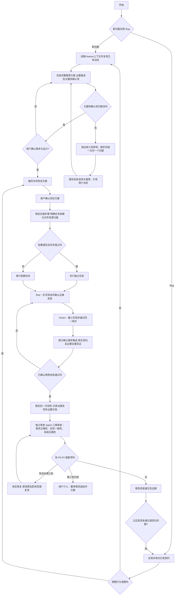

# LLM Gateway 项目协作约定

## 工作流

用户只在三类节点介入：**需求与设计确认**、**本项测试方案确认**、**第三轮代码审查后仍有阻断项**。其余规划、TDD、验证、文档同步和前两轮审查修复由执行者完成。已确认方案内的普通失败由执行者修复；若发现契约不清或需要改变需求，返回需求确认节点。验收结论依据已确认的测试方案、实际执行结果和独立审查；通过后直接报告，不再设置例行用户最终验收。之后发现验收未通过或回归问题，建立 Bug 记录并走 Bug 工作流。

每个Feature及独立优化在实现稳定后、独立审查前产出implementation-summary.md，使用[代码实现导读模板](docs/templates/代码实现导读模板.md)，覆盖行为变化、调用链、文件/类/函数阅读顺序、取舍、失败定位及实际证据/边界。审查修复代码时同步导读，纳入独审范围，不改写历史验收记录。

## 当前工作与阅读顺序

当前无进行中的 Feature；具体进度与下一步见 [docs/progress.md](docs/progress.md)。开始新任务前核对该文档与用户最新确认，不从历史验收记录推断当前任务。

本文件只保留协作规则及当前进行中任务的简要入口。Feature 完成后移除其临时进度说明；历史方案、测试数量、验收过程和后续路线分别维护在进度文档及对应 Feature 文档中，不追加到本文件。

先读 [README.md](README.md)、[进度](docs/progress.md)、[文档约定](docs/AGENTS.md)，再按任务读取 [架构](docs/architecture.md)、[接口契约](docs/contracts.md)、[跨功能测试原则](docs/test-plan.md) 和当前事项的设计、测试方案与实现导读。已确认的项目契约优先于课程示例，差异记录在对应事项文档。

## 两条工作路径

**新功能**：沿用 [进度文档](docs/progress.md) 中已确认的 Feature 内容和递增交付顺序，各 Feature 分别管理范围和验收，不另排一套替代路线。在 `docs/features/<编号>/` 中分别维护设计方案和测试方案。需求讨论使用 Superpowers 的 `brainstorming` 能力：先给完整推荐方案，存在实质取舍才给备选；用户选择后，仅对影响职责、接口或验收的歧义继续讨论。需求与设计确认后，单独提交覆盖正常、失败、边界、副作用及证据的测试方案供用户确认。两项确认后制定实施步骤，按依赖选择并行或串行，以 Red → Green → Refactor 实现并按顺序集成。实施中新需求先说明对当前范围、依赖和验收的影响，涉及契约改变时返回需求确认；普通实现细节自主处理。

已验收 Feature 的独立优化沿用新功能路径，在该 Feature 的 `optimizations/O<序号>/` 单独维护设计、测试与验收，不改写原验收记录；编号和归档规则见 [文档约定](docs/AGENTS.md)。

**Bug 修复**：在 `docs/bugs/` 建记录，先写现象、影响、稳定复现和已有契约；预期不清时返回需求讨论。明确回归测试与副作用检查并确认后，先运行失败复现，再只修根因，用相同场景复测和相关回归。修复后的验收与新功能共用本地验证、文档同步和独立审查；验收通过后报告结论。

两条路径都在本地验证通过并更新相关文档后，请独立审查 Agent **只审查、不修改**当前完整变更及证据。P0 为密钥泄漏、越权或严重数据破坏；P1 为主链或关键安全边界失效；P2 为约定场景不满足；P3 为不影响验收的轻微问题。P0–P2 阻断，P3 记录处理结论。每项工作最多三轮完整代码审查，修复后先原场景复测再提交下一轮；第三轮仍有阻断项时停止审查，交用户重审需求或技术方案。未完成独立审查时标记“待独立审查”，不得称验收通过；Claude Code 是可选工具，不是验收前提。更换工具不重置轮次。

### 独立审查 Agent：准备、三维核对与闭环

这是上图的独立代码审查节点，新功能与 Bug 修复共用，不增加用户确认节点。使用 [独立审查提示词模板](docs/templates/独立审查提示词模板.md)；选用 Claude Code 时可参考 [操作经验](docs/references/claude-code-review.md) 与 [可选模板](docs/templates/ClaudeCode审查提示词模板.md)。

1. **建立独立上下文与准备材料**：首轮使用全新审查 Agent，不继承实现对话（本环境用 `fork_turns="none"`）。不传入实现者私有推理或预设通过结论。冻结本轮源码、测试及安全配置快照，记录文件清单与哈希，审查后核对；排除凭据、`.env` 等敏感文件。提供用户原始需求/确认记录、当前设计与测试方案、实现导读、固定代码基线与真实差分、受影响调用链及原始执行回执。引用可获得的真实需求记录；缺失的原文或基线如实注明，不由实现者补造。无 Git 时使用已有快照/差分，不把文件清单冒充变更证明。将“用户约束”“已确认设计决定”“已有运行证据”分开，后两者仍须审查者核实，不预设实现正确。
2. **按三个维度审查**：

   | 维度 | 必查问题 |
   | --- | --- |
   | 需求正确性 | 是否满足用户实际需求；设计是否存在遗漏、误解或互相冲突，代码和测试是否共同实现了错误理解 |
   | 实现一致性 | 输入、输出、边界、错误、真实副作用和 Trace 是否符合契约；独立推导已有测试之外的反例，检查测试替身、断言和证据是否掩盖问题 |
   | 系统正确性 | 沿调用链检查老功能回归、并发共享状态、资源构造/释放、异常传播、部署假设及相关性能/资源上限；按本项实际影响审查 |

   当前单实例单 worker 仍须检查并发请求隔离。多实例/分布式按已确认范围审查：本项依赖的假设与能力声明必须准确，未来能力缺失不自动变成本项缺陷，也不能用未来归属掩盖当前范围内的故障。
3. **记录结论与验证来源**：报告逐维覆盖、具体依据、独立推导的反例/时序及其检查结果、未覆盖/未验证项。每个问题包含文件/行、触发条件、影响、违反的需求/契约、最小验证方法及修正建议；区分“已复现”“静态确定”“待验证风险”，标明运行证据由谁产生。严重等级按实际影响判断，不因测试已通过或细节未逐字写进设计而淡化实际故障，也不要求凑问题数量。
4. **核实并闭环**：审查者只读、不修改、不运行测试或付费调用；需要实验时，由执行者在已授权范围内运行最小复现并回传原始回执，审查者复核。记录实际工具能力与使用记录；通用 Agent 的“只读”是任务约束，除非实际工具配置强制限制，不宣称工具层只读。结论所依赖的关键证据缺失时不得判通过；普通未知项说明边界，不能把推测冒充已确认 Bug。P0–P2 和关键验收证据缺口消除、三维审查完成后才报告通过；完整审查最多三轮的规则保持不变。
5. **留存实际提示词**：每轮执行前在当前事项目录保存实际提交的 `review-prompt-r<轮次>.md`，逐字对应实际提交的审查输入，注明材料来源、基线、范围及必读文件；修订或下一轮使用新文件，不覆盖已执行版本。多个 Bug 共用目录时文件名前加 Bug 编号，避免覆盖其他事项。原始审查报告、复现回执、处置与最终结论按文档约定归档；不补造历史提示词。

### 需求不明确时的引导循环

1. 先读当前文档和已有决定，核实能够自行查明的事实；不重复询问已确认事项。
2. 基于该 Feature 先给完整推荐方案：目标和范围、实现与接口、状态/失败行为、前置依赖、验收要点，以及真正需要用户选择的关键取舍。事实、推荐、假设和待决定项分开写；不得只罗列问题等待用户设计。
3. 用户选择方案后，对仍影响职责、接口或验收的歧义**一次处理一个问题**，给出影响和可行选择；没有实质取舍时不凑备选。用户不理解时用简单例子解释，不把猜测当决定。
4. 整理完整方案供确认；已确认的决定直接复用，普通实现细节由执行者决定。不把每个字段或代码组织选择拆成独立确认，也不把单项选择当成整份设计确认。

这是“需求与设计确认”节点内部的讨论过程，不增加用户介入类别。测试方案若存在验收口径不明确，也在“测试方案确认”节点内按同样方式逐项澄清；涉及需求变化则返回需求节点。不得只列一份未决事项清单便要求用户整体批准，也不得把未决问题留给实现者自行猜测。

### 并行执行与评估结束条件

- 并行是执行方式，不增加第三条工作路径。只有设计与测试方案已确认、依赖接口稳定、修改文件与测试资源可隔离的任务才能并行；未确认的 Feature 不提前编码。进度文档中的已确认顺序约束集成和交付，准备及独立模块可并行。
- 实施步骤列明依赖、任务所有者及可修改文件。共同入口、公共契约和迁移由统一集成者处理；不同执行者不同时修改同一文件或创建相互冲突的迁移。发现共享依赖变化时暂停相关并行任务，重新明确影响后继续。
- 停启数据库、占用宿主端口等故障测试串行运行；不同时运行多套含此类故障的回归。真实 Provider 验证仍按已确认范围显式执行，不因并行额外付费调用。
- 方案做一次合理性自检；目标、职责、契约、依赖和验收依据明确后推进。只有新需求、新证据、测试失败或实质契约变化才重新评估相应部分，不重复启动多个同目的评估。
- 开发中执行目标测试及相关回归；稳定集成后进行必要全量验证和一次提交前自检。已通过的检查只在相关变更、失败或未解决问题出现时重跑；已确认的关键故障和副作用验证不能省略。
- 独立 Agent 三维审查和每项最多三轮完整审查规则保留，更换工具不重置轮次。首轮全新上下文，后续轮次由同一审查者复核，提供清晰基线、真实差分及必要调用链；未变部分可用已核实覆盖及哈希复用，重点复核新差分和影响链，并对最终完整行为负责。无阻断项和关键证据缺口即结束；纯文档索引/链接修正核对文档，不自动重开完整代码审查。
- 模板只在实际暴露通用缺口或过时要求时调整；不为每个 Feature 重复扩展。范围外未来风险记入对应后续项，不延长当前评估。

## 项目边界与证据

- 源码职责按 `api/`、`services/`、`providers/`、`middleware/`、`persistence/` 划分；应用入口为 `main:create_app --factory`。入口负责组件构建与接线，业务规则归对应组件；详细职责以 [架构](docs/architecture.md) 为准。
- ENV 与 Provider 独立；运行参数优先级为进程环境 > 项目根 `.env` > 默认值。模型接入和价格读取 `gateway.yaml`，真实 Key 和数据库密码使用独立本地文件，不提交版本管理。不加载 `.env.example` 或 `.env.test` 作为运行配置；测试使用自建配置和显式依赖，不读写维护者实际配置。
- Gateway 管单次模型调用；Agent/Harness 管任务、工具和业务决策。System 规则只来自受控 Prompt 模板，调用方不能自行提交 `system`；入口可确定的错误在调用 Provider 前拒绝。
- 只对可恢复故障有限重试；备用端点必须满足本次能力、预算和权限。流式内容提交后不静默换模型，取消接受后不再重试或 fallback。结构化结果须服务端校验；模型候选结果不授予业务动作权限。
- PostgreSQL 为持久化真相；执行快照、事件、Trace 和账务遵循 [接口契约](docs/contracts.md)。入口拒绝只保存已知元信息，Provider/数据库凭据及堆栈不落业务记录，未知 Usage 不记为零；普通回答不作为结果缓存。
- 当前运行范围为本机或隔离开发网络、单实例单 worker，多个内部 Agent 可并发调用。多实例与公网部署须另行设计；Chat Completions/Responses 仅为上游协议选择，不新增同名对外兼容接口。
- MockProvider、本地 FastAPI、适配器替身和真实 Provider 证据必须分开。真实调用显式启用，默认测试不访问外部服务或加载真实密钥；验收范围依 [跨功能测试原则](docs/test-plan.md) 和本项已确认测试方案执行。每次结论写明命令、结果、环境和未验证项。

## Don't

- 未经用户明确确认，不修改本文件。
- 不在需求或测试方案确认前写功能实现；不先写实现再补测试，也不把错误的 Red（导入错误、拼写错误）当作目标失败。
- 不在需求含糊时直接补成完整方案并要求一次性批准；先指出问题并引导澄清，不把用户对单项决定的认可视为整份设计已确认。
- 不凭 HTTP 状态码宣称零副作用；必须检查 Provider 调用次数、参数及相关 Trace。
- 不把文档设计、Mock 通过或静态审查写成真实 Provider 或生产验证；不把未运行的测试写成通过。
- 不因审查建议添加范围外能力；先核实其是否违反已确认契约。第三轮仍有阻断项时不发起第四轮。
- 不把设计文档、实现者说明、通过数量或已读文件数量当作正确性证明；不预先引导审查者认可实现，不以连续零阻断项证明审查充分。
- 不把后续 Feature 的占位配置、空接口或未来能力提前写进当前最小实现。
- 不以并行为由跳过设计/测试确认、抢改公共文件或并行运行共享宿主资源的故障测试；不机械重复评估、读取历史材料或重跑无关检查。

## 经验收获

- [Claude Code 独立审查：调用与取证](docs/references/claude-code-review.md)：选用 Claude Code 时的已验证调用方式、兼容参数、完成判定、失败排查与证据留存；历史验收记录保留原工具事实。

