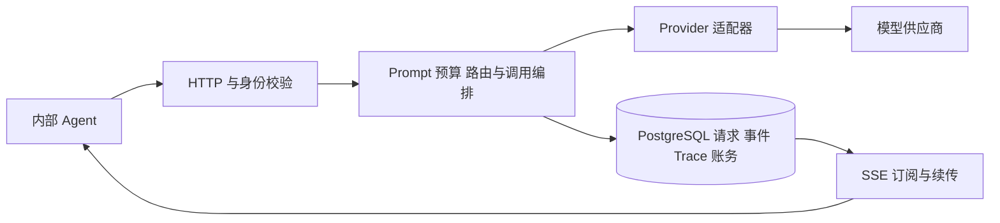

# LLM Gateway

面向内部 Agent 的统一模型调用服务，使用 FastAPI 和 PostgreSQL 构建。Agent 提交受控 Prompt、任务资料和模型组，Gateway 负责模型接入、预算检查、结构化验收、流式输出、调用恢复及用量计费。

Gateway 管理一次模型调用。任务规划、工具执行、订单修改和退款审批由 Agent 及业务系统负责。

## 能力与架构

- **统一接入**：支持 DeepSeek、OpenAI 兼容 Responses、阿里云百炼和脚本化 Mock；上游协议不暴露为调用方接口。
- **受控 Prompt**：固定 System、版本化模板、Few-shot、User 变量和渲染指纹。
- **预算与验收**：完整输入及输出预算检查；普通调用支持严格 JSON/Schema 验收和精确十进制处理。
- **可靠流式**：SSE 增量、空闲心跳、事件持久化、断点续传及主动取消。
- **有限恢复**：在总期限和尝试预算内重试、修复输出或切换合格备用端点；流式内容提交后不静默拼接模型。
- **诊断与账务**：按 request_id 查询尝试、路由、耗时与实际 Usage；持久化 Agent 凭据、余额、预留和结算。
- **并发与路由**：全局和单 Agent 请求上限；模型组能力筛选；自动入口先筛选再分类，失败时按既定规则降级。



普通文本、结构化输出共用 `POST /v1/llm`。流式先创建请求，再订阅事件；Chat Completions 和 Responses 是内部 Provider 配置，不是新增的对外接口。

## 运行条件

- Python 3.12、[uv](https://docs.astral.sh/uv/)。
- Docker 与 Docker Compose；Compose 只管理 PostgreSQL，应用在本机启动。
- 真实模型 API Key。完整示例包含百炼 Flash、Plus、Max 三个端点和自动路由，启动前须配置对应凭据。

当前部署范围是**本机或隔离开发网络、单实例、单 worker**，可同时处理多个内部 Agent 请求。

## 配置与启动

以下命令均在 `projects/llm-gateway` 目录执行。

### 1. 准备本地配置

首次运行复制示例；已有文件请先保留，不用示例覆盖本地配置：

```bash
cp -n config/gateway.example.yaml config/gateway.yaml
cp -n config/credentials.example.yaml config/credentials.yaml
cp -n config/postgres.password.example config/postgres.password
```

在本机编辑后两份文件：将 `credentials.bailian-main-key.api_key` 填为百炼真实 Key，将 `postgres.password` 内容替换成自选数据库密码。两个文件不提交版本管理。Gateway、迁移工具和数据库容器共用该密码文件；已有数据库卷须使用其原密码，修改文件不会自动修改数据库密码。

配置职责如下：

| 文件 / 分区 | 内容 |
| --- | --- |
| `config/gateway.yaml` | 数据库连接、Provider、端点、模型组、自动路由、恢复、并发及 `pricing` |
| `gateway.yaml` 的 `pricing` | 供应商绑定、价格版本、生效时间、缓存与输入分档价格 |
| `config/credentials.yaml` | Provider 的真实 API Key，由 `credential_ref` 引用 |
| `config/postgres.password` | 数据库密码 |
| 可选 `.env` | `ENV=development`、`test` 或 `production`，不存 Provider 或 Key |

默认示例中的 `light/general/analysis` 分别对应百炼 Flash/Plus/Max，`auto-general` 为自动选组入口。示例还保留 Mock 直接组用于本地流程验证；完整配置中的真实 Provider 仍要求凭据，选择 Mock 组不会跳过启动凭据检查。纯 Mock 开发须显式使用只包含 Mock 接入的配置；自动化测试自建隔离配置并注入脚本 Mock，不依赖个人绑定。

ENV 与 Provider 独立。ENV 来源优先级是进程环境、项目根 `.env`、默认值；需要时可从 [.env.example](.env.example) 复制 `.env`。`ENV=production` 不增加多实例或公网部署能力。配置修改后重启应用生效。

**旧价格配置迁移**：将原 `prices.yaml` 中的 `bindings` 和 `versions` 原样缩进至 `gateway.yaml` 顶层 `pricing` 下，保留字符串价格、版本、生效时间、分档及其他配置。迁移前备份原文件，核对后重启；应用不再读取或回退到独立 `prices.yaml`。已持久化的价格快照和历史账务保持不变。示例价格标注了核对时间，维护者应按实际供应商价格更新，项目计价不等同正式账单对账。

### 2. 安装、建库与启动

```bash
uv sync --python 3.12 --locked
docker compose up -d --wait
uv run alembic upgrade head
uv run uvicorn --app-dir src main:create_app --factory \
  --host 127.0.0.1 --port 8000 --workers 1 --timeout-graceful-shutdown 5
```

数据库默认地址 `127.0.0.1:15432`，库和用户名均为 `llm_gateway`。应用启动检查连接及迁移版本，不自动建表或迁移；数据库不可用时拒绝启动。`docker compose down` 保留数据卷。

服务启动后可访问 [Swagger UI](http://127.0.0.1:8000/docs)，存活检查：

```bash
curl -sS http://127.0.0.1:8000/healthz
```

### 3. 创建 Agent 凭据与拨款

在另一个终端进入项目目录。首次创建身份、签发凭据，将凭据保存在当前 shell 变量中：

```bash
export PYTHONPATH=src
uv run python -m admin create-agent orders 售后客服
GATEWAY_AGENT_TOKEN=$(uv run python -m admin issue orders)
uv run python -m admin deposit orders 10.00 --operation-id orders-initial-001
```

所有 `/v1/` 接口都需要该 Bearer 凭据。拨款按总余额管理，不按天重置；相同操作编号及内容不会重复入账，新拨款须使用新编号。真实调用每次尝试先预留，再按实报 Usage 结算；证据缺失保留待核实，不用本地估算冒充实测用量。

## 调用示例

### 普通调用与自动选组

`model` 选择已配置模型组或自动入口，不填写具体供应商型号。以下请求使用 `general` 组；改为 `auto-general` 即在硬条件筛选后进行任务分类。

```bash
curl -sS -i http://127.0.0.1:8000/v1/llm \
  -H "Authorization: Bearer ${GATEWAY_AGENT_TOKEN}" \
  -H 'Content-Type: application/json' \
  -d '{"model":"general","prompt":{"name":"basic_text","version":"1.0.0"},"messages":[{"role":"user","content":"用两句话解释 Streaming 和 TTFT。"}],"max_output_tokens":256,"timeout_seconds":30}'
```

普通响应顶层为 `success/code/data/message`，成功的 `data` 包含 `text` 和 `usage`。请求 ID 位于 `X-Request-ID` 响应头，实际端点和尝试细节通过 Trace 查询。调用方只能提交一条 `user` 消息，不能自行提交 System；User 内容不能改变受控模板职责。

### 结构化输出

使用支持结构化输出的模板并提供对象根 Schema。成功时 `data.parsed` 是服务端已校验结果；格式合格不代表业务事实或执行权限已核实。

```bash
curl -sS -i http://127.0.0.1:8000/v1/llm \
  -H "Authorization: Bearer ${GATEWAY_AGENT_TOKEN}" \
  -H 'Content-Type: application/json' \
  -d '{"model":"light","prompt":{"name":"context_answer","version":"1.2.0","variables":{"context":"订单A123的商品是充电器。"}},"messages":[{"role":"user","content":"提取订单号和商品名称。"}],"response_schema":{"type":"object","properties":{"order_id":{"type":"string"},"product":{"type":"string"}},"required":["order_id","product"],"additionalProperties":false},"max_output_tokens":256,"timeout_seconds":30}'
```

完整子集与限制见 [Schema 规则](docs/response-schema.md)。Gateway 保留十进制精度；上游舍入导致不符合原 Schema 时明确失败，需要逐位保证的字段可由调用方声明为字符串。

### 流式创建、订阅、续传与取消

```bash
curl -sS -X POST http://127.0.0.1:8000/v1/llm/stream \
  -H "Authorization: Bearer ${GATEWAY_AGENT_TOKEN}" \
  -H 'Content-Type: application/json' \
  -d '{"model":"general","prompt":{"name":"basic_text","version":"1.0.0"},"messages":[{"role":"user","content":"分五点解释流式输出如何改善等待体验。"}],"max_output_tokens":512,"timeout_seconds":30}'
```

创建返回 HTTP 202 和 `data.request_id`，状态为 `pending`，此时不调用模型。将 ID 填入下面变量，首次有效订阅才启动生成：

```bash
REQUEST_ID='<创建接口返回的 request_id>'
curl -sS -N -H "Authorization: Bearer ${GATEWAY_AGENT_TOKEN}" \
  "http://127.0.0.1:8000/v1/llm/stream/${REQUEST_ID}/events"
```

事件采用 `response.*`。业务事件有连续 SSE `id`，心跳不推进游标。订阅断开不取消后台生成；重连携带**最后成功处理**的序号，只读取其后的事件：

```bash
LAST_SEQ=12  # 示例：请替换为本次最后成功处理的 SSE id
curl -sS -N -H "Authorization: Bearer ${GATEWAY_AGENT_TOKEN}" \
  "http://127.0.0.1:8000/v1/llm/stream/${REQUEST_ID}/events?after_seq=${LAST_SEQ}"
```

主动取消可在另一个终端调用（需设置相同凭据及请求 ID）：

```bash
curl -sS -i -X POST -H "Authorization: Bearer ${GATEWAY_AGENT_TOKEN}" \
  "http://127.0.0.1:8000/v1/llm/stream/${REQUEST_ID}/cancel"
```

HTTP 202/`canceling` 表示仍在清理，可间隔 500ms 重复同一 POST；HTTP 200 返回 `canceled/failed/completed` 中的最终状态后停止轮询。HTTP 错误不当作生成终态。流式请求不接受 `response_schema`。

### Trace、账单与模型探测

`REQUEST_ID` 可取普通响应头或流式创建结果。查询只返回当前 Agent 有权查看的数据：

```bash
curl -sS -H "Authorization: Bearer ${GATEWAY_AGENT_TOKEN}" \
  "http://127.0.0.1:8000/v1/traces/${REQUEST_ID}"
curl -sS -H "Authorization: Bearer ${GATEWAY_AGENT_TOKEN}" \
  http://127.0.0.1:8000/v1/billing/summary
curl -sS -H "Authorization: Bearer ${GATEWAY_AGENT_TOKEN}" \
  'http://127.0.0.1:8000/v1/billing/requests?limit=20'
curl -sS -H "Authorization: Bearer ${GATEWAY_AGENT_TOKEN}" \
  "http://127.0.0.1:8000/v1/billing/requests/${REQUEST_ID}"
curl -sS -X POST -H "Authorization: Bearer ${GATEWAY_AGENT_TOKEN}" \
  http://127.0.0.1:8000/v1/models/general/health
```

`GET /healthz` 不调用上游；模型探测会实际发送测试文本并计费。Trace 可查看选组、实际尝试、错误阶段和用量；自动入口的用量与费用包含分类及生成尝试。详细字段见 [接口契约](docs/contracts.md)。

## 测试

```bash
# 默认测试：纯逻辑、脚本 Mock、受控上游协议、真实 PostgreSQL 和进程测试
uv run --python 3.12 python -W error -m pytest -q

# 显式执行包含真实 Provider 的完整回归；需要本机凭据并产生实际费用
uv run --python 3.12 python -W error -m pytest --run-live -q
```

测试侧自动创建独立 PostgreSQL 容器、配置、数据库和回环端口，不读取或清空开发数据库。默认阻止外部连接及实际凭据读取，live 用例仅显式开启；真实验证所需接入与凭据准备见各项[测试记录](docs/progress.md)。Mock 验证流程与可控故障，真实模型验证实际协议、输出、Usage 和延迟；两类证据分别报告。

## 代码结构

```text
config/                 # 统一 Gateway 示例与本地凭据/密码配置
src/
├── main.py             # FastAPI 工厂、组件构建与接线
├── lifecycle.py        # 启动、恢复任务与关闭编排
├── api/                # HTTP/SSE、身份校验与统一错误出口
├── middleware/         # 请求 ID、请求记录与异常收口
├── contracts.py        # 统一请求、响应和 Usage
├── trace_contracts.py  # Trace 查询输出
├── services/           # Prompt、预算、路由、恢复、调用和计价组件
├── providers/          # 统一 Provider 调用/事件协议与各上游适配器
├── persistence/        # PostgreSQL 事务、事件、账务及持久化补偿
│   └── reconciliation.py
├── utils/              # 精确 JSON 与诊断值工具
└── admin.py            # 本地 Agent 凭据、拨款及账务处置命令
migrations/             # Alembic 迁移
tests/                  # 单元、协议、集成、进程及真实接入测试
docs/                   # 架构、契约、设计与验收证据
compose.yaml            # 本地 PostgreSQL
```

## 边界与进一步阅读

- 单实例单 worker 是明确运行前提；PostgreSQL 持久化不代表已经实现跨实例取消或共享并发治理。
- 总超时覆盖整次执行，心跳和内部重试不重置期限。余额、预算、能力或权限不足不能靠换模型绕过。
- 三个百炼模型共用同一供应商连接，不代表三家供应商容灾。已有真实测试不能作为任何并发档位 100% 稳定或生产 SLA 的承诺。
- 模型输出是候选内容；不执行退款、工单等业务动作。取消不能保证远端停止计费，未知用量保持未知。
- 有效执行快照和流式事件保存在数据库，当前不自动清理；Provider Key 与数据库密码不进入这些业务记录。

[架构与组件职责](docs/architecture.md) · [接口契约](docs/contracts.md) · [Schema 规则](docs/response-schema.md) · [测试原则](docs/test-plan.md) · [功能进度与验收证据](docs/progress.md) · [协作工作流](AGENTS.md)
