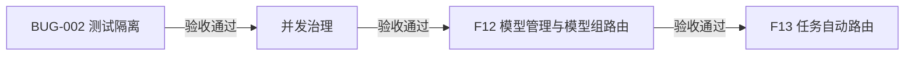

# 1.7 递增交付计划

日期：2026-11-03；收尾更新：2026-11-04。**BUG-002与F11已验收。用户现已确认模型组路由和任务自动路由都要做、依次交付：F12模型管理与模型组路由 → F13任务自动路由。F12完整设计与28组测试方案已分别确认，实现及最终完整回归已完成、验收通过；F13已按用户确认的分层标准完成功能验收，原严格容量失败及限制保留。** 1.6保持已收尾，历史基线见[收尾记录](1.6-closeout.md)。

## 1. 已确认的顺序

| 顺序 | 独立事项 | 当前状态 | 交付给下一项的基础 |
| --- | --- | --- | --- |
| 1 | [BUG-002测试隔离](bugs/BUG-002-offline-config-isolation.md#2026-11-03当前修复方案与测试方案已确认) | 验收通过：全量2086通过（含28个真实节点，零跳过），首轮独审APPROVED。[验收记录](bugs/BUG-002-acceptance-report.md)。 | Mock/协议替身测试显式管理模型配置，独立于维护者本地Provider绑定；真实测试继续显式启用。 |
| 2 | [F11并发治理](features/F11/design.md) | 两层调整及[测试方案](features/F11/test-plan.md)均已确认，已接入，已按分层标准验收通过（第2轮独立复核APPROVED）。 | 调用名额的准入、持有、释放与超额结果形成可验收契约，后续路由复用同一治理组件。 |
| 3 | [F12模型管理与模型组路由](features/F12/design.md) | 完整设计与[28组测试方案](features/F12/test-plan.md)已分别确认，最终2508项完整回归通过，验收通过。 | 三层配置、按请求过滤端点、有序选择及与恢复/并发/计费/Trace整合。 |
| 4 | [F13百炼三模型接入与任务自动路由](features/F13/design.md) | [32组测试与实际结果](features/F13/test-plan.md)已闭环；按分层标准验收，第1轮补充独审APPROVED。 | 先三模型接入与计量，再分类选组并复用F12选择端点。 |

按上述顺序分别完成设计/测试确认、TDD、回归、证据及独立审查，通过一项再进入下一项。各项按序设计、确认及验收，不把顺序或单项选择当作完整设计/测试确认；F12已验收；F13已根据实际证据和补充独审完成功能验收。

## 2. BUG-002：首先完成测试隔离

目标：本地开发配置切换Mock或真实Provider，不改变Mock/受控协议测试的预定输入、行为和结果；离线测试不读取真实凭据或连接外部Provider。用户另已确认公共功能共用用例、分别在Mock和真实Provider下执行，特殊故障用受控上游制造；详见[共用验收原则](test-plan.md#已确认的共用验收原则2026-11-03)。

以当前代码定位剩余直接读取维护者模型配置的路径，优先使用测试自建注册表、临时YAML及已存在的隔离数据库/进程夹具。配置解析仍执行真正的load_registry，默认加载路径由隔离副本验证，不以全局恒定成功替身跳过生产解析。

本项已确认同时补一个最小公共API验收层：普通、结构化、流式、续传、取消共用步骤和行为断言，由Mock和真实夹具分别提供结果与专属留证。复用既有真实场景、不新增业务能力或整体重写历史测试；该具体改造范围连同Bug测试方案已由用户整体确认。

本项不改变生产配置加载、Provider协议、预算、HTTP/SSE契约、ENV行为和真实测试的显式启用方式，也不借此实现并发限制或Router。当前方案、逐项用例、回归与验收条件集中在[原Bug记录](bugs/BUG-002-offline-config-isolation.md)，保留旧定位和历史结果。

## 3. 并发治理：控制现在能否开始执行

已确认的核心概念：本项计数单位是已准入且本地执行/清理尚未结束的生成请求，包含内部重试和退避，不等于瞬时Provider调用数。首次执行前取得全局与Agent名额，执行及清理结束后可靠释放；与每秒请求数、账户余额分别管理。

- SSE订阅断开但后台仍在生成，生成名额继续占用；订阅连接数不直接等于生成并发数。
- 接受取消进入canceling不等于已经清理完成，不能据此提前归还生成名额。
- 正常完成、失败、超时和取消路径均需有资源释放及不泄漏名额的验证。
- 重试/退避/修复/输出增额/fallback全程持有原请求名额，不重新申请；总期限不重置。

**F11最新两层设计已确认（2026-11-03）：**仅全局/单Agent请求名额，初始20/5，可按YAML调整并重启。首次两层原子准入，满额立即拒绝，不排队；首次GET拒绝保持pending，重连/补读不重复占位；内部恢复沿用原名额，不会因为再次申请本地名额而失败。删除上游组配置/名额与内部等位，供应商自行控制其容量，Gateway继续按F7处理供应商限流和有限恢复。

接口、期限、取消/清理所有权、错误/账务/日志及最小组件统一见[完整设计](features/F11/design.md)，不在计划中重复维护；[23组测试方案](features/F11/test-plan.md)已单独确认；依[实施步骤](features/F11/implementation-plan.md)推进，具体结果在本项测试方案记录。

## 4. F12模型管理与模型组路由：在受控候选中选择端点

用户已确认：`model`继续必填并表示模型组；YAML维护、修改后重启；Provider/端点/模型组三层配置，候选列表就是选择顺序，不嵌套模型组；逐端点检查启停、能力、专属Prompt和Token预算；失败恢复沿用F7，整次请求沿用F11同一名额，每次实际尝试沿用F9按实际端点取价结算，F8补充路由解释。

[完整目标设计](features/F12/design.md)已获用户确认，包括错误分类、迁移、流式快照和Trace结构。[28组测试方案](features/F12/test-plan.md)随后已获单独确认，已完成实现与最终2508项完整回归，验收通过。F12不阅读用户原文进行任务分类，不新增模型列表/动态管理接口或自动熔断。

普通/流式统一入口保持不变；流式POST冻结计划、首次GET启动，重连不重新路由。既有真实两条协议仍共用DeepSeek，不把它们当作独立供应商容灾。本文不重复维护配置/错误表，以F12设计为准。

## 5. F13任务自动路由：先选择模型组，再选择端点

用户要求两者逐项交付，F12已验收，现已确认[F13整体设计](features/F13/design.md)并授权先落地文档。[测试方案](features/F13/test-plan.md)已单独确认；阶段A已真实验证，阶段B已接线并执行旧版完整回归及首次封存评估；Trace修复版2813项非live及17项真实复验通过，首轮独审代码无遗留问题；用户已确认分层边界，补充独审APPROVED，整项功能验收通过，原容量失败保留。

本项按两个递增阶段闭环：A先接入百炼普通按量API的qwen3.8-flash、qwen3.7-plus、qwen3.8-max，处理协议、估算、分档价格及实际Usage结算；B使用Flash分类，Plus作为默认降级，三档分别覆盖轻量、通用、复杂分析。原DeepSeek接入保留，不自动成为新组备用。

先由程序筛硬条件：零组拒绝、一组直用、多组才分类；分类只返回白名单普通组。分类与生成共用请求ID、期限、名额、取消及账务链。估算明确标记，实际补差不足如实形成欠额，禁止后续付费尝试。流式POST零上游，首次GET执行，续传不重新分类。细节与错误/验收集中在F13文档，不在计划重复维护。

## 6. 共同约束与后续讨论

- 沿用当前内部Agent、本机或隔离网络、单实例单worker基础；改变部署范围时另行设计。Provider密钥和开发配置不因测试被覆盖。
- 对外继续使用既有统一入口。课程中的OpenAI兼容对外接口、SQLite等方案不能直接覆盖本项目已确认契约和PostgreSQL。
- 公共功能共用场景、分别在Mock和真实Provider下执行；故障注入由受控上游承担，纯逻辑不重复远端调用，真实表现用真实数据验证。ENV、Provider与测试范围独立；具体执行方式见[测试原则](test-plan.md)。真实两条协议目前同属DeepSeek。
- 当前不为多实例、分布式限流、复杂加权、Prompt灰度或管理后台预建接口；F13已排在F12之后且当前设计已确认，测试方案已单独确认，验收仍以完整实际证据为准。
- 每项依现有[工作流](../AGENTS.md)完成确认、实现、回归和最多三轮完整独审。顺序确认不替代测试方案确认，文档存在不代表能力已实现。

BUG-002已验收通过，用户随后确认F11两层调整。用户已单独确认更新后的F11测试方案；现已完成TDD、全量实际执行、四档/600秒及有界真实补验；用户确认分层标准后第2轮独立复核APPROVED，F11验收通过。原始23个真实失败及600秒24%成功率保留，F12设计/测试方案已分别确认，完整回归已通过、验收通过；F13已按用户确认的分层标准验收通过，原始容量失败和可用性边界保留。
