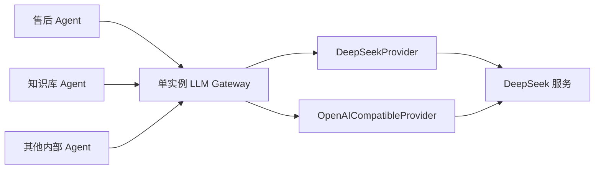
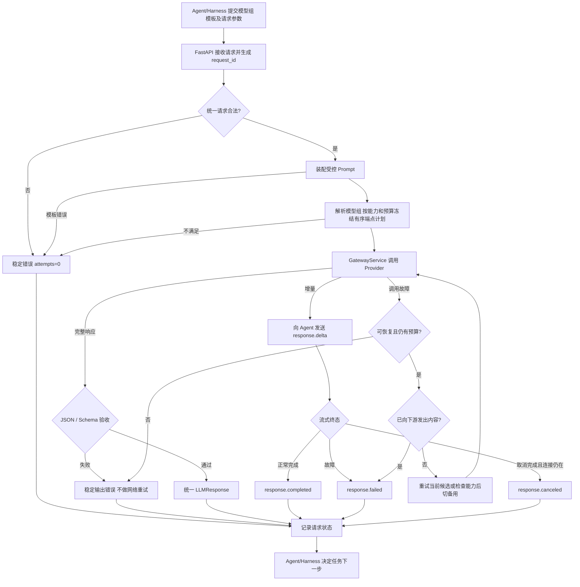

# 架构与执行边界

F11两层并发已按用户确认的分层标准验收通过（第2轮独立复核APPROVED），原始供应商失败及成功率保留，见[设计](features/F11/design.md)、[代码导读](features/F11/implementation-summary.md)及[测试方案](features/F11/test-plan.md)。应用生命周期建立唯一ConcurrencyLimiter，普通/探测与StreamingManager共用；首次执行取得全局/可信Agent请求凭证，全部内部恢复持有原凭证，本地执行及清理完成后释放。Limiter不管理Provider组、协议、预算或账本；满额立即拒绝，无队列。流式名额由后台任务持有，不随订阅断开归还，迟到清理由Task完成回调交接。本项不重写Provider或原流式执行器。

> 状态：F1/F1-O1/F2/F3均已验收。当前具备受控Prompt、YAML模型配置、统一Provider、完整消息Token预算、超时与探测；F4已验收。F5 完整设计与测试方案已分别确认，已验收通过；F6已验收；F7已验收，F8 的实现与验证进度见[测试方案](features/F8/test-plan.md)。

2026-11-02 后续顺序调整：先 [F5-O1 PostgreSQL 统一持久化设计](features/F5/optimizations/O1/design.md)，再 F5-O2 两阶段流式调用/续传，之后 F6 主动取消。O1 设计和[测试方案](features/F5/optimizations/O1/test-plan.md)已分别确认，持久化已实现并验收，最终串行全量1228/关键312及原生Claude Code第2轮APPROVED；O2[设计](features/F5/optimizations/O2/design.md)及[测试方案](features/F5/optimizations/O2/test-plan.md)均确认，新接口已实现并验收；F8 改为补齐 Trace 覆盖与查询，计费与总验收分别为 F9/F10。当前 F5 行为与后续目标分节说明。

F3 基线实现与验收见 [设计](features/F3/design.md)与[测试方案](features/F3/test-plan.md)，2026-11-01离线570、真实四例与Claude Code第2轮审查均通过；下文整体流程含 F4–F8 递增目标，F4当前实现以本项文档为准，F3阶段具体流程以其设计为准。
F2 的 [受控 Prompt 设计](features/F2/design.md)已实现、[本地测试与独立审查](features/F2/test-plan.md)通过，F2 已验收。装配/变量/指纹为当前能力；模型能力与后续流程仍按 Feature 递增。

## F12模型组路由（验收通过）

[设计](features/F12/design.md)和[28组测试方案](features/F12/test-plan.md)已分别确认。Registry把Provider连接、具体Endpoint能力/限制和ModelGroup调用策略分开；必填model只选择组，Router按实际请求能力、专属Prompt/Token预算筛选候选，列表顺序决定初选及备用。Router只做本地计算，F7消费冻结计划执行恢复，F11覆盖整次请求，F9按每次实际端点计费。任务原文的语义分类留F13，不在这里猜Agent需要哪种模型。

流式POST保存版本化计划及相关配置摘要，首次GET才生成；重新订阅不重新选型，关联配置变化或旧pending不能证明等价时明确failed，历史事件可读。Trace.routing解释初选和排除原因，实际切换查看Attempt；成功响应不暴露内部端点。完整调用图、迁移与错误表以F12设计为准，实际批次见测试方案，最终2508项完整回归已通过、第2轮独立复核APPROVED。

## F13百炼与任务自动路由（已验收）

[代码导读](features/F13/implementation-summary.md)按Registry→Router/AutoRoutePlan→分类Prompt→原尝试执行→存储计费组织。auto入口先按本次真实请求筛选组：零组拒绝、唯一组直接用、多个组才远程分类。分类器自己的固定System独立于任务资料中的原System；动态Schema和程序白名单共同限制选组。

普通和流式复用同一请求ID、总期限、Agent名额及逐Attempt账本。分类一次，生成保留F7预算；流式POST冻结相关配置与模板，首次GET执行，续传不重做。取消对分类/生成均有效，强杀进程恢复不重新分类。Qwen使用版本化estimated计数和安全窗口，百炼Schema/queued协议由适配器归一，实际Usage按固定或输入分档价结算。用途和路由诊断复用现有元信息存储，无新增表/DDL。

原DeepSeek和Mock路径继续存在；新增BailianProvider连接百炼，Flash/Plus/Max共用同一供应商连接。按用户确认的分层标准验收，实际批次、严格容量失败与独审结论以[F13测试方案](features/F13/test-plan.md)为准，不改写F12验收。

## 职责

F4 的 [已确认设计](features/F4/design.md)和[实际测试记录](features/F4/test-plan.md)对应已验收实现：新增 services/validation.py 与用户确认十进制补充后的共享 json_codec.py，扩展既有模板、配置、计数、Provider 和编排/Trace。结构化请求先验 Schema，再检查模板和模型，装配完整约束后计数；上游完成后通过 JSON/Schema 才成功。OpenAICompatibleProvider 已切到 Responses。完整十进制保真已实现并通过最终功能回归，Claude Code第1轮独审已通过；具体调用链和完整 Prompt 以 F4 设计为准，不把下文跨功能目标图当作当前实现证据。

[F4-O1](features/F4/optimizations/O1/design.md)已整理平台限制至 `src/constants.py`，HTTP 状态引用 `starlette.status`，共享 JSON 编解码原样迁至 `src/utils/json_codec.py`。常量/工具不反向依赖业务服务，Prompt 正文、Schema 规则集合、Tokenizer 专属资源与模型 YAML 保留原职责；行为和精度保持不变。验证与独审状态见本项测试方案。

多个内部 Agent 可同时向一个 Gateway 实例发起独立模型请求。Agent/Harness 决定为什么调用、需要哪些上下文、何时查工具以及如何处理模型结果。Gateway 管一次调用的协议、Prompt、能力、Provider、校验、恢复和 Trace；Provider 只处理供应商协议。模型返回候选内容，业务程序负责权限与实际动作。

两种 Provider 适配的是同一家真实供应商。其通信实现应独立到足以检验接口可替换，但不把“两个适配器”描述为“两家供应商”。

递增顺序采用最小纵向切片：F1 先以**一个固定模板、一个逻辑模型白名单项和 MockProvider**跑通普通调用，维持 Prompt 必选和入口校验；F2 扩展模板版本/变量，F3 扩展模型能力与两种真实适配器。F1 的静态配置不是 F2/F3 已完成的证据。

## 组件关系

| 组件 | 输入与输出 | 依赖边界 | 缺失后的问题 |
| --- | --- | --- | --- |
| `main.py:create_app` | 显式配置/Provider 或默认配置 → 应用 | 构建与连接组件、注册路由和 Middleware；不在导入时创建应用 | 配置加载过早，测试与启动相互污染 |
| `lifecycle.py` | Database/Store/ProviderClients/StreamingManager → lifespan | 编排启动恢复、周期核对、流任务关闭、Provider 关闭和有界最终补偿；不实现事务或计价 | 入口堆积资源时序，异常退出漏清理 |
| `persistence/reconciliation.py` | 应用独立的待补偿项与活跃集合 → 持久化核对 | 不收口活跃或取消清理中的请求；保留不确定创建及更新登记的归属 | 数据库恢复后遗留状态，旧补偿误伤活跃生成 |
| `services/classification.py` | 分类模板、候选组与任务资料 → 分类消息/选组结果 | 同组件负责启动时分类 Prompt 协议校验；不授予业务执行权限 | 分类协议错误进入运行期，配置规则散落入口 |
| `services/prices.py` | gateway.yaml.pricing 与用量 → 版本化报价/费用 | PriceBook 独立校验及计价，价格快照支持历史结算；不读取独立 prices.yaml | 预留和实耗无统一依据，历史金额随新配置漂移 |
| `settings.py` | 进程环境/.env/默认值 → Settings | ENV 与 Provider 独立；配置非法在启动时拒绝 | 来源优先级不清，错误配置静默生效 |
| `providers/factory.py` | ModelRegistry/注入集合/凭据引用 → ProviderClients | 校验、准备凭据、生命周期构造/释放；不读取ENV、不调用模型 | 注入与连接所有权散落入口 |
| `middleware/request_context.py` | ASGI scope/响应 → 请求 ID 与请求记录 | 未预期异常兜底；仅完整响应后收口 | 中断可能误记成功，请求无法关联 |
| `api/routes.py` | HTTP/SSE ↔ 统一契约 | 调用 GatewayService，不解析供应商对象 | 各路由各写一套调用流程 |
| `api/dependencies.py` | 配置 → 服务实例 | 注入 Provider；测试可替换 MockProvider | 测试依赖全局变量，难隔离 |
| `contracts.py` | 统一请求、响应、错误、内部事件 | 不采用供应商 SDK 对象作平台契约 | 换供应商影响所有 Agent |
| `services/prompts.py` | 名称/版本、问题与变量 → 受控消息及指纹（F2） | 固定 System、静态示例与 User 数据分离；应用初始化校验后只读 | 规则漂移、版本和实际内容无法区分 |
| `services/models.py` | YAML → Provider/Endpoint/ModelGroup只读注册表 | 连接、端点能力及组策略分层；引用/预算启动校验，密钥由credentials.py解析 | 组名与实际接入耦合，停用/替换会影响调用规则 |
| `services/routing.py`（F12） | 请求及注册表 → 有序候选、逐端点消息/计数和解释 | 只做本地筛选，不调用Provider、不管账务/恢复/准入；普通与流式共用 | 两种入口候选不一致，错用首选预算或无法解释切换 |
| `services/token_budget.py` | 完整消息+输出预算 → 输入计数/窗口验收 | 固定模型资源与编码，不裁剪、不以本地数冒充实际Usage | 上下文溢出、输出空间不足 |
| `providers/` | 统一调用 ↔ 供应商调用/事件 | 原始响应止于此层 | SDK 差异泄漏到核心主链 |
| `services/validation.py` | 文本 + Schema → 合法结构或错误 | 不代替 Agent 的业务校验 | 格式错误变成成功结果 |
| `services/recovery.py` | 错误 + 预算 + 已输出状态 → 决定 | 仅恢复同一调用，不重新规划任务 | 错误重试、成本失控、流式拼接 |
| `services/trace.py` | 请求/尝试/终态 → 可查询记录 | 不默认保存敏感正文 | 失败原因与实际成本不可定位 |
| `services/gateway.py` | 统一请求 → 统一响应/事件/错误 | 编排上述组件 | 边界和执行顺序无统一入口 |
| `services/streaming.py` | 已冻结输入/Provider统一事件 → 持久业务事件/生成终态 | O2后台消费Provider，生成总期限及有界清理；不等待订阅者 | 慢消费者阻塞生成，生成与交付混淆 |
| `services/streaming_manager.py` | 首次有效GET → 唯一后台任务 | 条件认领、任务归属、冻结资源核对及停机/孤儿收口 | 重复调用或永久running |
| `services/subscriptions.py` | PG分页事件 → 单订阅发送 | 独立游标、心跳及单次发送期限，断开只停止读取 | 订阅失败覆盖模型结果或无界缓存 |
| `persistence/database.py`（O1） | 显式数据库配置 → 异步引擎/Session 工厂 | 一套连接池、并发 Session 隔离和生命周期释放 | 事务交叉、连接泄漏 |
| `persistence/tables.py` / `store.py`（O1） | 记录和操作 → 已提交请求/Attempt/事件 | tb_ 单数三表、内部 BIGINT/外部 UUID、短事务、先存后发和恢复 | 请求状态与事件不一致、无法可靠补读 |

## 应用组装与生命周期

`main.py` 保留工厂签名、显式注入、组件构建、app.state 接线、路由和 Middleware。分类 Prompt 兼容检查归分类组件；`lifecycle.py` 调度现有资源，`persistence/reconciliation.py` 维护每个应用独立的延迟持久化队列。

正常启动依次执行 Database.start、Store.recover、建立周期恢复任务、打开 ProviderClients，然后对外服务。正常退出先关闭 StreamingManager，再退出 ProviderClients 上下文，停止周期任务，在原宽限时间内最终核对并补偿，最后关闭 Database。异常沿相应 finally 路径释放已建立资源；退出本身不证明业务成功。

补偿跳过仍活跃、仍生成或取消清理未完成的请求。不确定的流创建提交先查询数据库，不能把首次 GET 已启动的生成误判为停止；刷新期间出现新登记时，旧刷新不能删除新项。Store 继续拥有事务与终态写入，补偿不重发模型调用。

所有非敏感配置统一位于 `config/gateway.yaml`。价格放入顶层 `pricing`，保留原 bindings/versions 结构及字符串精度，由 PriceBook 校验；ModelRegistry 识别分区但不承担计价。独立 prices.yaml 不再读取或回退，缺少价格仍按 price_unavailable 拒绝报价，不能当作免费。Key 和数据库密码保留各自本地文件；既有请求价格快照不因文件合并改变。

## 正常、失败与恢复主链

图表示职责和成功/失败出口，不把 Trace 记录写成客户端收到结果的网络保证。调用前可确定的错误不进入 Provider；模型已返回但 JSON/Schema 不合格，不纳入网络重试。流式只有明确终态才能认定成功；连接关闭本身不是完成证据。

非流式 API 的成功与失败在 FastAPI 边界统一包装为 `success/code/data/message` 四字段 JSON，普通调用`request_id`只通过响应头关联Trace，O2创建另在data返回ID。集中错误处理负责请求校验和分类异常；Gateway 不把异常正文或堆栈交给调用方。SSE 启动后保持事件协议，不能改用 JSON 错误体。F1 的 HTTP 契约见 [F1 设计方案](features/F1/design.md)，当前目录与应用组装变更见 [F1-O1 设计](features/F1/optimizations/O1/design.md)。导入不创建应用；工厂创建时加载配置一次，显式 Settings 跳过外部加载，显式 Provider 实例优先于工厂构造。该优化不改变模型调用主链或 HTTP 信封。

## 流式与取消

对外 SSE 事件统一采用 `response.*`。F5 的[已确认目标设计](features/F5/design.md)包含 delta、heartbeat、completed、failed；F6 再增加 canceling/canceled。一次运行只允许一个终态。F5 Provider 内部统一为 ProviderStreamEvent（delta/status/usage/error_code），Gateway 不根据 Chat finish_reason 或 Responses 原始事件名决策。

原 F5 基线在本地预检后、建立 SSE 前设置 B 起点总期限，覆盖实际下游发送等待；心跳不延长期限。先建立 SSE 再连接上游，15秒空闲时可发送 heartbeat。该基线中增量发送完成再读取下一条，不缓存完整回答。断连/超时立即停止生成转发并有界清理本次流，不能关闭共享客户端；上游completed不等于下游已经完成，终态由执行层记录。具体流程、指标观察点和[实际测试](features/F5/test-plan.md)以F5文档为准，当前已通过功能验证及原生Claude Code第2轮独审。

F6 的[完整设计](features/F6/design.md)已确认、[测试方案](features/F6/test-plan.md)已确认，已验收通过。pending/running 均先进入 canceling；调用方使用 POST /v1/llm/stream/{request_id}/cancel 发起及轮询，处理中202/canceling，终态200返回canceled/failed/completed，不依赖SSE确认结果。Gateway持有取消所有者，独立停止、清理并原子保存终态及事件；重复POST不重复清理。完成与取消按数据库先成功提交的状态变更决定；取消接受后不再提交新delta、转completed、重试或fallback，之前已提交事件保留供发送/续传。清理失败为failed/cancel_cleanup_failed，存储不可用或结果未知不虚报取消完成。不取消Agent整体任务、不回滚业务动作，也不保证上游停止计费。

浏览器不是本 Gateway 的直接调用方：`浏览器 → Agent/Harness → LLM Gateway → Provider`。原 F5 关闭流会清理本次生成；当前 O2 关闭订阅不停止生成，需要停止生成的主动取消接口留 F6。

### O1 持久化基础与当前 O2 续传实现

历史O1保留POST直接SSE，并先提交业务事件再发送；完成状态、Attempt 和完成事件同事务提交，之后传输失败不能覆盖 completed。普通与流式统一 Request/Attempt，入口拒绝保存元信息、零 Attempt；主动探测暂不落库。完整有效执行输入和流式事件保存正文，Provider 凭据不落库，暂不清理。

O2 使用 POST /v1/llm/stream 返回 202 与 request_id；首次有效 GET /v1/llm/stream/{request_id}/events 原子触发 pending → running，此后的 GET 只订阅。同请求可多订阅，各自携带可选 after_seq（默认 0），从 PostgreSQL 按 seq 读取历史及后续事件；心跳不保存、不推进游标。断连继续生成；生成期限从首次触发开始并包含持久化，重连不重置；订阅无整体总超时，15 秒空闲心跳、单次发送最多 30 秒。当前细节见[O2设计](features/F5/optimizations/O2/design.md)及[代码导读](features/F5/optimizations/O2/implementation-summary.md)，不改写O1历史验收。

## 部署与一致性边界

1.6 运行在本机或隔离开发网络，单实例、单 worker，可以同时服务多个内部 Agent 的独立请求。单 worker 不表示串行处理。原 F5 在内存中；O1 已接 PostgreSQL/Compose、SQLAlchemy 异步接口 + psycopg 3 + Alembic，替换原 F8 SQLite 规划。数据库为必需依赖，启动检查连接和迁移版本，不自动建表或退回内存。持久化不能自动向另一个进程传递取消信号。

重启恢复仅在原执行进程已退出时进行：running/canceling → failed，pending 保持，已有终态不变；保存恢复失败事件但不自动重新调用 Provider。运行时存储恢复只收口已停止的遗留执行，不能误伤仍在运行的请求。数据库事务不能与上游调用构成原子提交；没有远端接受证据的 Attempt 不代表供应商已经收费。

多 worker 或多实例会产生独立内存：请求 R1 在实例 A，取消请求到 B 时，B 未必能停止 A 中的调用。多实例分发、跨实例取消、共享状态与对外访问在 1.7 讨论，不属于 1.6 的能力声明。Gateway 不修改订单、工单等业务数据；这些数据的一致性属于业务系统。

网络超时不证明供应商没有处理请求。`attempts` 只表示 Gateway 发起的尝试次数，不能等同供应商最终计费次数；未知 Usage 和成本保持未知。

F3-O1已验收的职责拆分（离线606、真实4、Claude Code第1轮通过）：ModelRegistry分别关联Provider与token_counter；TokenBudget经受控策略注册选择计数实现，专用资源/编码归token_counters包；通用预算/启动不比较具体型号。ProviderClients接管注入与资源所有权；当前main通过独立lifecycle模块挂载lifespan。[实现导读](features/F3/optimizations/O1/implementation-summary.md)和[本项验证](features/F3/optimizations/O1/test-plan.md)独立维护，原F3验收不改写。

## F7 恢复编排（已验收）

[完整设计](features/F7/design.md)已确认。services/recovery.py仅决定共享次数、错误恢复类别、预算增长/一次修复及请求内等待域；Gateway和StreamingExecution拥有异步执行与存储，不把恢复循环放Provider。Provider单次适配同时提供安全transient/HTTP状态/Retry-After证据，不泄露原始异常。

普通和流式都先冻结候选配置/输入/策略，再在共享总期限内逐Attempt执行。Store.finish_attempt只结束本次模型尝试，Store.finish才收口整个Request，避免中间错误提前终结。每次Attempt有准确输入、计数、实际预算和原因；登记不等于远端接受。f7_001显式升级现有三表，不增加业务表。

流式每次模型启动都经过StreamingManager原取消准入协调。失败后先清理并确认保存，再恢复；首次delta提交、提交结果未知、取消、清理失败或持久化故障均禁止再次发送模型请求。冻结计划配置变化仍保守拒绝，重启不重发running/canceling。恢复不实现Router、跨请求限流、多实例或计费。

2026-11-02最新验收：最终版本完整开启真实调用，1776项全部通过，0跳过/0未选中；16个真实用例和原297项均实际执行，见[F7验收](features/F7/test-plan.md#39-用户修订验收标准最终版本全部重跑并启用真实provider)。

## F8 诊断读写路径

普通生成、流式执行与主动探测各自由原执行器写入 Request 和 Attempt。主动探测只登记元数据。存储失败由统一恢复机制按 request_id 核对提交结果；后台核对不会再次调用上游。

诊断 GET 经 `api/routes.py` 进入 `persistence/trace_query.py`。一次只读、可重复读事务获取请求、尝试和取消记录，`trace_contracts.py` 限定可返回字段。读取路径不调用模型或流式管理器，也不借用进程内的 Trace 作为数据库替代来源。

## F9 预算与成本持久化

AgentIdentityMiddleware 在进入请求处理前查询已持久化的凭据摘要及请求归属。Store 在建请求时记录所有者，在登记 Attempt 的同一事务中锁定该 Agent 并预留预算。首次有效订阅启动流时才会登记 Attempt。PriceBook 将本次价格版本与预留依据存入快照。适配器交付独立于本地估算的实报 Usage 及缓存分类；完成、失败、取消和恢复共用账本事务，读端按账户过滤。请求锁再到账户锁的顺序沿用同一个 PostgreSQL 实例。查询、人工处置、计费边界及实测入口见 [F9 导读](features/F9/implementation-summary.md)。
