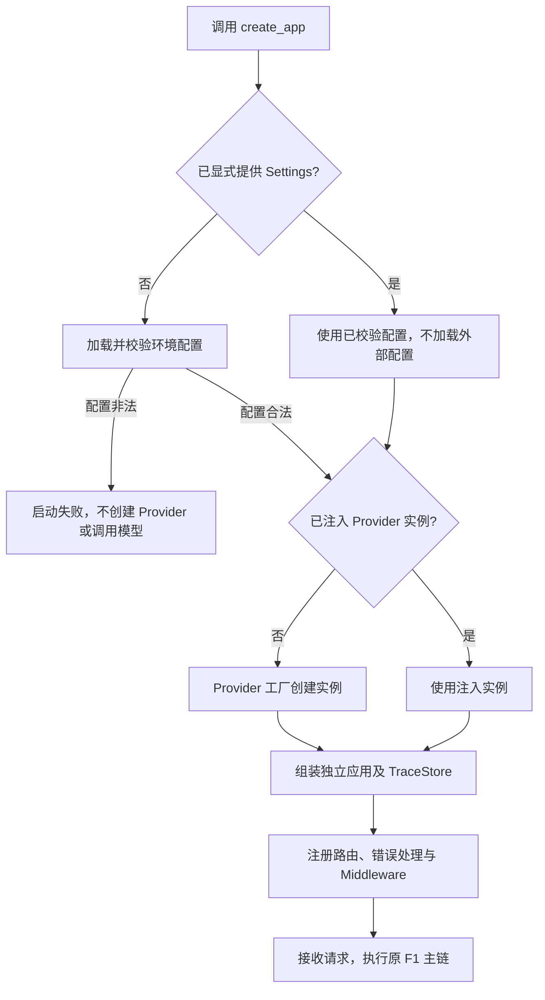

# F1-O1：应用组装、目录命名与环境配置优化

> 状态：验收通过。2026-10-31 用户确认设计与测试方案后完成实施，115 个测试及 Claude Code 第 1 轮独立审查通过。
>
> 关联基线：[F1 设计](../../design.md)、[F1 测试与验收](../../test-plan.md)。本项属于 F1 的第一次优化，沿用新功能工作流，不增加第三种工作流，不占用 F2 编号。原 F1 设计、测试与审查记录保留；本项独立记录变更、测试及验收结论。

## 1. 目标与边界

- 前置能力：F1 已通过本地 Mock、进程内 HTTP、真实回环 HTTP 测试及 Claude Code 独立审查；源码直接位于 `src/`。
- 完成后：维护者能按职责定位 Middleware 和服务组件，通过统一 `.env` 选择环境标识与默认 Provider，测试可显式注入配置和 Provider 实例。
- 必须做：整体抽取 RequestContextMiddleware；`service/` 改为 `services/`；引入 Settings、Provider 工厂、`.env.example` 与应用工厂启动；维护测试隔离和既有 F1 行为。
- 不做：`.env.test` 或多环境文件切换、环境与 Provider 自动联动、配置热更新、调试/日志策略、真实 Provider/密钥/模型能力配置（F3）、Structured Output/SSE/取消/重试/fallback/SQLite（F4–F8）。
- 稳定基础：后续功能可扩展配置和 Provider 工厂，但本次只实现两个配置项和 MockProvider，不建立后续能力占位。

## 2. 最小方案

### 2.1 目录与组件

```text
projects/llm-gateway/
├── .env.example                    # 已建立，示例配置
├── .env                            # 用户自行复制的本地文件，不覆盖、不纳入共享
├── .gitignore
├── src/
│   ├── main.py                     # create_app，组装与注册
│   ├── settings.py                 # 配置读取与校验
│   ├── contracts.py
│   ├── errors.py
│   ├── api/
│   │   ├── routes.py
│   │   ├── dependencies.py
│   │   └── errors.py
│   ├── middleware/
│   │   └── request_context.py
│   ├── services/                   # 原 service/ 整体迁移
│   │   ├── gateway.py
│   │   ├── prompts.py
│   │   └── trace.py
│   └── providers/
│       ├── base.py
│       ├── mock.py
│       └── factory.py
└── tests/                          # 保留现有分层，增加必要用例
```

命名按语义统一：`providers/`、`services/` 表示实现或组件集合；`middleware/` 使用不可数名词原形；`api/` 表示职责领域。文件仍按具体职责命名，不统一追加 Service 类或文件名后缀。

| 组件 | 输入 → 输出 | 依赖与责任 |
| --- | --- | --- |
| `settings.py` | 指定来源的配置 → 已校验 Settings 或配置错误 | 使用 `pydantic-settings`，集中处理来源、优先级和允许值；不创建 Provider、不处理 HTTP |
| `providers/factory.py` | 已校验 Settings → Provider 实例 | 当前只构造 MockProvider；不读取环境、不发模型请求 |
| `main.py:create_app` | 可选 Settings、可选 Provider 实例 → FastAPI 应用 | 创建本应用独立的 TraceStore，选择 Provider，注册错误处理、路由与 Middleware；保存 `app.state.settings` 便于内部检查，不增加配置查询接口 |
| `middleware/request_context.py` | ASGI 请求/响应及 TraceStore → 附请求 ID 的响应与请求记录 | 原样承接当前请求 ID、请求 Trace、未预期异常兜底和响应完成判断；依赖 `api/errors.py` 的错误响应函数与 `services/trace.py` |
| `services/` | 原有服务输入 → 原有结果 | 仅迁移路径；Gateway 仍编排调用和记录尝试，Prompt 与 Trace 职责不变 |

### 2.2 创建应用与请求处理



- `create_app(*, settings=None, provider=None)`：显式配置优先；Provider 实例注入优先于按配置构造默认实例。配置始终先有效，不通过注入实例绕过配置校验。
- 显式 Settings 已在构造时校验；传给 `create_app` 后不再读文件或环境。自动化测试构造配置时显式指定两个字段，并禁用 dotenv 加载，隔离相关进程变量。
- 每个应用只在创建时确定配置、Provider 和 TraceStore；请求期间不重新读取文件。不同应用的配置和记录不通过全局缓存共享。
- 保留具体 Mock 实例注入，用于检查调用参数、次数、异常和并发；环境配置不承担故障脚本功能。
- 移除模块级 `app = create_app()`；导入 `main` 只定义工厂，不读取 `.env`、创建 Provider 或应用记录。

### 2.3 Middleware 与错误处理

整体迁移现有类，不再拆分。保留 ASGI 实现、执行顺序及非 HTTP 透传。Middleware 负责请求 ID、请求级记录与未预期异常兜底；`api/errors.py` 保留已分类错误处理；Gateway 只维护实际 Provider 尝试。

请求记录仅在最终 `http.response.body` 成功发送、且无后续 body 的正向证据成立时收口。中断继续传播，未确认请求/尝试保持原来的 `running`，不提前实现 F6 取消终态。响应已开始时不再发送第二份错误响应。

## 3. 契约

### 3.1 完整示例与字段

本项 `.env.example` 的完整内容：

```dotenv
# 当前运行环境：development、test、production
ENV=development

# 默认 Provider；F1 目前仅支持 mock
LLM_GATEWAY_PROVIDER=mock
```

| 外部配置名 | Settings 字段 | 允许值 | 缺省值 | 语义 |
| --- | --- | --- | --- | --- |
| `ENV` | `env` | `development`、`test`、`production`，值区分大小写 | `development` | 运行环境标识，本项不附带行为切换 |
| `LLM_GATEWAY_PROVIDER` | `provider` | 当前仅 `mock` | `mock` | 默认 Provider 实现选择，不是逻辑模型名 |

- 两字段独立：三个 ENV 与 mock 的组合均合法，不自动覆盖、修正或推导另一字段。
- 空值、全空白或未知值拒绝，不裁剪或转成另一个允许值。例如 `ENV=develop`、`ENV=TEST`、Provider 为 `deepseek` 均在本项启动失败；真实适配器留到 F3。
- ENV 不改 System Prompt、接口响应、Provider、调试开关或日志等级。`production` 仅为标识，本项仍限定本机或隔离开发网络、单实例单 worker。

### 3.2 来源、路径与失败

1. 正常加载优先级：进程环境变量 > 项目根目录 `.env` > 字段默认值；高优先级来源中的非法值直接失败，不能偷偷选低优先级值。
2. 默认文件路径由 `settings.py` 所在项目位置计算，不依赖当前工作目录；配置加载函数允许测试显式指定临时 `.env` 的路径。
3. `.env.example` 只作示例，不作为默认值文件读取；不生成或加载 `.env.test`，不按 ENV 切换文件。
4. 默认 `.env` 缺失时使用进程环境/默认值；值非法时配置构造或应用启动失败，错误指出配置项，不输出整个配置文件或环境变量集合。
5. 显式提供 Settings 时跳过外部配置加载；修改文件不会改变已创建应用，新应用/重启才读取新值。
6. `.env.example` 纳入共享文件；`.env` 加入 `.gitignore`。操作说明提供复制方法，程序、测试和实施者不得覆盖用户已有 `.env`；实施中也不创建或覆盖用户实际配置文件。

配置/启动错误发生在服务可接收请求之前，不套 HTTP 四字段信封，不伪造请求 ID 或 Trace：Provider 模型调用数为 0；配置无效时 Provider 工厂也不执行。配置有效但工厂内部出现未预期错误时启动失败，不静默回退。

### 3.3 启动与兼容范围

实施后的启动命令，在项目目录运行：

```bash
uv sync --locked
uv run uvicorn --app-dir src main:create_app --factory \
  --host 127.0.0.1 --port 8000 --workers 1
```

`main:app` 在本项实施后替换为 `main:create_app --factory`，不保留模块级应用兼容层；同步所有实际启动入口和文档。当前实现和 README 已同步使用工厂入口，原 F1 文档保留其历史启动方式。

F1 的公开 HTTP 契约全部沿用 [基线设计](../../design.md)：`POST /v1/llm`、固定模型与 System 模板、唯一 user 消息、严格校验、四字段响应、响应头请求 ID、错误分类、0/1 次 Provider 调用及内存 Trace 都不变。不把配置项加入调用方请求体；完整 System Prompt 继续使用原已确认文本，不在本项复制维护。

## 4. 验收边界

目录迁移完整，当前导入、monkeypatch 与启动入口一致；Middleware 抽取不改变既有异常、收口和并发隔离行为。默认配置、覆盖顺序、非法配置、显式注入、无导入副作用和应用间隔离均有对应可观察结果；原有 70 个 F1 用例作为回归基线，允许仅为新路径、隔离配置与工厂入口调整测试装配，不减少场景或放宽断言。

验收以 [本项测试方案](test-plan.md) 的逐例记录为准。配置/逻辑/进程内 HTTP 测试证明内部行为与副作用；真实进程冒烟证明工厂启动及实际回环 HTTP；两者均不证明真实模型或生产部署。实施后的完整变更由 Claude Code 只读审查，最多三轮，P0–P2 阻断。

## 5. 状态与交接

- 已确认：用户认可整体优化方案、ENV 与 Provider 独立、单一 `.env`；最新要求是在 F1 下用子目录独立维护本优化设计和测试方案。
- 归档：`docs/features/F1/optimizations/O1/`，事项编号 F1-O1；下一次独立优化递增 O2，不预建目录。设计、测试、审查均在本子目录闭环，不把新结果写回或冒充原 F1 的验收证据。
- 当前状态：设计与测试方案均已确认，本地实现、115 个测试及独立审查均完成；原 F1 记录与用户实际 `.env` 保持不变。
- 对应方案：[F1-O1 测试方案](test-plan.md)。用户已确认后按下列步骤实施，实际 Red/Green 与回归证据在测试方案中独立记录。
- 已同步：README、项目/文档 AGENTS、架构中受影响的组件职责、进度、依赖与锁文件；HTTP 契约无变化则不改其语义。有效路径全部同步，历史报告保留原文和快照解释。
- 模板回看：本项暴露“优化与原验收基线的关联”缺少记录位置；在设计/测试模板补充可选的基线与独立编号说明。文档关联、配置与回归测试已本地验证；本项独立审查已通过，后续 Feature 的效果仍待验证。

### 实施步骤

按 test-driven-development 小步实施，在当前工作区顺序执行，不依赖 Git，不增加其他功能：

1. 记录原 70 个用例与基线文件指纹；先通过断言证明导入仍创建应用、配置文件尚未加载。
2. 在可导入的最小配置边界上增加来源/校验/隔离测试，运行 Red 后实现 Settings 与加载函数，锁定依赖。
3. 增加应用工厂、Provider 注入与异常用例，运行 Red 后实现工厂与无导入副作用；同步原测试的显式配置注入。
4. 整体迁移 services 和 Middleware；补齐 ASGI 边界测试，保留原 70 个场景和断言；用临时目录验证工厂启动及非法配置退出。
5. 同步 README、AGENTS、架构与进度；核对 25 组用例与原回归，提交 Claude Code 只读审查，按不超过三轮的闭环核实/修复并记录结论。

- 本项交接：工厂入口、配置加载、实例注入和 ASGI 边界已验证；[逐例结论与审查处置](test-plan.md)独立留存。历史 Red 原始日志未独立保存的取证缺口已明确记录，并回填后续执行时及时存证的测试模板要求。
