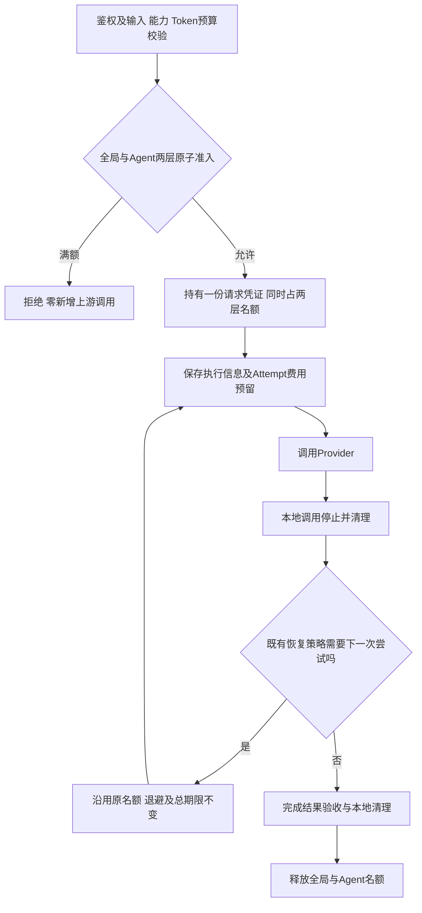

# F11：并发治理

> 状态：验收通过（2026-11-03，用户确认的分层标准）。[第2轮独立复核APPROVED](review-r2.md)，P0—P3均为0。通过对象是全局/Agent两层并发治理及Gateway正确性；完整pytest原始23个失败、600秒真实成功率24%及证据边界均保留，见[测试记录](test-plan.md)。不宣称供应商稳定或20并发持续运行通过。

## 1. 目标与边界

基线：F1—F10及BUG-002已验收；BUG-002最终2086通过、含28个真实节点，见[验收记录](../../bugs/BUG-002-acceptance-report.md)。历史通过不代替F11验证。

在内部Agent、本机或隔离网络、单实例单worker条件下，让一次生成请求有明确的并发准入、所有者及释放条件。并发是同时占用的请求执行名额，与每秒请求数、Token预算和账户余额分别管理。

必须做：全局请求上限、单Agent请求上限；首次准入满额立即拒绝，不排队；覆盖普通、结构化、流式、主动探测、重试/fallback、超时、取消及异常清理；同一请求从首次准入至执行和清理结束持续持有原名额；保留既有HTTP/SSE、期限、账务和请求归属。

不做：上游组名额及分组配置、内部等位机制、等待队列、RPM/TPM限流、动态配置、管理后台、分布式协调、自动熔断、根据空闲容量改选模型。供应商自行控制其容量，Gateway沿用F7处理供应商限流/繁忙及有限恢复；全局名额保护Gateway，不保证不会触发某家供应商的限制。模型管理与路由是下一独立Feature，本项只交付可复用的请求准入组件。

## 2. 最小方案

### 2.1 两层限制与组件

| 组件/现有入口 | 输入与输出、职责及依赖 | 对应位置 |
| --- | --- | --- |
| 并发配置 | 全局与每Agent的严格正整数上限；启动时校验后只读。不增加Provider字段或路由策略。 | 扩展services/models.py与gateway.yaml安全示例 |
| ConcurrencyLimiter | 输入可信agent_id、request_id；原子检查两层并占用，输出统一的请求持有凭证，或安全的拒绝原因；不返回HTTP、不访问Provider/账本。 | 新增src/services/concurrency.py |
| 应用组装 | 每个应用生命周期只建立一份Limiter，普通入口、StreamingManager、探测共用；不能每个HTTP请求新建。 | main.py、api/dependencies.py |
| 普通执行与探测 | 校验后、执行前准入；所有Attempt共用原请求凭证，由请求级所有者最终释放。 | services/gateway.py |
| 流式任务所有者 | pending首次认领前准入，成功后将名额交给后台任务；认领/建任务失败撤回；订阅不持有生成名额。 | services/streaming_manager.py |
| 流式执行器 | 整个生成/恢复周期使用同一请求凭证，向任务所有者交接执行和清理完成证据；与现有取消边界整合。 | services/streaming.py |
| 错误与诊断 | API包装首次准入HTTP错误，Trace保留错误码/阶段；安全日志记录拒绝层、上限、占用与request_id。Provider错误及SSE终态仍沿用原归属。 | api/errors.py、api/routes.py、既有Trace/持久化路径 |

不使用Middleware按HTTP连接数计数，否则重连、取消接口和后台生成会被混为一谈。Limiter内的检查与递增必须作为同一次原子操作，多层中任一层拒绝不得残留其他层的占用。重复释放不能造成负数或放大容量；内部所有者错误仍应可发现。

### 2.2 生命周期



- 全局与Agent计数单位是生成请求，包含首次准备、执行、有限重试等待及本地清理；一个request_id最多持有一份。多个凭据属于同一agent_id时共享额度，不能按Token字符串分别计数。
- 请求已准入后，重试/修复/输出增额/fallback以及退避等待均沿用原请求名额，不释放后重新申请，也不重复增加计数。先结束旧调用及清理，再按F7进入下一次尝试；不并行执行同一请求的多个Attempt，总期限不重置。
- 其他请求把余下额度占满，不影响原请求继续内部恢复；它不会因再次申请本地名额而失败。恢复仍可能因供应商错误、次数/预算耗尽或总超时失败，不承诺必然成功。
- 本地concurrency_limited仅用于首次准入拒绝，不是上游429，不触发F7自动重试、输出增额或fallback。Provider限流使用既有provider_rate_limited及恢复策略，不混为本地名额错误。
- 获取名额后的存储失败、余额不足、建任务失败、取消和异常都必须撤回尚未交接的持有关系。Provider未调用时也不能泄漏请求名额。
- 释放依据是本地执行停止且相关清理结束；不是收到canceling、数据库终态、HTTP结束或进入finally。清理超时且任务仍活跃时保留占用，实际停止后再释放，期间不得启动下一次上游尝试。
- 后台持久化补写不再执行Provider，执行/清理已停止后不因数据库暂不可用永久占用名额。不能通过释放名额把未知Usage记为零。
- 本地客户端停止不能证明供应商已停止计费。F11限制本地持有资源，账务仍按实报/未知规则处理。

### 2.3 接口参与规则

| 场景 | 准入与状态 |
| --- | --- |
| POST /v1/llm普通/结构化 | 校验后、执行与首次费用预留前同时申请两层请求名额。 |
| POST /v1/llm/stream | 仅创建pending，不占生成名额；不新增队列调度。 |
| pending的首次有效GET events | 校验归属/游标后、claim_stream前申请两层。满额返回429，原请求保持pending、无开始时间/期限、无上游调用/费用预留。稍后由调用方主动重试GET。 |
| running/canceling的订阅、断连重连 | 不重新申请生成名额；后台任务继续持有原名额。多个GET竞争首次启动仍只产生一次生成。 |
| 终态补读与after_seq续传 | 不占生成名额，不增加Provider调用或费用。 |
| POST cancel、Trace及账务查询 | 不申请生成名额，满额时仍可访问；保留鉴权及归属校验。 |
| POST /v1/models/{model}/health | 使用鉴权所得Agent，纳入两层；保留既有单次探测和账务契约。 |
| GET /healthz | 不调用模型，不占名额。 |

正常准入仍沿用已有B起点及总期限；不引入排队时间或因重连重置期限。满额尚未执行的pending请求可以继续取消，不能为拒绝GET把原生成状态改成failed。

## 3. 契约

### 3.1 配置与信任

初始部署值为全局20、每Agent统一5；保留原已确认的两项启动值，不是生产容量承诺。不增加逐Agent覆盖值或调用方自定义上限。ENV、Provider选择与治理配置独立；更换模型或协议不产生新的全局/Agent额度。

以下为gateway.yaml需要合并的新字段，不是可覆盖整个文件的完整运行配置：

```yaml
concurrency:
  max_requests: 20
  max_requests_per_agent: 5
```

Agent额度以鉴权所得agent_id为准，不由HTTP参数指定。不同协议、模型别名、Provider名称和Gateway凭据轮换不改变同一Agent的额度。本项不向Provider配置加入任何治理字段，不新增供应商配额管理。

上限必须是严格正整数，拒绝0、负数、布尔、字符串、小数、null；拒绝缺失治理块/必填上限、未知配置字段及重复YAML键。每Agent上限不得超过全局。启动拒绝不发Provider请求。

首版两项治理配置显式必填，不静默回退到无限制。实施时只向现有运行配置合并上述concurrency块、保留当前Provider绑定；真实配置示例同步。测试自建完整配置和Registry，不借此读取维护者YAML。程序内测试构造也必须显式给出治理策略，不为测试保留绕过治理的产品分支。

### 3.2 成功与拒绝

请求协议、正常成功字段及request_id位置保持既有契约，不新增并发控制请求参数。拒绝示例：

```json
{"success":false,"code":"concurrency_limited","data":null,"message":"当前模型调用并发已满，请稍后重试"}
```

首次准入拒绝返回HTTP429；不承诺准确空位时间，不添加猜测的Retry-After。Provider调用次数为0，无Attempt或费用预留。按global、agent顺序报告首个命中项，任一拒绝均不改变两层计数。

已开始生成的请求不再申请名额，因此不新增“内部恢复因本地满额而失败”的路径，也不新增concurrency_limited型SSE终态。Provider调用/恢复失败仍沿用原HTTP错误或response.failed事件与唯一终态；取消已接受后保持原取消所有权。不能为其他请求的准入拒绝覆盖既有生成的状态或事件。

### 3.3 记录

首次准入拒绝的Trace保留concurrency_limited及admission阶段；明确区分本地拒绝和provider_rate_limited。日志关联request_id，记录scope(global/agent)、limit及in_use。不记录Key、Bearer或原始Prompt。

普通/探测首次拒绝按既有入口拒绝路径保存元信息，不创建假Attempt。pending首次GET拒绝仅记录该次HTTP访问的安全诊断及原generation request_id，不改原pending请求的状态、错误、输入、账务或事件；之后成功启动不能残留拒绝错误。不得把SSE订阅请求ID与生成请求ID混淆。

活跃名额保存在进程内，不建立并发计数数据库表；重启清空进程占用，旧running/canceling仍由既有启动恢复处理，pending继续保留。活动计数不是账本，不从历史Request/Attempt行数反推当前名额。本项不新增公共并发查询/配置接口。

## 4. 验收边界

两层分别检查N-1、N、N+1和同时争抢最后一个名额；检查拒绝无部分占用、幂等释放、跨Agent/模型/协议统一计数、首次订阅/取消竞争。直接复现“其他请求占满剩余额度时，已准入请求内部重试仍能成功”，同时检查重试期间不释放、不重新申请、不重复增加计数。上游调用、名额快照、任务退出/关闭、SQL/事件/账务互相核对，不能只看429或状态字段。

Mock/受控上游确定性制造等待、429、失败、清理阻塞及取消；真实DeepSeek Chat与OpenAICompatible Responses运行共用公共场景并分别留证，二者仍同属DeepSeek。保持原2086节点及原真实接入/容量；旧容量测试显式使用能容纳原20并发负载的测试限额，不能为新默认值缩小历史负载或跳过失败。

逐例方案及运行安排见[test-plan.md](test-plan.md)。设计与测试方案均已确认；已开始TDD，实际命令、结果和未验证项在测试方案单独记录。

2026-11-03用户随后确认分层验收：Gateway正确性与真实供应商业务成功率分别评价。经失败现场证据确认的上游故障，在恢复/超时收口、资源、唯一终态、事件及账务均正确时不单独阻断；未归因失败及Gateway缺陷仍阻断。保留真实原始失败记录，不改产品超时/重试，不省略原四档容量与600秒实验；具体证据门槛见测试方案，旧回执及首轮BLOCKED审查保持原文。

## 5. 状态与交接

- 最新确认记录：用户提出只保留全局和Agent请求名额，由供应商自行控制其容量；对“删除上游组配置/名额与内部等位，内部重试持有原名额，保留Provider有限恢复”的推荐方案回复“确认”。本设计以该决定为准，替代此前的上游组方案；此前测试草案未获确认、未执行。
- 文档阶段历史：设计/测试草案及索引同步时未改代码或配置；用户单独确认测试方案后进入实施。当前仅最小修改已确认范围，运行YAML只增加两项上限，Provider绑定、凭据、迁移、AGENTS及原Feature工件保持。
- 文档核验：本轮5份文档本地链接均存在、代码围栏配对、JSON示例可解析、YAML示例仅两项上限；C01—C23编号连续不重复，无旧分组配置/内部再申请路径，441份受保护文件摘要一致。只核验文档，未运行产品测试或真实调用。
- 一次合理性自检：首次两层原子准入；pending拒绝不写failed；断线不释放、取消等待清理；重试始终持有同一请求凭证、不再次准入；旧容量测试需独立限额。均纳入更新后的测试映射。
- 模板回看：现有模板已覆盖生命周期、副作用、并发交错、分层证据与独审，未发现需要扩展的通用缺口，本次不改模板。
- 下一功能只接收经过F11验收的准入接口；模型管理与路由尚未设计/实现。
