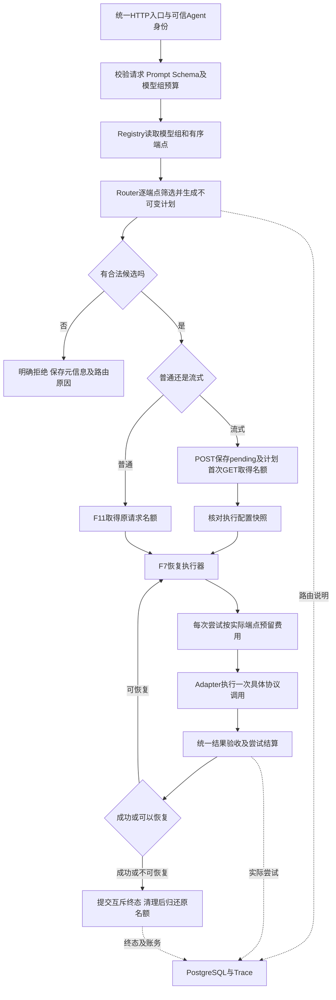

# F12：模型管理与模型组路由

> 状态：验收通过（2026-11-03）。设计/测试方案已分别确认，按[实施步骤](implementation-plan.md)完成TDD、最终完整2508项回归（42个真实节点、零跳过）和[第2轮独立复核](review-r2.md)，P0—P3均为0；首轮两项P2已修复，实际证据见[测试方案](test-plan.md#7-修复后完整版本回归第2轮复核)。

## 1. 目标与边界

前置为已验收的F3配置/适配器/预算、F4结构化输出、F5-O2两阶段流式、F6取消、F7恢复、F8诊断、F9计费、F11并发治理。历史验收不改写，当前单实例、单worker、本机或隔离网络的部署约束不变。

调用方继续填写必填的`model`，其含义为稳定的模型组名称。Gateway从该组的受控候选端点中筛选并选择；不要求Agent提交一份自行判断的“能力清单”。例如请求使用流式接口，就要求候选支持流式；携带`response_schema`，就要求候选支持Gateway的结构化输出链路。

必须做：三层配置、启停、按候选列表顺序选择、逐端点能力/Prompt/Token预检、有界恢复、持久化路由解释、旧配置迁移说明及现有功能回归。现有`general-primary`、`general-backup`调用名称保留。

不做：分析用户原文并判断任务类型/难度、LLM分类器、模型推荐、随机/权重/最低成本路由、自动熔断/健康状态自动改写路由、动态配置管理接口、模型列表接口、多实例协调、新Provider协议和工具/图像调用。F13任务自动路由后续独立设计、测试和交付，本次不创建其实现或空方案。

管理仅指维护受控YAML、启动校验、启停和修改后重启生效；不新增模型管理数据库表。价格继续由既有`prices.yaml`管理，凭据继续在独立本地文件中，不写入`.env`、公开响应或Trace。

## 2. 最小方案

### 2.1 组件及调用关系



图中Router只做本地预检，不调用Provider、不收费、不占用生成名额。流式POST仍只创建pending；首次GET才执行，已有订阅和补读不重新路由。并发准入、持有和释放时机沿用F11，不因路由增加第二次准入。

| 组件/目标文件 | 本次职责与输入输出 | 缺失会怎样 |
| --- | --- | --- |
| Registry：`src/services/models.py` | 从YAML校验并冻结Provider、端点及模型组定义；按组名提供受控候选 | 调用名称与实际接入继续耦合，无法独立替换/停用端点 |
| Router：新增`src/services/routing.py` | 接收已校验的请求、组策略及Registry，复用Prompt/Schema/Token组件，返回有序、逐候选有理由的计划；不返回HTTP响应 | 普通/流式各自拼候选，排除规则及解释容易不一致 |
| Gateway：`src/services/gateway.py` | 编排预检、请求元数据、执行和现有响应；不再自行遍历`fallback_models` | Router可能只用于展示，实际执行仍走另一套候选 |
| F7：`src/services/recovery.py`与现有执行器 | 消费冻结计划，按端点计次，控制重试、修复、增额、切换及期限；不自行添加候选 | 切换可能越过能力检查、次数或总期限 |
| 流式管理：`streaming_manager.py`、`streaming.py` | 保存/恢复计划及配置核对；生成、取消和只读订阅职责不变 | 重连可能更换端点，或POST/GET执行不同策略 |
| TokenBudget/Adapter | TokenBudget按每个实际端点计数；Adapter仍只执行一次已选端点调用 | 错用首选模型的计数或把选型逻辑放进协议适配器 |
| Store/价格/Trace | 保存计划元数据，实际Attempt按实际Provider及模型取价、留痕、结算 | 选对端点却扣错费用，或无法解释为什么切换 |

依赖明确后再制定实施步骤；共同入口、Trace/持久化及配置接线由统一集成者处理。独立纯配置/路由逻辑与验收任务可按实施步骤划定所有权后并行，本次讨论不启动实现任务。

### 2.2 三层配置

`gateway.yaml`将旧`models`拆成`endpoints`与`model_groups`，其他既有顶层配置保留。未知字段、重复YAML键、错误类型、非法引用或不合法预算在启动时拒绝；不静默回退到旧配置。名字为非空字符串，引用精确匹配，不自动去空格或改写。

| 层次 | 属性 | 边界 |
| --- | --- | --- |
| `providers.<id>` | `adapter`、`api_protocol`、真实接入的`base_url`/`credential_ref` | 沿用现有适配器/协议组合及独立凭据校验；Mock不配置地址/凭据 |
| `endpoints.<id>` | `provider`、`model_id`、`thinking_mode`、`enabled`、`token_counter`、`supports_streaming`、`structured_output_mode`、`context_window_tokens`、`provider_max_output_tokens`、`max_output_tokens`、`safety_margin_tokens`、`max_timeout_seconds` | `enabled`必填布尔；能力描述的是当前模型、协议与Adapter共同可交付的能力，不是仅凭厂商宣传推断 |
| `model_groups.<name>` | `candidates`、`default_output_tokens`、`max_output_tokens`、`default_timeout_seconds`、`max_timeout_seconds` | 候选为非空有序端点ID列表，禁止重复和未知ID，不引用另一个组；各预算为严格正整数，默认值不超过组上限 |

端点`max_timeout_seconds`是一次上游尝试的上限；组的超时是整次请求的授权总期限。每次上游超时取端点上限与请求剩余时间的较小值；不因切换重置总期限。不要求每个端点都能承接组最大预算，否则无法表达“大预算走第二个端点”；本次请求不适配的端点在路由时排除。

端点的厂商物理输出上限由`provider_max_output_tokens`表达，维护者允许该端点承接的上限由端点`max_output_tokens`表达，启动时校验后者不超过前者；模型组`max_output_tokens`则是该调用入口的授权上限。保留端点上限可以防止同一端点被另一个组引用后，绕过原接入限制。端点不再保留默认输出/默认总超时，避免首选端点变化后默认值跟着变化。结构化模式保留`none`、`json_object`、`json_schema`，两种结构化模式都由Gateway执行既有严格输出验收，不宣称JSON mode等于原生Schema约束。

以下为**目标配置的完整模型/恢复片段**，数值沿用当前安全Mock示例，仅用于解释迁移，不宣称是最新厂商参数；实际模型限制应由维护者依据官方资料和验证结果维护。`database`继续合并既有块，不在这里重复数据库密码配置。

```yaml
providers:
  mock-main:
    adapter: mock
    api_protocol: chat_completions
  mock-backup:
    adapter: mock
    api_protocol: responses
endpoints:
  primary-chat:
    provider: mock-main
    model_id: deepseek-flash
    thinking_mode: disabled
    enabled: true
    token_counter: deepseek_v41
    supports_streaming: true
    structured_output_mode: json_object
    context_window_tokens: 1048576
    provider_max_output_tokens: 393216
    max_output_tokens: 4096
    safety_margin_tokens: 1024
    max_timeout_seconds: 120
  backup-responses:
    provider: mock-backup
    model_id: deepseek-flash
    thinking_mode: disabled
    enabled: true
    token_counter: deepseek_v41
    supports_streaming: true
    structured_output_mode: json_schema
    context_window_tokens: 1048576
    provider_max_output_tokens: 393216
    max_output_tokens: 4096
    safety_margin_tokens: 1024
    max_timeout_seconds: 120
model_groups:
  general-primary:
    candidates: [primary-chat, backup-responses]
    default_output_tokens: 1024
    max_output_tokens: 4096
    default_timeout_seconds: 30
    max_timeout_seconds: 120
  general-backup:
    candidates: [backup-responses]
    default_output_tokens: 1024
    max_output_tokens: 4096
    default_timeout_seconds: 30
    max_timeout_seconds: 120
recovery:
  max_attempts: 3
  max_attempts_per_endpoint: 2
  base_delay_seconds: 0.1
  max_delay_seconds: 1.0
concurrency:
  max_requests: 20
  max_requests_per_agent: 5
```

`max_attempts_per_model`迁移为`max_attempts_per_endpoint`，数值及F7原有约束不扩大：默认总3次、每端点2次，具体请求沿用既有恢复配置。一个请求不递归调用其他模型组、不重复解析别名，所有修复/增额/切换共享总次数。不同请求使用同一端点不共享请求内计数。

启动校验端点能力与Adapter/协议、TokenCounter是否兼容，包括停用端点；组内全部停用允许启动，用于维护期间明确拒绝请求。真实凭据的加载和客户端生命周期沿用现有规则，不承诺通过停用端点规避错误凭据配置。启动仅本地校验，不发付费探测。

### 2.3 路由与执行规则

1. 请求结构、身份、Prompt选择/变量、Schema子集及模板能力按既有规则校验。查不到组返回`unknown_model`；不把组名当成端点ID、真实模型名或Provider名。
2. 从模型组确定本次授权输出上限、首次输出预算和总超时；非法值直接拒绝。整组策略不取首选端点的默认值。
3. 按阶段筛选候选：启用状态 → 本次技术能力 → 端点输出上限 → 端点专属Prompt渲染 → 端点上下文预算。每阶段保留原顺序，每个被排除端点保存第一个不满足的原因。没有合法候选时，按耗尽候选的阶段返回第3.2节错误，不受端点排列改变错误类型。
4. 普通、流式、结构化只使用请求实际表达的能力，不新增`capabilities`、`provider`、`endpoint`或调用方自定义System参数。当前Schema请求允许JSON mode加服务端验收，不增加“必须原生Schema”的新参数。
5. 逐端点按其结构化模式组装消息、计算输入Token，并检查`输入Token + 本次授权最大输出 + 安全余量 <= 上下文窗口`。预检使用授权最大输出，不仅使用较小的首次预算。Chat JSON mode与Responses原生Schema的Prompt、生成约束和计数分别处理；固定System仍只来自受控模板。
6. 第一个合法端点为初始选择，其余为有序备用；不随机、不重新评分、不按余额或价格自动换端点。过滤不产生Attempt、供应商调用或费用预留。
7. F7执行恢复时消费同一计划，保留瞬时错误/认证错误/格式修复/输出增额等现有分类。只有既有规则允许才切换。取消已接受、总期限耗尽或首个文本增量已提交到事件库后，不切换端点或重答。
8. 修复增加消息时按当前端点重新检查渲染/上下文预算；不能因为初始计划合法就跳过修复预检。余额不足、价格不可用等仍在每次实际尝试前由现有计费准入处理；不把账务故障自动转成选择更便宜端点。

### 2.4 流式计划及升级

POST成功保存pending时冻结本次授权值、组策略、有序候选、各端点消息/计数器版本、排除原因及相关安全配置快照，不发上游请求、不预留供应商费用、不占生成名额。首次GET仍执行F11准入；拒绝时保持pending且不创建上游尝试。

首次执行必须检查创建时关联的组、全部候选端点、Provider连接配置、计数器版本及恢复策略是否仍一致，包括已排除端点的启停/能力变化；无关模型组的修改不应使本请求失效。凭据内容不纳入快照，执行仍使用当前合法加载的凭据。这里的快照一致性不保证远端模型版本或厂商行为未变。

关联配置变化、端点删除或旧版pending快照无法证明与新结构等价时，使用既有`execution_configuration_changed`提交唯一failed终态与`response.failed`事件，零Provider调用/零费用预留；不按新配置重新规划。旧版pending可重新创建请求，不提供静默快照转换。

重连/多订阅只读取既有执行与事件。终态事件历史读取不依赖当前模型配置；旧请求、Attempt、账单和Trace不回填不存在的路由决策。启动恢复仍是running/canceling转failed、pending保持、终态保持；不新增恢复生成。

## 3. 契约

### 3.1 HTTP及成功响应

普通/流式请求字段、严格类型、长度、显式null、额外字段和Schema规则均沿用[当前接口契约](../../contracts.md)与[Schema规则](../../response-schema.md)，仅`model`的解析从旧直接绑定改为组。`model`为必填非空字符串，精确匹配已注册组；不新增默认组或自动路由别名。

普通请求完整示例：

```json
{
  "model": "general-primary",
  "prompt": {"name": "basic_text", "version": "1.0.0"},
  "messages": [{"role": "user", "content": "请解释一下什么是流式输出。"}],
  "initial_output_tokens": 256,
  "max_output_tokens": 1024,
  "timeout_seconds": 30
}
```

`POST /v1/llm`返回HTTP200；请求ID继续仅在`X-Request-ID`响应头，成功正文示例：

```json
{
  "success": true,
  "code": "ok",
  "data": {
    "text": "流式输出是把生成的内容分段发送给调用方。",
    "usage": {"input_tokens": 248, "output_tokens": 20, "total_tokens": 268}
  },
  "message": "成功"
}
```

此处文本和Usage仅为响应结构示例。结构化成功继续增加对象类型`parsed`，未知Usage仍为null；不向普通响应增加实际模型、端点、尝试次数或路由内部信息。

同一请求体可用于`POST /v1/llm/stream`（不允许`response_schema`），HTTP202正文保持`{"success":true,"code":"ok","data":{"request_id":"<Gateway生成的UUID>","status":"pending"},"message":"请求已创建"}`。GET仅使用request_id和可选`after_seq`，不接受model。既有`response.*`事件及seq规则、总期限和15秒空闲心跳不变。

`POST /v1/models/{model}/health`继续无需请求体，`model`为组。选择组内第一个启用端点，沿用既有固定探测文本及Token/超时预算并检查组/端点限制；限制不满足直接报错，不扩大预算、不换端点。实际只尝试一次，不重试/不fallback；结果在Trace解释选中了哪个端点。返回的`latency_ms`仍只证明这一次探测，不证明组内全部端点健康，不自动更新启停状态。探测继续计入F11及既有F9账务；`/healthz`不调用上游。

不新增GET模型列表、端点探测接口、配置修改接口或对外Chat Completions/Responses接口。

### 3.2 错误与副作用

所有HTTP错误沿用四字段信封及`X-Request-ID`，`data`为null；不在公开message暴露端点地址、凭据引用、上游原文或堆栈。下表路由前拒绝均为零Provider调用、零费用预留，Trace.status为failed、无实际Attempt，保存已知元信息与可用的路由原因，不存原始请求正文。

| 场景 | HTTP / code | Trace/恢复 |
| --- | --- | --- |
| 缺少model、字段类型/null/额外字段不合法 | 422 / `invalid_request` | 沿用既有入口拒绝，尚无路由时routing为null |
| 未知模型组 | 400 / `unknown_model` | 不尝试把组名解析为具体端点 |
| 授权输出超组上限、首次输出超授权值 | 400 / `invalid_output_budget` | 调用方修正，不自动降额 |
| 总超时超组上限 | 400 / `invalid_timeout` | 不自动扩大组上限 |
| Prompt/变量/Schema本身非法或模板不支持Schema | 沿用已有400/422及具体code | 公共输入错误不通过换端点绕过 |
| 所有端点停用 | 503 / `no_available_endpoint` | error_stage为`routing`；不重试或探测停用端点 |
| 启用端点全部不支持本次流式/结构化能力 | 400 / `unsupported_capability` | error_stage为`routing`，逐端点原因保存 |
| 能力匹配端点全部容纳不了授权输出 | 400 / `invalid_output_budget` | error_stage为`routing`，不降低本次授权值 |
| 剩余端点专属User渲染均超现有字符限制 | 400 / `prompt_too_long` | error_stage为`routing`，不裁剪输入 |
| 可渲染端点全部上下文预算不足 | 400 / `context_length_exceeded` | error_stage为`routing`，不裁剪或减少预留输出 |
| 本地并发满额 | 429 / `concurrency_limited` | 沿用F11；首次GET保持pending，已保存计划不变 |
| 每次尝试的价格/余额准入失败 | 沿用F9现有状态及code | Provider尚未进入；不改成路由故障，不新增恢复条件 |
| Provider实际调用后失败/次数或期限耗尽 | 沿用F7实际错误及stop_reason | 记录已发生尝试和实际费用；不统一覆盖为无候选 |

错误示例：

```json
{
  "success": false,
  "code": "no_available_endpoint",
  "data": null,
  "message": "模型组没有启用的候选端点"
}
```

初始路由没有合法候选时，流式POST直接返回错误，不创建可执行pending。POST已成功之后的配置变化在首次GET触发的生成流程中通过持久化failed事件表达，不把SSE内故障改成第二份JSON响应。事件已发送与上游已完成仍是不同观察点，成功依据沿用已验收结果及终态事务；路由计划存在或函数退出不代表请求成功。

### 3.3 路由解释、信任及持久化

`GET /v1/traces/{request_id}`沿用可信Agent所有权检查。新增可空`routing`对象；F12以前的历史记录返回null，不伪造旧决策。目标结构示例如下，候选列表保持配置顺序：

```json
{
  "version": 1,
  "strategy": "ordered",
  "config_fingerprint": "<相关受控配置及计数器版本的SHA-256>",
  "candidates": [
    {"endpoint_id": "primary-chat", "status": "skipped", "code": "endpoint_disabled"},
    {"endpoint_id": "backup-responses", "status": "eligible", "code": null}
  ],
  "selected_endpoint": "backup-responses",
  "reason": "first_eligible"
}
```

`version`固定整数1；生成请求strategy固定`ordered`；config_fingerprint为64位十六进制摘要，候选status为`eligible`或`skipped`，code为可空受控枚举。排除code依阶段为`endpoint_disabled`、`unsupported_capability`、`invalid_output_budget`、`prompt_too_long`、`context_length_exceeded`。失败无选择时selected_endpoint为null、reason为`no_eligible_endpoint`。探测使用strategy=`probe_first_enabled`，只选择首个启用端点，不产生备用计划；候选说明只列检查过的停用前缀与所选端点，后续端点不列为已检查。eligible仅表示本地预检可用，不能作为远端健康或调用成功证明。

selected_endpoint表示初始选择，实际执行及切换以有序attempts为准，不将该字段反复覆盖成最后端点。请求`requested_model`继续记录模型组；F12的`attempts[].model`记录端点ID，provider/configured_model/actual_model继续记录实际接入、配置模型、上游返回模型。F12之前该model字段的历史逻辑名不重写，通过routing版本/是否为null区分记录时期。

请求级prompt_fingerprint、input_token_count、counter_version、structured_output_mode描述初始选中端点的预检；每个Attempt继续保存自身真实值，不能把首选端点消息或计数套用到备用端点。已有`recovery.skipped_candidates`保留兼容投影，F12其model为被排除端点ID，code同上；新的routing为完整初始候选说明。

拒绝而未产生初选时，已完成渲染/计数的信息仍按既有诊断原则保留：这些请求级字段描述首个进入计数阶段候选的已知预检事实；routing.selected_endpoint仍为null、实际Attempt为零，不将已测Token或指纹描述成已执行。计数器自身失败时只保留此前已确认的版本、消息/Schema指纹，不虚构Token数。

相关配置摘要只覆盖本组、全部引用端点、Provider安全配置、计数器版本及恢复规则，不包含用户正文、密钥值、数据库密码、无关组或原始厂商回复。公开Trace只展示摘要及受控ID/原因，不展示地址、凭据引用、Prompt/Schema正文；有效执行正文仍只按既有授权保存在内部输入快照。被拒绝输入不因需要解释路由而落库。

路由元数据复用既有持久化快照/诊断元数据承载，不新增模型配置表或为此改变表命名。Store是终态和账务提交所有者，TraceQuery只做一致性只读投影；取消/完成竞争、未知Usage待核实、Mock零收费规则不变。每次实际Attempt仍按自己的Provider与configured_model取价、预留和结算，不在初始规划时为所有备用端点预扣费用。

### 3.4 配置迁移与依据

维护者迁移步骤：停止旧进程；保留本地配置副本；把每个旧models条目的实际接入/能力/计数/物理及接入输出限制迁入一个端点，补enabled；把默认输出、组授权上限和总超时迁入同名组，旧max_output_tokens同时保留为端点接入上限及同名组授权上限；组候选按原首选及直接fallback顺序填写；删除旧models/fallback_models字段，迁移恢复字段名；保持Provider地址、协议、凭据引用、数据库和价格绑定；启动新版本。配置不合法则启动失败且不调用上游，不自动读取旧格式或覆盖用户文件。

实现时更新安全示例及测试自建配置，提供真实绑定迁移示例；未经明确需要，不切换维护者当前Mock/真实绑定、不改密钥文件。旧请求记录和账单无需批量改写；旧pending按2.4保守失效，历史事件可读。此格式升级不是新增配置热更新。

依据为[课程1.7第8节](../../../../../docs/网页版完整内容/1.7-LLM统一模型调用服务.md)及现有F3—F11契约。2026-11-03核对[LiteLLM普通Router](https://docs.litellm.ai/docs/routing)与[Auto Router](https://docs.litellm.ai/docs/auto_router)：其模型组选择部署与自动任务分类是不同层次，都可通过model名称进入。这里只借鉴边界，不复刻其全部策略；任务分类归F13，课程中的优先级数字由本项目有序候选列表替代，避免两套顺序冲突。

本功能不更改上游协议；官方资料是设计参考，不等于本项目实现或真实验收证据。当前DeepSeek Chat与OpenAICompatible Responses实际共用DeepSeek，不能作为两个独立供应商容灾证据。

## 4. 验收边界

完整设计及[本项测试方案](test-plan.md)均已分别确认，已进入Red→Green实施。测试需证明：三层配置及迁移正确、筛选顺序可解释且与实际调用相同、主选/备用的Prompt与Token计数真实、未授权预算不裁剪、次数/期限/取消/首增量边界不扩大、每次尝试按实际端点计费、Trace可回溯、流式快照变化失败且历史续传不受影响、F11名额最终归零、老功能回归。

Mock提供确定性的正常/错误/组合路径，受控协议上游验证真实解析与副作用；公共功能共用验收步骤，在Mock和真实两条协议下分别执行。真实用例显式启用，不以费用为理由跳过；完整回归范围和执行命令在测试方案确认，不在此写成已执行。供应商成功率与Gateway正确处理失败分别报告，沿用已确认分层标准；未知故障或Gateway丢失/错误终态/错误扣款仍阻断，不能把供应商错误码当作自动通过证明。

TDD、最终完整真实回归已完成，2497通过及容量证据见测试方案；独立审查尚未完成，F12未验收。文档一致性检查不能替代功能测试。

## 5. 状态与交接

| 确认节点 | 当前结论 |
| --- | --- |
| 模型组路由和任务自动路由都要做、逐项交付 | 用户已确认；F12在前，F13随后独立推进 |
| F12范围、必填model表示组、保留现有调用名 | 用户已确认 |
| YAML管理、修改重启生效 | 用户已确认 |
| 三层配置、有序候选、能力/预算过滤、既有恢复/计费/Trace衔接、探测及不新增管理接口 | 用户已确认推荐方向 |
| 本文完整结构、错误优先级、Trace字段、恢复字段迁移和旧pending升级行为 | 用户在完整设计落地及总结后回复“确认”，完整设计已确认 |
| 测试方案 | [本项方案](test-plan.md)已获用户单独确认，已授权按TDD实施 |

设计/测试确认阶段仅维护文档及修正测试模板的过时审查引用；两项确认后已按实施步骤修改本项源码、测试、安全配置示例及必要文档，不修改两份AGENTS.md或历史验收。运行配置迁移保持Provider绑定与凭据不变，具体执行状态另记。

合理性自检（文档层）：将组策略与端点能力分开，避免首选停用影响默认预算；只保留一套候选顺序；普通/结构化/流式复用同一筛选；实际协议、账务与生命周期仍由已有组件负责；F13无提前实现。首次设计自检未发现模板缺口；本轮编写测试方案时发现测试模板仍固定引用Claude Code，与已确认工作流不一致，仅将该引用修正为独立审查Agent及通用提示词模板，详情见测试方案末尾，不新增流程。

当前已完成实施、完整回归及累计两轮独立审查，验收通过。F13将复用实际验证后的模型组解析与端点选择能力，其需求和测试仍需另行确认。
