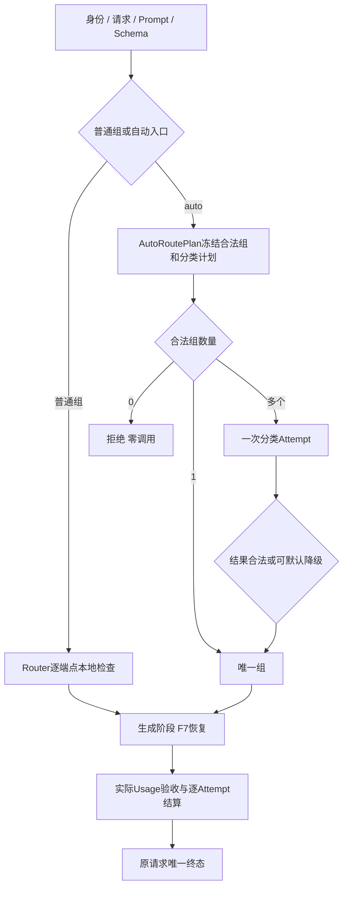

# F13：百炼三模型与任务自动路由——代码实现导读

> 状态：**按用户确认的分层标准验收通过**。对应[设计](design.md)、[实际测试记录](test-plan.md)、[补充独审APPROVED](review-r1-capacity-followup.md)和[实施步骤](implementation-plan.md)。原严格容量失败与实际成功率继续保留。

## 1. 行为变化

普通组继续由调用方指定，例如`model: light`。新增`model: auto-general`：程序先检查哪些组能够执行，再调用一次Flash分类，最后使用固定选定组生成。调用方不提交Provider、协议、能力或System规则。

百炼通过Responses接入`qwen3.8-flash`、`qwen3.7-plus`和`qwen3.8-max`。原DeepSeek和Mock路径保留；三款千问同属百炼，不能当作三家供应商容灾。

## 2. 核心调用链

普通调用在一次准入和原期限内执行两阶段。流式POST只保存冻结计划，首次GET取得名额并执行；分类期间订阅仍由原订阅器提供心跳。分类JSON不写入正文事件。重连只读已提交事件，不再次分类或生成。

## 3. 建议阅读顺序

| 顺序 | 文件 / 函数 | 应理解的问题 |
| --- | --- | --- |
| 1 | [models.py](../../../src/services/models.py)：AutoRouteConfig、ModelRegistry | 连接、物理端点、普通组和自动入口为什么分开；错误引用如何在启动时拒绝 |
| 2 | [routing.py](../../../src/services/routing.py)：Router.route | 能力、输出预算、模板渲染、完整输入预算如何先于远程调用检查 |
| 3 | [auto_routing.py](../../../src/services/auto_routing.py)：plan_auto_route、AutoRoutePlan | 零组/唯一组/多组如何分流；如何保留逐组原因和相关配置快照 |
| 4 | [classification.py](../../../src/services/classification.py) | 独立System、静态Few-shot、JSON任务资料和动态enum怎样组成分类调用 |
| 5 | [gateway.py](../../../src/services/gateway.py)：resolve_auto_plan、_ordinary_attempts | 怎样复用一次尝试执行，不递归调用完整Gateway；分类如何只用一次而生成保留原恢复预算 |
| 6 | [streaming_manager.py](../../../src/services/streaming_manager.py)：_restore、_generate、_admit_classification | pending如何恢复；分类与生成怎样共用后台请求、取消边界和原名额 |
| 7 | [bailian.py](../../../src/providers/bailian.py)、[streaming.py](../../../src/providers/streaming.py) | 百炼嵌套Schema及queued元信息如何归一；为什么不放宽其他Provider协议 |
| 8 | [qwen_text.py](../../../src/services/token_counters/qwen_text.py)、[token_budget.py](../../../src/services/token_budget.py) | 完整消息/Schema的字节估算、固定/比例余量及estimated版本如何传递 |
| 9 | [prices.py](../../../src/services/prices.py)、[billing.py](../../../src/persistence/billing.py) | 报价预留与实际输入档位为何不同；欠额后为什么禁止下一次付费尝试 |
| 10 | [store.py](../../../src/persistence/store.py)、[trace_query.py](../../../src/persistence/trace_query.py)、[billing_query.py](../../../src/persistence/billing_query.py)、[trace_contracts.py](../../../src/trace_contracts.py) | 同一ID如何查询选组、用途、实际用量、错误和费用关联；账务明细怎样在同一读取事务内投影Attempt用途 |

## 4. 设计取舍

- F12先做硬条件筛选，模型只从冻结白名单中选择；分类错误不授予业务权限，也不能增加候选。
- 分类最多一次、5秒、128输出；可恢复故障使用仍合法的默认组。认证、额度、账务、存储、原总期限和取消不通过默认组绕过。生成最多三次、单端点最多两次，分类和生成的Attempt编号连续但次数预算独立；流式分类写库也纳入原总期限的外层计时，整次到期不会误报为存储自身超时。
- 复用原`_ordinary_attempts`持久化和结算，分类成功不会结束请求。流式分类调用在取消使用的同一把认领锁内登记任务，在锁外等待，取消可以及时进入。
- 自动pending保存原请求及相关组/端点/Provider/Counter、分类和回答模板定义。相关变化拒绝执行，无关组变化不使其失效；不在重启后自动重选。
- 用途、估算来源和自动路由元数据复用现有`timing_snapshot`，没有必要的结构变更，因此不增加迁移。历史记录缺用途时投影为generation，缺估算来源保持未知。旧普通组缺省描述及语义等价的最小输出1不改变原指纹；真实下限16等变化仍会拒绝。
- auto确定组以后，请求级指纹、Schema指纹、结构化模式、输入计数及Counter版本在Store原登记/结束/取消事务内同步；分类前的初候选不能冒充选定组。白名单只对本次已确定auto生效，不写身份或授权预算，普通F12的入口元信息保持原含义。每个Attempt仍记录自己的实际输入。
- Qwen估算是经验余量策略，不是精确Tokenizer或数学上界。计费始终使用真实Usage；预留不足照实结算成欠额，未知消费保持待核实。
- Gateway保留十进制精度。百炼将数值Schema中的`1.0000000000000001`舍入后，原服务端校验仍拒绝；逐位业务字段可由调用方声明字符串，不自动改Schema。

## 5. 从请求定位问题

`context_answer@1.2.0`提供A123订单资料，`model: auto-general`要求提取订单号：先检查三组，Flash返回候选组，程序验Schema和白名单，然后将原回答Prompt发送给选定组。普通结果仅text/usage及可选parsed；usage汇总分类和所有生成尝试，任一未知则不伪造完整总数。

从`X-Request-ID`查询Trace：`requested_model`是auto入口，`auto_routing.resolved_group/source/fallback_reason`解释选组；每个Attempt的`purpose`、实际端点、Counter版本、Usage和错误解释消耗。再用同ID查询账单，账单明细也直接给出purpose，以连续Attempt编号关联分类和生成费用。

| 现象 | 先看哪里 |
| --- | --- |
| `no_available_group` | auto_routing.candidate_groups逐组硬筛原因；不应有上游Attempt |
| 使用默认组 | fallback_reason及classification Attempt；局部故障不等于零消耗 |
| `auto_route_failed` | 默认组是否已被硬条件排除；不能随机挑第三组 |
| `execution_configuration_changed` | pending中的相关配置、模板及Counter快照；历史事件仍可读取 |
| `output_truncated` / `request_timeout` | generation Attempt、授权预算和原总期限；分类正确不代表后续回答已完成 |
| 余额不足 / 待核实 | 每个Attempt的预留/已结算/未知费用及实际Usage；不能用本地估算补成实测 |

## 6. 验证与边界

实际批次和失败原因见[测试方案开发记录](test-plan.md#4-开发执行记录2026-11-03)。包括纯配置/算法、真SDK回环协议、受控HTTP/PG、实际进程强杀恢复及三模型真实调用，证据分开保存。

旧版完整2904节点为2903通过、1容量失败、零跳过，包含104真实节点；追加8项通过。正式开发集30有效29一致，首次封存集30有效30一致，均经独审逐条核对标签；后续回答分别23和26笔完成，其余输出截断照实保留。20并发600秒6808/6825成功，5并发600秒1725/1727成功，两轮原严格门槛均失败，不能宣称稳定容量。新5档传输观察只定位发送后的响应头等待，不证明具体供应商事故；观察开销计入实测。

真实SQL暴露的请求级Trace持久化缺陷已通过业务Red、最小Store修复和5项直接PG回归；修复版全部默认非live2813项及受影响真实17项均通过，不用旧全量冒充新版本结果。用户已确认分层容量标准，原数据处理检查复核通过；首轮补充独审APPROVED，整项功能验收通过。新增20项判据及原相关测试共130通过，产品代码未改，原严格失败不改写。当前只承诺本机或隔离网络、单实例单worker；不承诺供应商正式账单一致、跨供应商自动容灾、任意输入估算上界或所有长回答在固定预算内成功。

样例来源：由实施Agent按用户确认规则预编，未经人工逐例标注；原metadata来源文字的纠正及已完成的60项独立标签核对见[来源记录](artifacts/corpus-provenance.json)。分数只代表固定合成样例的一致率。
