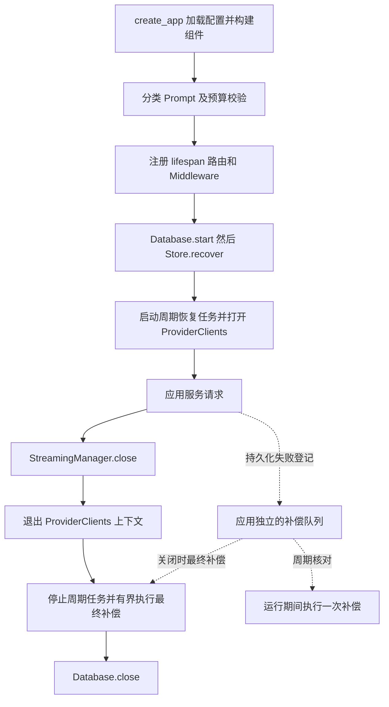

# F13-O1：配置示例、应用入口与项目首页整理

> 状态：验收通过。2026-11-04，用户已确认本设计的推荐方案；测试方案随后已获单独确认，进入实施。
>
> 对应[测试方案](test-plan.md)。基线为已验收的 [F13](../../design.md)，原验收、容量失败及限制保持原记录。

## 1. 目标与边界

用户提出三个问题：Gateway 配置示例重复；数据库引入后 `main.py` 承担过多生命周期工作；README 含大量 Feature 信息，不便新读者了解和运行项目。

本项完成后，新读者能通过唯一配置示例和标准项目首页完成配置、启动和调用；维护者能从入口看清组件接线，在对应模块定位恢复及关闭逻辑。

必须做：

- 配置示例统一为项目根 `config/gateway.example.yaml`，采用已确认的完整百炼三模型、模型组和自动路由示例；价格合入同一文件的顶层 `pricing` 分区，不另建 `prices.example.yaml`。
- 从 `src/main.py` 提取持久化补偿、应用生命周期及分类 Prompt 校验，保持入口主要负责构建和连接组件。
- 按项目介绍、能力与架构、运行条件、配置与启动、调用示例、测试、目录及限制组织 README；Feature 状态及证据通过现有文档链接访问。

不做：新增业务功能、配置 profile、依赖注入框架、数据库迁移、多 worker 支持、路由或计费策略变更。不开启 Git 初始化、发布或推送；不再次扩大敏感信息清理范围；不修改任何 `AGENTS.md`。

## 2. 最小方案

### 2.1 唯一配置入口

以当前 `gateway.bailian.example.yaml` 为完整内容来源，合并进 `gateway.example.yaml` 后移除重复文件。保留其已有 Mock 接入和直接组兼容示例，同时完整给出百炼 Flash、Plus、Max 三个真实端点、`light/general/analysis` 及 `auto-general`。README 的真实调用示例使用真实组或自动入口，明确 Mock 的用途。

将 `prices.bailian.example.yaml` 的 `bindings/versions` 合入 `gateway.example.yaml` 的顶层 `pricing` 分区，完成后移除独立价格示例，不另建 `prices.example.yaml`。公开价格注明来源时间和使用边界，不承诺永久有效或等同正式账单。

实际运行配置也统一：`PriceBook.load(config_dir)` 改为读取 `gateway.yaml` 中的 `pricing`，不再读取或回退到 `prices.yaml`，避免两个价格来源冲突。PriceBook 仍独立负责价格定义校验、版本选择及报价；文件合并不把计价逻辑放进 ModelRegistry 或 main。Gateway 配置加载须识别此分区，但价格内部结构由 PriceBook 校验。

价格内容保持现有 `bindings/versions` 结构、价格字符串、时区、生效时间、缓存价格及输入分档，不改变金额精度和计算规则。未配置 `pricing` 时沿用原缺少价格表的行为：空价格目录，需要实际报价时返回 `price_unavailable`，不能视为免费；分区存在但结构非法时启动拒绝。

已有配置通过将原 `prices.yaml` 内容嵌入 `gateway.yaml.pricing` 迁移，不维持双读或双写。README 给出迁移说明；测试夹具和临时配置构造同步迁移，禁止只更新示例却让应用和测试仍依赖旧路径。请求已保存的价格快照和历史账务不作迁移，仍按原快照解释。

`credentials.example.yaml` 只含占位值，数据库密码仍使用独立本地文件。当前 Provider 工厂在启动时需要已配置真实接入的凭据；README 必须说明完整真实示例需要填写 Key，不能宣称复制后无需 Key 即可启动。ENV 与 Provider 独立，测试仍使用自建配置和显式注入。

只更新当前使用说明中的相关链接和路径。历史审查报告、执行提示词、原始回执、快照与哈希不追溯改写。用户实际配置不被示例覆盖；已有本地价格配置的迁移保留全部原值及其他配置，核对前保留本机原文件，原文件不再作为应用价格来源。

### 2.2 组件职责

| 位置 | 本项职责及依赖 | 向外提供 |
| --- | --- | --- |
| `src/main.py` | 保留 `create_app(...)`；加载配置、构建组件、绑定 `app.state`、注册路由和 Middleware | 原 FastAPI 工厂及注入参数 |
| `src/services/prices.py` | 从 `gateway.yaml.pricing` 读取价格目录，继续独立校验和计算；配置注册表仅接纳该分区 | 保持 PriceBook 对调用方的报价与快照接口 |
| `src/persistence/reconciliation.py` | 持有每个应用独立的待补偿项；依赖 Store、活跃请求集合和生成任务集合 | 延迟登记、是否等待持久化、执行一次补偿 |
| `src/lifecycle.py` | 依赖 Database、Store、ProviderClients、StreamingManager 和补偿组件；编排启动、周期恢复和关闭 | FastAPI lifespan |
| `src/services/classification.py` | 在已有分类组件内校验自动入口引用的 Prompt 及变量协议 | 启动校验函数；沿用现有错误类型和信息 |

不将整份 `main.py` 搬到一个新的大文件。Database 仍负责数据库连接，Store 仍负责持久化事务及恢复规则，StreamingManager 仍负责流任务；新生命周期模块只安排它们的执行顺序。

图中是正常退出顺序；启动及运行中异常同样沿现有 `finally` 路径释放已建立的资源，不把退出当作请求成功证据。

### 2.3 README

首页保留能够帮助使用项目的内容：统一入口、受控 Prompt、结构化输出、流式续传和取消、恢复、Trace、账务、并发与路由；用一张简明架构图说明关系。

启动说明覆盖新克隆后的统一配置复制、填写本地凭据和数据库密码、安装依赖、Compose、迁移、单 worker 启动、创建 Agent 凭据与拨款；既有配置说明如何将价格迁入 `pricing`，不再要求复制独立价格文件。给出普通、自动路由、流式订阅/续传/取消及 Trace/账务的必要示例，详细协议链接已有文档。

Feature 列表、历史通过数量、阶段性状态从首页正文移出；已有 `docs/progress.md` 和 `docs/features/` 继续保留，不新增一份重复历史。目录树反映实际布局。

## 3. 保留契约

- `create_app(...)` 的签名、显式注入优先级、测试配置隔离及现有 `app.state` 消费关系保持兼容。应用实例之间不得共享补偿队列或活跃集合。
- 分类模板缺失和协议不兼容仍在启动校验阶段拒绝，零远程探测、零模型调用。
- 保留数据库启动检查与恢复、Provider 打开、流管理器关闭、Provider 关闭、恢复任务停止、最终有界补偿、数据库关闭的现有顺序及错误传播规则。
- 补偿不得收口仍活跃或正在清理取消的请求；不确定的流创建提交只能核对既有记录，不能误伤首次 GET 已启动的生成；同一 ID 出现更新项时，旧补偿不能删除新登记项。
- 请求总期限、恢复次数、并发名额、唯一终态、事件 seq、Usage/账务及既有脱敏边界保持不变。本项不添加 HTTP 字段、状态或接口。
- 价格配置来源统一为 `gateway.yaml.pricing`；原价格版本、精度、预留/结算和持久化快照语义保持不变。旧 `prices.yaml` 不再作为隐式备用来源。
- 启动失败不记为业务成功；补偿失败仍可后续重试，任务被取消时继续传播取消，关闭清理保持现有时限。

## 4. 验收边界

以独立配置加载、组件级故障测试、HTTP/PostgreSQL/真实进程回归及显式真实 Provider 验证，证明组织调整后保留上述行为；README 的命令须在隔离配置中实际核验。具体范围和通过标准见[测试方案](test-plan.md)，须单独确认后才能实施。

## 5. 状态与交接

- 设计决定：用户已确认唯一完整真实示例、两个职责模块及分类组件内校验、标准项目 README；随后确认将价格合入 `gateway.yaml.pricing`，取消独立价格示例，保留 PriceBook 组件。该决定替代最初独立价格示例的建议；无待决定的设计分支。
- 当前进度：TDD、分批回归、真实调用和README启动完成，同一首轮独审APPROVED；原始失败及证据边界见测试方案。
- 实现后同步：README、受影响的架构描述和进度入口；稳定后产出本目录 `implementation-summary.md`。
- 模板回看：沿用现有模板，本次未发现需要推广的通用规则，不修改模板。
