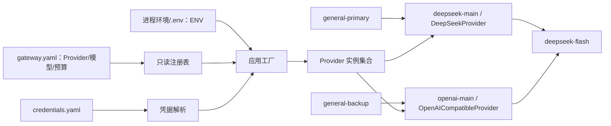
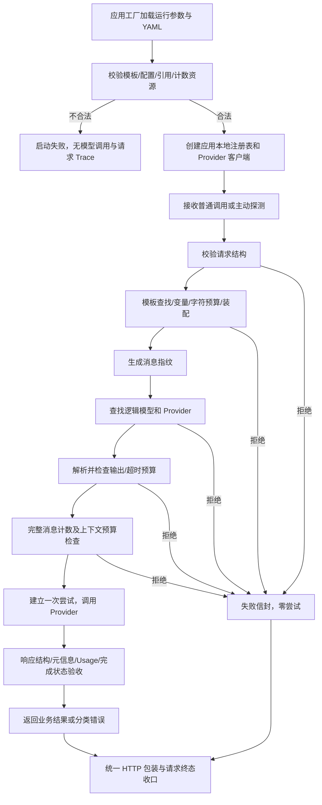

# F3：模型配置、统一 Provider 与真实接入

> 状态：验收通过（2026-11-01）。离线570、真实4及Claude Code第2轮APPROVED；证据与实际验证边界见测试方案3.8–3.9。
>
> 基线：[F2 验收及用户反馈](../F2/test-plan.md)。F3 源码与离线测试已落地；真实接入与第2轮独立审查均已通过。

## 1. 目标与边界

- 前置：受控模板与版本、变量装配、字符预算、消息指纹、统一 HTTP 信封、应用工厂与内存 Trace 已完成。
- 完成后：内部 Agent 用稳定逻辑名调用模型，明确指定输出预算和调用超时；维护者用 YAML 管理多个 Provider、模型和凭据，并主动探测某模型绑定的 Provider。
- 必须做：配置加载与只读注册表；Mock/DeepSeek/OpenAICompatible 统一契约；两种真实适配；完整消息 Token 预检；输出与超时预算；错误归一化；文本结果验收；调用元数据；模型健康探测；离线、协议和真实接入测试。
- 不做：管理 API/UI、数据库持久化、在线配置修改或热更新、自动模型发现/能力同步、自动裁剪/压缩上下文、调用方覆盖 System/思考模式、多轮历史、工具调用、JSON/Schema 输出、Streaming、自动重试/fallback。
- F4/F5/F6 按原路线递增。F7 增补“授权范围内增大尝试输出预算”的受控恢复，届时区分首次分配与调用方最大许可，不能突破现有 max_output_tokens 含义。持久化留到后面统一设计，Trace 当前仍为内存记录。
- 部署边界沿用本机/隔离开发网络、单实例单 worker；多个内部 Agent 可并发。备用侧按 OpenAI 的角色设计，当前按已确认方式用 deepseek-flash 验证接入。

## 2. 最小方案

### 2.1 组件与职责

| 位置 | 输入 → 输出 | 负责与依赖 | 缺失后的问题 |
| --- | --- | --- | --- |
| `settings.py` | 进程环境/.env → 运行设置 | ENV 来源与合法性，不存密钥；不按 ENV 切 Provider | 环境标识和供应商选择混在一起 |
| `services/models.py` | YAML/显式配置 → 只读 Provider/模型注册表 | 严格定义、引用和能力预算校验；解析逻辑模型 | 模型地址、能力和选择散落在调用路径 |
| `services/credentials.py` | 凭据引用 → 内部凭据 | 从独立本地文件/测试注入获取，不读密钥环境变量，不进入模型公共配置或 Trace | 密钥在业务参数与日志间流转 |
| `services/token_budget.py` | 完整消息+模型计数配置+输出预算 → 本地计数/验收 | 模型匹配的 tokenizer、消息编码及安全余量；不调用模型 | 字符限制被误当 Token 限制，输出空间未预留 |
| `providers/base.py` | 统一调用参数 → 内部结果/分类异常 | 明确正文、模型元信息、结束原因、Usage、关闭协议；不返回 HTTP 对象 | SDK/原始响应泄漏到服务层 |
| `providers/mock.py` | 同一调用参数 → 预设结果/异常 | 正式可配置适配器，也能被测试注入；记录参数与调用次数 | Mock 绕过真实主链，验收失真 |
| `providers/deepseek.py` | 统一参数 ↔ HTTP | 异步 HTTP 直接调用 Chat Completions，隔离原始 JSON/状态 | 上层自己拼接供应商请求 |
| `providers/openai_compatible.py` | 统一参数 ↔ SDK | OpenAI 异步 SDK 指定 Provider 地址；关闭自动重试 | SDK 对象/异常/默认重试影响平台契约 |
| `providers/factory.py` | 校验后的 Provider 定义+凭据 → 客户端 | 构造与资源归属，不执行远程探测 | 配置错误发生在半次调用以后 |
| `services/gateway.py` | 普通/探测调用 → 业务结果 | 唯一编排入口；共享预算、调用和结果验收 | 探测另建一套绕过校验的主链 |
| `contracts.py`、`api/` | HTTP ↔ 内部参数/结果 | 输入和响应包装、错误拦截；路由不读取供应商对象 | 上层依赖 Provider 协议 |
| `services/trace.py`、`middleware/` | 生命周期 → 请求/尝试记录 | 请求 ID、用途、调用元信息、真实终态；保留 ASGI 响应完成边界 | 中断被记成成功，失败和成本不可定位 |
| `main.py` | 已验证资源 → 应用 | 每应用初始化、依赖注入、客户端释放；导入不创建应用 | 全局状态和连接无法隔离 |

这些是本次需要的职责，不要求每个文件再包装成 Service 类。普通结果的最小校验留在 Provider 统一边界，不提前建立 F4 Schema 校验组件。

### 2.2 配置与调用关系



上图为真实接入配置。默认本地配置分别将两个逻辑名绑定到 Mock，不因真实配置错误自动切 Mock。两个逻辑名可被显式调用；F3 不配置 fallback 关系。

### 2.3 启动与调用流程



客户端每应用、每 Provider 配置构造并复用，参数按请求传递，不修改共享客户端状态。全部本地验证在客户端构造之前完成；启动不调用远程 API。工厂自身创建的客户端由应用关闭流程释放，测试注入对象由测试 fixture 管理；初始化中途失败时释放已创建资源。总超时覆盖一次 Provider 调用及其结果验收，不以 SDK 的每段连接/读取超时代替总时限。

## 3. 契约

### 3.1 配置来源、结构与迁移

| 文件 | 内容及维护方式 |
| --- | --- |
| `.env` / `.env.example` | 只保留 ENV 等运行参数；不存任何密钥，不存模型库 |
| `config/gateway.yaml` | 默认本地 Mock 配置，保存 Provider 与模型条目；正常启动必需 |
| `config/credentials.yaml` | 本地实际凭据，不共享；仅注册真实适配器时按其引用读取 |
| `config/credentials.example.yaml` | 凭据格式示例，只含占位值 |
| `assets/tokenizers/` | 固定版本计数资源及来源/版本/摘要记录，已固定并离线核验 |

配置路径相对项目根目录，不随启动工作目录改变；不搜索父目录、不叠加多环境 YAML。进程环境 > 项目根 .env > ENV 默认值的现有规则保留，显式运行设置跳过外部加载。模型配置只有 YAML/显式注入一个来源，不用环境变量逐字段覆盖。`.env.test` 不引入。

YAML 启动时严格解析：拒绝重复键、未知字段、非法类型、空白标识、空集合和错误引用；不做变量插值，不动态导入配置指定的代码。数字是严格整数，拒绝 bool/字符串/小数。每个模型的 Provider 必须存在；真实 Provider 的凭据引用必须存在且值非空；Mock 不需要 base_url 或 credential_ref，不能借此跳过模型预算/计数校验。所有已注册定义都校验，不因暂未被请求而放过坏配置。

现有 `LLM_GATEWAY_PROVIDER` 的选择职责迁移到模型的 provider 引用；旧键出现时启动失败并明确提示迁移，不静默忽略。旧 `.env` 由维护者迁移，实施者不得自动覆盖用户文件。ENV 不控制适配器。配置修改后重启，不热加载、不自动同步官网或 /models。

### 3.2 Provider、模型与完整配置示例

Provider 使用字典键作为唯一 ID，adapter 为 `mock`、`deepseek`、`openai_compatible`。真实适配器需要 HTTP(S) base_url 与 credential_ref；地址与密钥只能来自受控配置，不能由请求提交。

模型字段：

| 字段 | 类型/约束 | 职责 |
| --- | --- | --- |
| 字典键 | 非空白字符串 | 逻辑模型名，当前提供 general-primary/general-backup |
| provider | 非空白字符串 | 引用 Provider ID |
| model_id | 非空白字符串 | 发往适配器的模型标识；不是 Provider 已执行的证据 |
| thinking_mode | `disabled` | 本项固定非思考；不开放请求覆盖 |
| token_counter | `deepseek_v41` | 当前支持的本地计数策略标识；Mock 同样检查 |
| context_window_tokens | 正整数 | 上下文窗口 |
| provider_max_output_tokens | 正整数 | 核实的供应商输出上限 |
| default_output_tokens | 正整数 | 省略请求预算时使用的值 |
| max_output_tokens | 正整数 | 平台允许申请的输出上限 |
| safety_margin_tokens | 正整数 | 本地预检余量，不作为输出发送或计费 |
| default_timeout_seconds | 正整数 | 默认调用总时限 |
| max_timeout_seconds | 正整数 | 平台超时上限 |

启动要求：`1 ≤ default_output_tokens ≤ max_output_tokens ≤ provider_max_output_tokens`；默认超时不超过最大超时；默认输出预算+余量必须留有正的输入空间。模型是否能接收某份具体消息，在请求时检查。

默认配置正文（不含凭据；model_id 是模拟的目标，不代表 Mock 实际推理）：

```yaml
providers:
  mock-main:
    adapter: mock
  mock-backup:
    adapter: mock
models:
  general-primary:
    provider: mock-main
    model_id: deepseek-flash
    thinking_mode: disabled
    token_counter: deepseek_v41
    context_window_tokens: 1048576
    provider_max_output_tokens: 393216
    default_output_tokens: 1024
    max_output_tokens: 4096
    safety_margin_tokens: 1024
    default_timeout_seconds: 30
    max_timeout_seconds: 120
  general-backup:
    provider: mock-backup
    model_id: deepseek-flash
    thinking_mode: disabled
    token_counter: deepseek_v41
    context_window_tokens: 1048576
    provider_max_output_tokens: 393216
    default_output_tokens: 1024
    max_output_tokens: 4096
    safety_margin_tokens: 1024
    default_timeout_seconds: 30
    max_timeout_seconds: 120
```

真实接入时，将 providers 整段替换为下段，并分别将两个模型的 provider 改为 deepseek-main、openai-main，其余字段不变；不得把真实定义混入默认配置却缺少引用凭据：

```yaml
providers:
  deepseek-main:
    adapter: deepseek
    base_url: https://api.deepseek.com
    credential_ref: deepseek-main-key
  openai-main:
    adapter: openai_compatible
    base_url: https://api.deepseek.com
    credential_ref: deepseek-main-key
```

独立凭据文件格式（只作示例，不创建实际文件）：

```yaml
credentials:
  deepseek-main-key:
    api_key: "<维护者在本地填写>"
```

示例占位值不能作为可用凭据声明。启动只验证本地结构和必要值，不远程认证。密钥不从进程环境或 .env 回退读取，错误只指出引用项，不打印值或配置全文。默认 Mock 返回 `MOCK_REPLY`、正常结束、未知实际模型及 Usage；故障/延迟由测试注入控制，不新增产品故障开关。

### 3.3 模型能力与 Token 预检

2026-10-31 官方文档将 deepseek-flash 列为当前推荐标识，旧 deepseek-v4-flash 被新模型承接；用户已确认更新。文档模型窗口为 1,048,576、输出上限 393,216，这些是来源核实值，不是本账户极限实测值。

本地计数对 F2 装配完成的全部 system/user/assistant 消息，使用匹配模型的消息编码与 tokenizer；包含角色、消息边界和生成起始标记，不是字符比例，也不是仅 content 分词求和。只支持当前文本链路，不引入图片/工具编码。资源固定版本、来源与摘要，启动离线验证和加载；请求期间不下载、不回退通用 tokenizer。资源缺失或配置不支持则启动失败，运行期异常返回 internal_error、零 Provider 尝试。

完整预检条件为：

```text
本地输入计数 + 本次生效输出预算 + safety_margin_tokens
    ≤ context_window_tokens
```

等于窗口允许，超过拒绝。F2 原始 User/变量/渲染后 User 字符预算继续保留，不擅自给已发布 System 或 Few-shot 增加局部硬限制、更改其版本正文；它们全部计入最终 Token 预算。输出预算先确定，再做完整计数；超限不裁剪、不减少示例、不降低请求预算。

本地计数只作预检，真实 Usage 只能取自 Provider。云端可能与本地编码存在差异，安全余量不是普遍一致性保证；本地通过而上游拒绝时，归类 provider_rejected_request，不猜测错误正文来改预算或重试。

已核验：官方 DeepSeek-V4.1-Flash 资源固定 revision `314113f8a7dadb388215396ba5fbee2c610a04d6`，摘要与来源见 [manifest](../../../assets/tokenizers/deepseek-v4.1-flash/manifest.json)。先用固定官方编码脚本产生独立黄金，再验证本地文本计数实现；basic/context 1.0/context 1.1/Unicode 的计数分别为 236/358/515/17。启动验证资源摘要、模型与模式，不执行下载的参考脚本。Python 3.14.7 全量离线与 Python 3.12 关键路径已运行；2026-11-01四条真实测试的云端输入差值均为0，未证明全部输入一致。

### 3.4 普通请求与执行顺序

```json
{
  "model": "general-primary",
  "prompt": {"name": "context_answer", "version": "1.1.0", "variables": {"context": "订单 A123 的商品为充电器。"}},
  "messages": [{"role": "user", "content": "订单 A123 的商品是什么？"}],
  "max_output_tokens": 1024,
  "timeout_seconds": 30
}
```

- F2 现有 model/prompt/messages 契约、字符串原文与错误规则保留；外部仍恰好一条 user，静态 assistant 由模板提供。
- 两个新字段可省略，分别使用模型默认值；显式值为正整数，null/bool/字符串/小数/0/负数均为 422。未知字段仍拒绝，包括地址、凭据、适配器、thinking、stream、response_schema。
- 值合法但超过模型平台上限分别为 400 invalid_output_budget/invalid_timeout。不自动调小；省略后使用默认预算却放不进窗口也直接拒绝。
- 固定顺序：结构 → 模板/变量/字符/渲染 → 指纹 → 模型查找 → 输出预算 → 超时预算 → 完整 Token 计数/窗口 → 创建尝试 → Provider → 结果验收。
- 调用前失败为零尝试。指纹生成前失败为 null；模型/预算/计数拒绝保留指纹。指纹仍只包含最终消息，模型名、输出预算、超时、用途及计数资源版本另记，不改变 F2 算法。
- 总超时从尝试开始计时，直到完整 Provider 结果验收结束，覆盖连接、等待和读取，不包含之前的模板/计数。默认 30 秒、上限 120 秒。超时停止等待并清理本地连接，不证明远端没有执行或计费。
- DeepSeekProvider 直接异步 HTTP 调用；OpenAICompatibleProvider 使用异步 SDK。两者将 max_output_tokens 映射为 max_tokens，并显式发送 thinking.type=disabled。网络重试和 SDK 自动重试均关闭，不在适配器内部恢复。

### 3.5 结果与 HTTP 响应

Provider 内部返回或分类异常可携带已确认元信息：text、actual_model、finish_reason、usage；SDK 对象、raw body/异常文本不上交路由。统一验收最小响应结构与元信息，再判定完成状态。真实响应缺少合法非空模型标识为 provider_invalid_response；Mock 模型信息允许未知，不复制配置伪造实际执行。

只有明确 stop、非空白最终正文且其他结构合法才满足文本调用成功；不检查回复是否事实正确或完成业务任务。工具调用本项不支持；length 明确失败，不返回部分正文。内部结束原因、尝试数和实际模型只记 Trace。

Usage 映射 prompt_tokens→input_tokens、completion_tokens→output_tokens、total_tokens→total_tokens；三个严格非负整数，满足 total=input+output。Usage 整体缺失/null 则未知；提供但部分缺失、bool/字符串/小数、负数或总数矛盾则响应异常，不补零或本地估算。缓存命中已包含在 prompt_tokens 中，不再累加；本项不公开缓存细分。

```json
{
  "success": true,
  "code": "ok",
  "data": {
    "text": "订单 A123 的商品为充电器。",
    "usage": {"input_tokens": 120, "output_tokens": 30, "total_tokens": 150}
  },
  "message": "成功"
}
```

上例数字是示意。data 精确仅有 text、usage；未知为 usage=null。删除当前公开的 model、actual_model、attempts 是本次已确认的契约变更，不保留 null 占位。请求 ID 仍只放 X-Request-ID 响应头，不加入正文。

```json
{"success": false, "code": "output_truncated", "data": null, "message": "模型输出达到长度限制，未完整完成"}
```

### 3.6 统一错误与记录

| 阶段/原因 | HTTP / code | 尝试与记录 |
| --- | --- | --- |
| 请求结构/字段类型 | 422 / invalid_request | 0，失败请求记录 |
| F2 模板/变量/字符错误 | 保留 F2 状态与 code | 0，按原阶段决定指纹 |
| 逻辑模型不存在 | 400 / unknown_model | 0，有指纹 |
| 输出预算超过平台上限 | 400 / invalid_output_budget | 0，有指纹 |
| 超时超过平台上限 | 400 / invalid_timeout | 0，有指纹 |
| 输入+输出+余量超过窗口 | 400 / context_length_exceeded | 0，有本地计数及指纹 |
| 上游认证失败 | 502 / provider_auth_error | 1，失败尝试 |
| 余额/额度不足 | 503 / provider_quota_exceeded | 1，失败尝试 |
| 上游限流 | 503 / provider_rate_limited | 1，失败尝试 |
| 连接失败 | 502 / provider_connection_error | 1，失败尝试 |
| 总调用超时 | 504 / provider_timeout | 1，失败尝试 |
| 上游 5xx、资源不足、aborted | 503 / provider_unavailable | 1，失败尝试 |
| 上游拒绝请求参数/模型，如 400/404/422 | 502 / provider_rejected_request | 1，不解析错误字符串猜测重试策略 |
| 响应结构/模型标识/Usage 异常、未知终态、意外工具调用 | 502 / provider_invalid_response | 1，失败尝试 |
| content_filter | 502 / provider_content_filtered | 1，失败尝试 |
| length | 502 / output_truncated | 1，保留已取得的合法元信息与 Usage |
| 其他未分类上游故障 | 502 / provider_error | 1，失败尝试 |
| Gateway 自身未预期错误 | 500 / internal_error | 发生在调用前为 0，调用/验收期间为 1 |
| HTTP 路由错误 | 保留 404/not_found、405/method_not_allowed | 不新建模型调用 Trace |

上游 401/402/429 分别对应认证/额度/限流类别，不将 401 透传成调用方认证失败。SDK 异常和直接 HTTP 状态归一到相同类别；与网关代码缺陷区分。异常消息采用固定安全文案，不透传供应商正文、堆栈或凭据。

所有 F3 错误均不重试、不换模型、不加预算；不得因 503 就认定可恢复。F7 再按错误类别和授权预算设计策略。模型调用成功验收后才能完成尝试；请求终态仍由现有 Middleware 在完整 ASGI 响应发送后收口。断连/取消信号保持传播，未完成发送不伪记成功；保留原 F1/F2 中断边界，不提前实现 F6 取消接口。

### 3.7 主动健康探测

```http
GET /healthz
POST /v1/models/general-primary/health
POST /v1/models/general-backup/health
```

GET /healthz 仅检查服务存活，不调用 Provider、不建模型调用记录。POST 接口按模型解析 Provider，复用 Gateway 主链；不接受请求体或调用方覆盖探测 Prompt/预算。模型路径参数的存在性按模型注册表检查，未知模型返回 unknown_model。

固定参数：basic_text@1.0.0；唯一 user 内容为“请仅回复 OK”；max_output_tokens=16；timeout_seconds=10；非思考。仍接受模型预算约束；模型上限不允许 16/10 时调用前明确拒绝，不绕过。成功条件与普通文本一致，不强制逐字等于 OK。

```json
{"success": true, "code": "ok", "data": {"latency_ms": 235}, "message": "模型探测成功"}
```

latency_ms 为非负数，测量一次 Provider 尝试开始到完整结果验收结束，不含之前的模板/计数时间。探测不返回正文或 Usage；用量等元信息进 Trace。失败使用统一状态/code、data=null，失败耗时只记 Trace。每次 POST 显式发起探测，不缓存、不后台轮询、不修改可用状态/路由、不自动禁用。Mock 同样能被探测，Trace 的 adapter 明确为 mock，本次成功不作为真实连通证据。

### 3.8 Trace 最小增量与秘密边界

| 粒度 | 本次内容 |
| --- | --- |
| 请求级 | 原 request_id、requested_model、模板名/版本/消息指纹、状态/错误、内部尝试计数；增加 operation=completion/provider_probe、生效输出/超时、本地输入计数及计数资源版本 |
| 尝试级 | 请求 ID、序号、逻辑模型、Provider ID、adapter、配置模型 ID、响应 actual_model、finish_reason、合法实际 Usage、耗时、状态/code |

新探测路由也要在请求校验前建立请求 ID/用途和请求记录。未知值用 null，不用 0 或配置值伪造返回值。长度/过滤等受控结果失败时，合法模型标识、结束原因、Usage 仍可被记录；元信息非法部分不落成已确认数据。若响应同时存在结构/Usage 损坏和 length，以响应异常优先，不把损坏 Usage 记录成合法消耗。

不保存完整消息、Prompt、回答、原始异常、密钥、Authorization 或包含秘密的配置全文；安全错误定位到配置项或请求 ID。请求与响应、调用记录通过 request_id/确定输入关联，不依赖并发列表的相同顺序。F3 无 Trace HTTP 查询、数据库、成本金额计算。F7 多次尝试后再确定请求 Usage 汇总，未知尝试不能被当作零消耗，不能只返回最后一次用量冒充整次消耗。

### 3.9 来源与课程差异

- [课程 1.6](../../../../../docs/网页版完整内容/1.6-LLMGateway.md) 4.1–4.5、7.4–7.6：逻辑名、适配、统一入口和副作用验证。项目按已确认要求改为独立凭据文件；不使用课程 api_key_env；恢复/结构化/流式分 Feature 实现。
- [DeepSeek 模型与价格](https://api-docs.deepseek.com/quick_start/pricing/)、[模型元数据](https://api-docs.deepseek.com/api/list-models/)：当前模型名与能力；记录的是 2026-10-31 文档事实，未实测账户边界。
- [思考模式](https://api-docs.deepseek.com/guides/thinking_mode/)、[调用与 Usage](https://api-docs.deepseek.com/api/create-chat-completion/)、[错误](https://api-docs.deepseek.com/quick_start/error_codes/)：固定关闭思考、参数映射、结束原因、Token 统计；网关状态码是项目设计，不是透传。
- [官方模型编码](https://huggingface.co/deepseek-ai/DeepSeek-V4.1-Flash/blob/main/encoding/README.md)、[tokenizer 资源](https://huggingface.co/deepseek-ai/DeepSeek-V4.1-Flash/blob/main/tokenizer.json)、[用量说明](https://api-docs.deepseek.com/quick_start/token_usage/)：计数来源和 Usage 边界；固定版本与摘要见本地 manifest。
- [OpenAI Python SDK](https://developers.openai.com/api/reference/python)：异步客户端、指定 base_url、关闭重试与显式释放；不改变当前模型选择。

## 4. 验收边界

逐例见 [测试方案](test-plan.md)。离线逻辑/Mock 证明控制流和计数；协议替身使用真实适配器及实际 SDK 证明出站请求和归一化；真实调用证明该次账户、网络和模型组合可用，三者不能替代。

两条真实路径均必须通过普通调用和主动探测；核对合法 Usage、本地计数差异和计数资源版本，不把 200、单次成功或文档能力当成生产保证。真实测试显式开启，缺配置不是通过或静默跳过。只完成离线验证不得宣布 F3 验收。全部必测、基线迁移回归、本地实际 HTTP 和真实接入通过，再经 Claude Code 无 P0–P2 独立审查，才能验收。

## 5. 状态与交接

- 用户逐项确认：配置/凭据分离、Provider 统一、Mock 默认配置、主备身份与实际模型、非思考、输出/安全余量/超时、顺序与错误、公开 data 精简、主动探测、分层测试及真实必验。
- 当前授权：用户已明确要求实现；按设计和测试矩阵执行 TDD。真实密钥仅在真实测试前由用户本地填写。
- 技术核验：资源与独立黄金已核验；锁定 OpenAI 3.42.0、httpx2 2.16.0、PyYAML 6.0.3、tokenizers 0.23.3。当前 Python 3.14.7 全量离线 570 通过；Python 3.12 的配置/协议/计数/HTTP 等关键子集 237 通过（不是整套回归）。
- 明确迁移：删除普通成功 data.model/actual_model/attempts；增加两预算请求字段及探测路由；模型选择从 .env 全局键迁至 YAML。测试中针对这些刻意变化调整装配和断言，建立逐项对照，不削弱其余 F2 行为；不改写 F1/F2 验收工件。
- 实施中，执行回执即时保存在 evidence.json，未完成的验证仍标未验证；Claude Code 第1轮实现审查已完成，无P0–P2，真实四例与第2轮独立补审均通过。真实凭据与实际 .env 不由执行者修改。
- 已同步 README、项目 AGENTS、跨功能架构/契约与进度；历史 F1/F2 验收工件保持原文，当前能力与待验收事项分别标注。
- 模板回看：现有两模板能够容纳配置完整正文、迁移、层次、副作用和证据要求，本轮不增加模板条款；未验证未来效果。

### 实施步骤（2026-10-31）

采用 writing-plans/TDD 的小步方式；项目工作流优先，不建 Git 工作树/分支、不提交；实现任务可由子代理执行，独立验收必须使用 Claude Code，最多三轮。

- [x] 资源与基线：保存 F2 原文/历史指纹；运行 `uv run python -m pytest -q`，取得基线。固定模型官方资源 revision/hash，独立产生计数黄金；核验 Python/SDK，锁定依赖。
- [x] 配置：先在可导入最小接口上测试重复键、引用、严格预算、Mock免凭据和旧键拒绝的 Red；实现 settings.py、services/models.py、credentials.py 与 config 示例，再运行配置单元 Green。
- [x] Provider：先写 protocol 本地服务脚本，分别测试实际适配器请求/归一化/错误与零隐式重试的 Red；实现 providers/base.py、mock.py、deepseek.py、openai_compatible.py、factory.py 和安全错误类型，再运行协议 Green。
- [x] 主链：先对现有 HTTP 接口观察新预算、精简响应、备用显式选择和健康探测 Red；实现 contracts.py、token_budget.py、gateway.py、trace.py、main.py、api、middleware；完成预算黄金/边界及探测 Green。
- [x] 回归：逐项迁移已声明改变的公开字段、设置装配与 Provider 接口；保留其余原用例/断言，覆盖并发、中断、进程、生命周期及默认网络隔离。运行分层与完整离线命令，建立52组到实际测试映射。
- [x] 真实与交接：具备本地凭据后显式运行 live；全部本地/真实通过后更新当前文档，调用 Claude Code 审查证据与源码。若凭据尚未提供，先完成可独立推进的离线工作和审查准备，明确尚未完成真实验收，不假报完成。

2026-11-01：用户本地配置凭据后四条真实必验均通过，输入计数差值均0；保持源码与默认配置不变，第2轮补审已APPROVED、F3验收通过，真实证据与最终结论见测试方案3.8–3.9。此前“待凭据”表述均为首轮实施交接历史。
