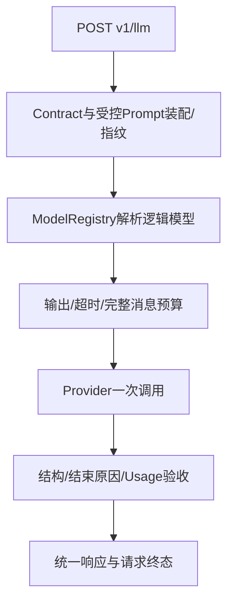

# F3：配置、真实Provider与预算——代码实现导读

> 2026-11-01新增导读。原F3已验收；后续职责拆分见[O1导读](optimizations/O1/implementation-summary.md)。历史设计/测试/审查保持原文，本导读链接当前源码，保留F3行为背景。

## 1. 问题与行为变化

F2负责受控Prompt装配；F3补齐按逻辑名选择模型/Provider、完整消息Token预检、输出/总超时预算、真实HTTP/SDK接入、文本结果验收和调用元信息。普通成功data只保留text/usage，实际模型、尝试数及结束原因进入内部Trace。调用方不能覆盖地址、密钥或System。

## 2. 核心调用链与组件

普通调用和主动探测共享Gateway主链；GET healthz仅存活。具体计数资源、注册选择与Provider资源装配在O1之后各归对应组件，原先main/TokenBudget的职责已拆分，读取当前代码时按下面顺序。

## 3. 建议阅读顺序

| 顺序 | 当前源码入口 | 读完应能回答 |
| --- | --- | --- |
| 1 | [main.create_app](../../../src/main.py) | 应用加载哪些依赖、由谁拥有客户端？ |
| 2 | [models.ModelConfig/ModelRegistry/load_registry](../../../src/services/models.py)与[credentials.load_credentials](../../../src/services/credentials.py) | 模型、Provider、凭据引用怎样关联，错误何时拒绝？ |
| 3 | [contracts.LLMRequest/Usage/LLMData](../../../src/contracts.py)与[routes.complete/probe](../../../src/api/routes.py) | 调用方能传什么，成功和失败怎样表达？ |
| 4 | [gateway.GatewayService._complete](../../../src/services/gateway.py) | 为什么先预算再建立尝试，如何区分超时与程序错误？ |
| 5 | [providers.base.parse_response/validate_result/error_for_status](../../../src/providers/base.py) | HTTP成功为何不一定是文本成功，Usage怎样验收？ |
| 6 | [DeepSeekProvider](../../../src/providers/deepseek.py)与[OpenAICompatibleProvider](../../../src/providers/openai_compatible.py) | 直接HTTP和SDK各自怎样映射参数与异常？ |
| 7 | [TraceStore](../../../src/services/trace.py)与[RequestContextMiddleware](../../../src/middleware/request_context.py) | 请求与尝试如何关联，什么时候才可记成功？ |

## 4. 关键设计与取舍

Gateway管理一次模型调用，不执行Agent工具或退款。Provider返回候选文本不证明业务事实正确。模型配置关联Provider与计数策略，两者不一一绑定；本地计数不冒充供应商Usage。固定资源离线验证，无字符估算回退；超限不裁剪、不降低预算。

Provider创建的连接复用并按应用生命周期释放，注入对象由测试持有。错误文案固定安全；Trace不默认保存Prompt、回答或Key。F3没有自动重试/fallback，general-backup需要显式选择。

## 5. 成功、拒绝与失败定位

示例：context_answer@1.1.0+订单A123资料→6条完整消息→计数/预留输出→指定Provider一次调用→stop和合法Usage→text/usage。先由响应头X-Request-ID关联内存Trace（当前没有查询API）。

| 现象 | 定位入口 |
| --- | --- |
| 启动配置/凭据错误 | models/credentials及计数初始化；无请求或模型调用 |
| missing_prompt_variable等 | prompts.build_messages，零尝试 |
| invalid_output_budget/invalid_timeout/context_length_exceeded | gateway/token_budget，拒绝前无模型调用 |
| 认证/限流/连接/超时 | providers错误映射与AttemptTrace；不透传原始错误正文 |
| output_truncated/损坏响应 | base解析/结束原因验收，部分文本不包装成功 |
| 未完成发送 | middleware只在完整ASGI正文发送成功后收口，不误记成功 |

## 6. 验证与边界

历史[F3测试方案](test-plan.md)记录离线570通过、真实四例与Claude Code第2轮APPROVED；该数字是F3历史，不代表O1重新验证结果。[O1测试](optimizations/O1/test-plan.md)维护新回归和导读核对。单实例、单worker、本机/隔离网络；资源元数据的最大窗口不是极限实测，四次计数对齐不保证通用一致性。Schema、SSE、取消、恢复、持久化按后续Feature推进。
