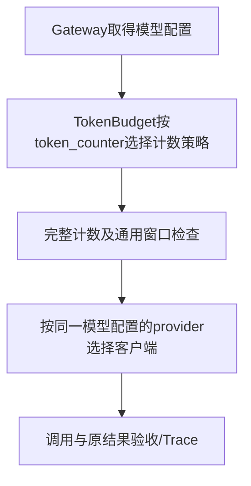

# F3-O1：应用组装、计数策略与代码导读

> 状态：验收通过（2026-11-01）。2026-11-01，用户已确认整体设计、测试范围、token_counter显式必填，并明确授权落文档及TDD实现。

## 1. 目标与边界

关联基线：[F3验收](../../test-plan.md)。原HTTP字段/错误码、Prompt/指纹、预算公式、超时边界和Trace语义保留；本次新证据独立保存，不改写原F3历史。三项范围为代码导读规范、main职责整理、通用预算与模型计数分离。当前Mock运行配置及实际凭据/.env不修改；本地切换真实配置不是Bug，本次不引入测试隔离修复专项。

不新增模型、动态插件、Router、重试、Schema、SSE、持久化或统一应用容器。现有两种真实适配器和Mock仍遵守同一Provider协议。

## 2. 最小方案

| 文件 | 输入/输出及职责 |
| --- | --- |
| main.py | 加载Settings/Prompt/ModelRegistry，初始化预算及Provider装配，挂载state/路由/异常/Middleware；lifespan只挂载客户端集合 |
| services/models.py | 模型定义、预算关系、Provider引用、只读查询；不管理SDK/连接 |
| services/token_budget.py | 按model.token_counter查找统一接口，验证绑定并进行通用预算检查 |
| services/token_counters/base.py | TokenCounter协议及TokenCount输入计数/版本结果 |
| services/token_counters/__init__.py | 受控工厂字典，只构造当前配置引用的策略，无动态导入 |
| services/token_counters/deepseek_v41.py | 迁移原计数资源校验和完整文本消息编码，保留固定资源/黄金，具体模型兼容性封装在这里 |
| providers/factory.py | 保留create_provider，增加ProviderClients装配对象，封装注入归一化、凭据及open上下文管理；不依赖FastAPI |

ProviderClients不是统一应用容器，只管理Provider资源；保留provider/providers两种互斥注入方式。instances在创建后即提供只读注入集合；工厂客户端延迟到open构造。凭据在本地初始化阶段解析，不远程探测。open在失败/退出时尝试关闭所有自有客户端，注入对象不关闭。

通用层不比较具体model_id；具体配置/资源/专用实现允许具体标识。同Provider可不同策略，不同Provider可共享策略。相同算法/不同资源可复用实现，只有必要时才新增算法策略；本次只有一个真实策略。

## 3. 契约

ModelConfig.token_counter改为非空必填字符串，移除供应商专属默认值。缺失/空白/错类型拒绝；未知策略、模型/模式不兼容或资源无效在客户端创建前拒绝。未知策略校验从定义类型枚举移至启动注册校验，不放宽可执行配置。当前YAML已有字段，无需迁移。

TokenCounter提供supports(model)、count(messages)、version；TokenBudget持有复制后的只读策略集合，validate_models检查全部配置，count(model,messages)返回TokenCount(input_tokens,counter_version)。Gateway先记录本次策略版本，再计数，以保留原计数异常时记录语义；窗口拒绝仍保留计数/版本/指纹/生效预算，零尝试。预算公式仍为输入+输出+余量<=窗口。

固定顺序：结构/Prompt/指纹→模型→输出/超时预算→策略计数/窗口→尝试/Provider→结果验收。输出/超时错误不触发计数。HTTP响应和错误分类不变；未知计数策略等是启动配置错误，不增加HTTP错误码。

代码导读模板放docs/templates/代码实现导读模板.md，Feature/独立优化各自implementation-summary.md，覆盖前后变化、组件调用链、文件/类/函数阅读顺序、设计取舍、成功失败定位、证据链接与边界。实现稳定/独审前产出，代码修复同步。当前补F3及本O1，历史设计/验收工件不改写。

## 4. 验收边界

用户已确认[测试方案](test-plan.md)：行为、零/一次调用、生命周期、计数黄金、Trace及并发隔离，离线/协议/进程和真实四例分层验证。全部必测和Claude Code无P0–P2才验收，最多三轮；不以静态扫描代替行为测试。

## 5. 状态与实施步骤

采用writing-plans/TDD及分任务执行；项目约定优先，不建Git工作树/分支、不提交，独立审查只用原生Claude Code。

1. 保存src/tests、运行配置和历史文档指纹；运行uv run python -m pytest -q，记录基线。
2. 新建tests/unit/test_f3o1_counters.py：先以现有ModelConfig验证缺省策略拒绝Red；在可导入接口上测试策略注册/兼容性及两模型分派Red，再迁移计数实现及模型配置Green。旧黄金改测具体实现，期望字节/Token不变。
3. 新建tests/integration/test_f3o1_dispatch.py：不同策略/Provider组合、24+16+8边界、错误优先级、受控并发/版本Trace。按Red/Green迁移Gateway及测试计数fixture，保留原断言。
4. ProviderClients先测注入/生命周期Red，再迁移factory及main。旧main.create_provider/load_credentials的spy移到新职责模块；不是删除原生命周期验证。
5. 回归、四真实调用、代码导读/AGENTS/README同步；核对历史指纹和用户配置不变。产出当前变更差分与证据供原生Claude Code审查，处置发现后原场景复测。

每步实际命令与输出保存在本项目录evidence.json。旧测试的内部签名/patch位置迁移单独核实；当前真实凭据只由显式live读取，不输出或改写。

实施完成：606离线/4显式真实通过，Claude Code第1轮APPROVED。三项交付及P3处置见测试方案；原运行配置与历史工件未改。
