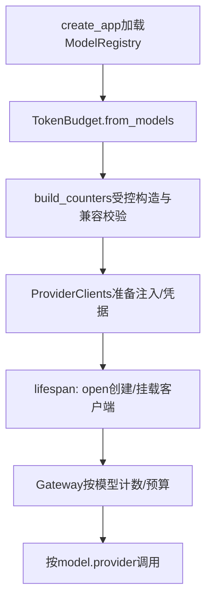

# F3-O1：职责拆分与计数策略——代码实现导读

> 状态：验收通过（2026-11-01）。[设计](design.md)、[测试与实际证据](test-plan.md)。文件/类/函数入口已对照当前实现核验。

## 1. 问题与行为变化

main原本同时判断具体型号、规范化Provider注入和管理连接关闭；TokenBudget同时持有通用预算公式与DeepSeek专用分词。现在通用代码只依赖模型配置和计数协议。token_counter从供应商专属默认值变成显式必填字符串，未知标识仍在启动注册校验中拒绝。外部HTTP、Prompt与指纹等原行为保留。

## 2. 核心调用链与组件

ModelConfig同时声明provider和token_counter，但两字段职责独立。相同Provider的模型可以选不同策略，不同Provider可以共享同一策略。当前只有一个真实计数实现，测试策略不代表支持新真实型号。

## 3. 建议阅读顺序

| 顺序 | 文件/函数 | 读完应能回答 |
| --- | --- | --- |
| 1 | [ModelConfig.token_counter](../../../../../src/services/models.py) | 配置结构校验与策略存在性校验如何分工？ |
| 2 | [TokenCounter/TokenCount](../../../../../src/services/token_counters/base.py) | 通用协议与计数/版本结果是什么？ |
| 3 | [build_counters](../../../../../src/services/token_counters/__init__.py) | 怎样构造所引用策略，为什么未知键先拒绝？ |
| 4 | [DeepSeekV41Counter](../../../../../src/services/token_counters/deepseek_v41.py) | 专用编码、资源摘要与支持关系藏在哪里？ |
| 5 | [TokenBudget](../../../../../src/services/token_budget.py) | 怎样按模型选择策略，怎样检查窗口？ |
| 6 | [ProviderClients](../../../../../src/providers/factory.py) | 注入、凭据与连接所有权如何集中管理？ |
| 7 | [create_app](../../../../../src/main.py)与[GatewayService._complete](../../../../../src/services/gateway.py) | 启动怎样组装，调用时怎样记录正确的策略版本？ |

## 4. 关键设计与取舍

采用受控工厂字典而非动态插件；ProviderClients只管理Provider资源，不是统一应用容器。专用型号只出现在配置/资源或专用实现中，主链不按供应商名分支。固定资源原编码/黄金不变；每次计数携带资源版本，调用拒绝仍保留已取得元信息。

## 5. 成功、拒绝与失败定位

成功：模型a选择策略a计数→检查预算→模型配置的Provider→原结果验收。启动拒绝：缺策略字段在ModelConfig；未知策略在build_counters；不兼容模型/模式在TokenBudget；资源错误在专用计数器；均先于Provider构造。调用期间错误继续由gateway/base及middleware处理。跨模型串线先查配置的token_counter及Trace版本，不根据Provider名称推测策略。

## 6. 验证与边界

已执行离线606通过、真实4通过；原生Claude Code第1轮APPROVED、无P0–P2，实际回执见[test-plan](test-plan.md)。独立黄金检验算法，测试计数器检验分派和窗口算术，真实HTTP/Provider验证当前组合；不新增其他模型、重试或配置管理。代码导读是本项交付的一部分，独立审查前将核对所有文件/函数入口。
