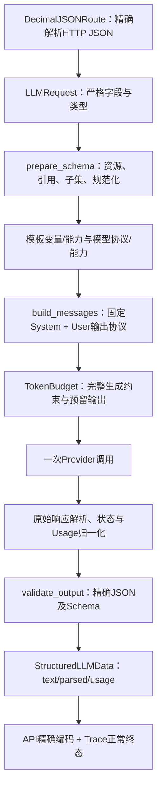

# F4：Structured Output 与 Responses——代码实现导读

> 状态：验收通过；更新于 2026-11-01。对应 [设计](design.md)、[测试与执行证据](test-plan.md)、[调用方完整规则](../../response-schema.md)。功能验证及原生Claude Code第1轮独立审查通过。

## 1. 问题与行为变化

F3 只能完整返回文本，两种真实适配器都使用 Chat。F4 在同一 POST /v1/llm 增加 response_schema：在调用前验证约束，在上游完整返回后严格解析 JSON、检查 Schema，全部通过才返回 parsed。DeepSeek 继续 Chat JSON mode，OpenAICompatible 改用 Responses 原生 Schema；上层仍只选择逻辑模型和受控模板。

普通文本的 data 仍只有 text/usage，探测仍为16输出Token/10秒、成功只返回latency_ms。没有重试、修复、备用切换、流式或业务操作。默认两条Mock保留，但默认MOCK_REPLY不是JSON；结构化成功测试使用显式脚本Mock或真实Provider，不让Mock自动编造任意Schema结果。

实施中发现默认JSON浮点解析会改变约束数值。用户确认完整十进制保真后，新增一个共享json_codec模块，不在四处各写一套转换。Schema、计数、实际出站与parsed都保留JSON数字；不将Decimal转float或字符串。

## 2. 核心调用链与组件

json_codec负责值的表示，validation负责是否符合协议；Provider负责实际网络与上游结构，GatewayService负责顺序和Attempt。HTTP信封/请求完成仍归API与原middleware，不让校验器创建HTTP响应或决定业务动作。

## 3. 建议阅读顺序

| 顺序 | 文件及类/函数 | 读完应能回答的问题 |
| --- | --- | --- |
| 1 | [contracts.py](../../../src/contracts.py)：LLMRequest、StructuredLLMData、SuccessResponse | 为什么省略Schema与显式null不同？为什么文本响应没有parsed:null？ |
| 2 | [gateway.py](../../../src/services/gateway.py)：GatewayService._complete | 调用前/后各检查什么，在哪里创建Attempt，什么时候才允许成功？ |
| 3 | [validation.py](../../../src/services/validation.py)：prepare_schema、_schema_nodes、_references、_expanded_resources | 怎样区别Schema节点和注解数据？重复引用与循环如何区分？ |
| 4 | [models.py](../../../src/services/models.py)：ProviderConfig、ModelRegistry | api_protocol与structured_output_mode各归谁，不兼容时为什么在启动拒绝？ |
| 5 | [prompts.py](../../../src/services/prompts.py)：validate_selection、build_messages、STRUCTURED_SYSTEM | 1.2.0如何保留固定System，只有User承载应用输出协议？ |
| 6 | [token_budget.py](../../../src/services/token_budget.py)及[专用策略](../../../src/services/token_counters/deepseek_v41.py) | 两种约束怎样计入完整编码，为什么不能只计messages或加固定22？ |
| 7 | [deepseek.py](../../../src/providers/deepseek.py)、[openai_compatible.py](../../../src/providers/openai_compatible.py) | 同一请求如何分别变成Chat与Responses，零重试和资源所有权是否保留？ |
| 8 | [providers/base.py](../../../src/providers/base.py)：parse_response、parse_responses_response、validate_result | 为什么HTTP200/completed仍可能失败？原始结束信息与归一结果如何分开？ |
| 9 | [json_codec.py](../../../src/utils/json_codec.py)与[validation.py](../../../src/services/validation.py)：validate_output | 怎样避免1.0000000000000001变成1.0后误验收？ |
| 10 | [api/routes.py](../../../src/api/routes.py)：DecimalRequest、DecimalJSONRoute、structured_response | 精度在哪个HTTP层保留，为什么使用精确编码而不是Pydantic默认Decimal字符串？ |
| 11 | [trace.py](../../../src/services/trace.py)与[请求middleware](../../../src/middleware/request_context.py) | 如何按request_id区分零调用拒绝、上游完成但Schema失败和真正成功？ |
| 12 | [f4_cases.py](../../../tests/f4_cases.py)、[Gateway测试](../../../tests/integration/test_f4_gateway.py)、[协议测试](../../../tests/protocol/test_f4_providers.py) | 测试究竟替换哪里，怎样证明实际出站参数和副作用，而非只检查状态码？ |

源码链接维护：JSON 工具已由 [F4-O1](optimizations/O1/design.md)原样迁至 `src/utils/`；此处只更新阅读路径，原 F4 验收结论与工件不变。

## 4. 关键设计与取舍

**Schema先预检，之后才装配。** JSON mode把Schema放到User，原生Schema走API参数；只有确定模型模式才能生成最终messages。无Schema保持F3的既有顺序，因此未知模型时能否取得完整消息指纹取决于所走路径，不伪造部分指纹。

**复杂度限制是图验收。** 原始容器深度32、结构深度8、原始/展开节点各256及16384字节分别检查；所有定义都检查，展开只计数不生成巨型文档。refs/anyOf约束同一JSON位置，容器不重复计层，属性和items进入下一位置；共享定义按使用位置重复计数，active路径只判循环。

**精确JSON单独成组件。** json_codec.loads使用Decimal处理小数/指数，大整数必要时也用Decimal；dumps按JSON数字输出。Schema规范化排序键、保持数组顺序；参考计数使用同一值与参考空白格式。四个长度/数量参数的标准元Schema类型差异只在私有元校验副本处理，不改实际约束。其余jsonschema语义由校验库完成，不手写一套标准。

**SDK继续承担真实接入。** 当前资源helper的默认编码器不能表示Decimal，因此使用同一AsyncOpenAI的公开post('/responses',content=bytes)，SDK仍负责认证、网络、超时和异常。不是自行绕开SDK，也没有monkey-patch；协议测试使用真正SDK与回环服务，检查字节中的小数仍为原值。

**计数视图与出站消息分开。** Chat的完整Schema已计入User，还须计API的json_object格式标志；Responses计原生Schema本体。虚拟Response Format说明只用于专用计数策略，不修改实际System。首次真实Chat结构化出现+22差异后，定位到格式标志，依据完整编码修复，未硬加22或提高余量。资源revision与计数规则版本分开记录。

**已完成生成不代表已验收。** 只有完整状态、有效文本、严格JSON、Schema都通过才完成Attempt。截断、拒答和过滤优先收口；合法Usage在后续JSON/Schema失败时保留。这里不判断A123事实是否正确，不授予退款或创建工单权限。

## 5. 成功、拒绝与失败定位

使用规则文档中的A123请求：入口生成request_id；Schema取得独立指纹；1.2.0绑定资料与输出协议；预算通过后调用一次；成功得到text/parsed/usage。响应头X-Request-ID关联内存请求和Attempt，当前没有Trace查询API。

| 现象 / 错误 | 先读哪里 | 观察证据 |
| --- | --- | --- |
| invalid_request | DecimalJSONRoute、LLMRequest、集中错误处理 | 字段/角色/类型或严格JSON错误；零调用 |
| invalid_response_schema | prepare_schema与完整规则 | 子集、引用、资源；零调用，不保存原Schema |
| unsupported_capability | 模板标志、ModelRegistry、Gateway | 模板或模型模式不满足；零调用 |
| prompt_too_long / context_length_exceeded | build_messages、TokenBudget | 分别看字符/完整Token，不裁剪或重试 |
| provider_* / output_truncated | 适配器与parse/validate_result | 看api_protocol、原始状态、归一原因；一次失败Attempt |
| invalid_json / schema_validation_failed | validate_output | 上游可能completed，但请求与Attempt都failed；保留合法Usage |
| 数值看似相同却判断不同 | json_codec与Schema canonical | 核对十进制真实值，不先转换float再比较 |
| input_tokens与预检不同 | 策略encode及counter_version | 区分messages、API格式标志/Schema、输出预留与实际Usage；不盲增余量 |

仅记录受控元信息和指纹，不记录完整消息、回答、Schema、密钥或任意上游error.message。未知Usage保持null，不用本地计数充当实际用量。

## 6. 验证与边界

[逐例方案与实际回执](test-plan.md)记录基线、各切片Red/Green和中途失败；[evidence.json](evidence.json)保留原始输出，不以最后通过覆盖历史失败。最终默认离线836 passed/6 skipped；Python3.12关键集233 passed，弃用警告视为错误。全量含Mock、真实协议转换及4个实际进程场景，不能把它们当作外部服务证明。

最终真实六例6 passed，最新回执为live-release-results.xml；此前3次首轮+4次修复/余下验证保留，累计19次本功能真实调用（含编码器边界修复后的新一轮六例）。六个最终样本的计数差值均为0，只证明当前模型/模式与这些输入，不保证所有输入精确一致、供应商内部任意精度处理或生产可靠性。

原生Claude Code第1轮APPROVED、无P0–P2，56份清单文件及2份证据均读取，66份源码/测试/默认配置摘要前后一致。两项P3观察的核实处置见测试方案3.9，本项验收通过。F5继续流式，F7继续受控恢复，F8继续持久化，不在本次提前实现。
