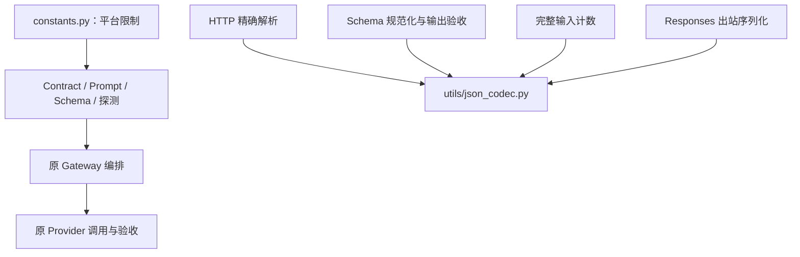

# F4-O1：平台常量与 JSON 工具整理

> 状态：验收通过。实现与回归完成，原生 Claude Code 第2轮APPROVED；首轮文档发现及二轮P3处置见测试方案。
>
> 对应[测试方案](test-plan.md)。沿用[项目工作流](../../../../../AGENTS.md)和[文档约定](../../../../AGENTS.md)。

## 1. 目标与边界

- 关联基线：[F4 设计](../../design.md)、[原测试与验收](../../test-plan.md)、[实现导读](../../implementation-summary.md)。F4 已验收；本项独立编号 F4-O1，新证据只在本目录归档，不重写 F1–F4 的历史验收工件。
- 前置能力：统一请求、受控模板、模型预算、Chat/Responses 适配、Schema 验收与十进制保真均已存在。
- 完成后：维护者能在 `src/constants.py` 查看本项平台限制，在 `src/utils/json_codec.py` 找到共享 JSON 编解码；调用方请求与结果行为保持一致。
- 必须做：提取下表平台常量；HTTP 状态码使用框架常量；迁移 JSON 工具并更新全部有效引用；验证边界、出站字节、指纹、调用次数及 Trace 无回归；同步当前源码阅读入口。
- 不做：调整任何限制数值、接口、模型能力、Prompt 内容/版本、错误分类或恢复策略；不把所有字符串/数字机械搬入常量文件；不迁移其他工具、不新增配置开关、兼容导入层或依赖。Streaming、恢复、多实例仍归后续 Feature。
- 稳定基础：后续功能可复用明确命名的限制和唯一 JSON 工具，不能因此绕过 Schema/预算校验。

## 2. 最小方案

### 2.1 平台常量

`src/constants.py` 仅包含不可变平台常量，不读取配置，不导入服务、Provider、HTTP 路由或工具。各调用处显式导入所需名称，不使用通配导入。

| 常量 | 保留值 | 现有消费位置 / 语义 |
| --- | --- | --- |
| `MAX_USER_MESSAGE_CHARS` | `20_000` | `contracts.py`：用户原始消息长度 |
| `MAX_RENDERED_USER_CHARS` | `20_000` | `services/prompts.py`：含标签、变量及输出约定的最终 User 长度 |
| `MAX_CONTEXT_VARIABLE_CHARS` | `10_000` | `services/prompts.py`：现有三版 context 模板的变量定义 |
| `MAX_SCHEMA_BYTES` | `16_384` | `services/validation.py`：原始资源预检及规范化 UTF-8 大小 |
| `MAX_SCHEMA_RAW_DEPTH` | `32` | 同文件：原始 JSON 容器深度 |
| `MAX_SCHEMA_EXPANDED_DEPTH` | `8` | 同文件：引用展开后的业务容器深度 |
| `MAX_SCHEMA_RAW_NODES` | `256` | 同文件：原始 Schema 节点上限 |
| `MAX_SCHEMA_EXPANDED_NODES` | `256` | 同文件：引用展开后的节点上限 |
| `PROVIDER_PROBE_MAX_OUTPUT_TOKENS` | `16` | `services/gateway.py`：主动健康探测的固定输出预算 |
| `PROVIDER_PROBE_TIMEOUT_SECONDS` | `10` | 同文件：主动健康探测的固定超时 |

同值而含义不同的限制保留不同名称，比较符、边界计数方式及校验先后顺序不变。最后两项是固定探测策略，不是模型 YAML 中的默认或最大调用预算。

错误文案与接口描述引用本项限制时使用同一来源，保留当前可见文本（例如 `20,000`、`16 KiB`），不得因格式变化修改 Prompt 内容或返回契约。

### 2.2 HTTP 状态码与保留项

源码中代表 HTTP 状态的裸数字统一改用 `starlette.status` 的既有名称。Starlette 已是当前应用依赖，不增加新包。使用导入别名 `http_status`，避免与现有函数参数、局部变量及字典推导变量 `status` 冲突。

- 覆盖路由声明、应用错误处理、middleware、Gateway/模板/预算/模型/Schema 错误、Provider 默认错误与上游错误映射。
- 同时核对上游状态与对外状态，不改变映射、错误码、文案、错误优先级或 OpenAPI 响应集合。
- `>= 500` 之类范围判断只替换相同数值的起点，保持当前比较语义；运行时收到的状态码仍是整数。
- 不新增自定义 HTTP 常量表，不把错误码/文案重构成本项未讨论的统一错误枚举。

以下内容保留职责归属：Prompt 正文/Few-shot/模板在 `services/prompts.py`；Schema 关键字、类型集合和 dialect 在 `services/validation.py`；Tokenizer 版本、摘要和参考格式在具体计数器；模型窗口、默认/最大输出和超时预算在 YAML；毫秒换算等普通算法数字保留原处。

### 2.3 JSON 工具迁移

```text
src/
├── constants.py
├── utils/
│   ├── __init__.py
│   └── json_codec.py
├── api/
├── middleware/
├── providers/
└── services/
```

将 `src/json_codec.py` 原样迁移至 `src/utils/json_codec.py`，新包的 `__init__.py` 不装配依赖、不重导出兼容接口。新导入为 `from utils.json_codec import dumps, loads`（按调用处实际需要选择）。移除旧文件，不保留两份实现或旧路径代理。

当前生产调用处为 `api/routes.py`、`services/validation.py`、`services/token_counters/deepseek_v41.py`、`providers/openai_compatible.py`，另有 `tests/unit/test_f4_json_codec.py`。实施时重新扫描有效源码、测试和当前文档，避免遗漏动态引用；历史证据中的旧路径是当时事实，不批量改写。

调用关系保持：



常量与工具都是被依赖方，不能反向导入业务组件；此次不改变 HTTP 包装、Prompt 装配、终态记录的责任归属。

## 3. 契约

### 3.1 外部协议保持不变

请求、完整成功/失败样例与边界继续以[接口契约](../../../../contracts.md)、[Schema 规则](../../../../response-schema.md)及 F4 基线为准，本项不新增请求字段或路由。

- 输入长度、最终 User 长度、context 长度、Schema 字节/深度/节点上限均保持原数值和计量单位。
- 普通成功 `data` 仍为 `text/usage`；结构化成功增加 `parsed`；四字段信封和响应头 `X-Request-ID` 不变。
- 调用前拒绝：Provider 调用及 Attempt 均为 0；调用后 JSON/Schema 失败保留一次失败 Attempt；不重试或 fallback。
- HTTP 状态码、业务错误码、安全文案、校验顺序、Trace 字段及未知 Usage 的 null 语义不变。
- System/Few-shot/User 最终内容、消息与 Schema 指纹、计数资源及计数规则版本不变。
- 健康探测仍使用固定 16 输出 Token/10 秒，不改变探测消息或结果字段。

### 3.2 保留精度，不收窄数值类型

保持完整十进制处理：接收、Schema 规范化、输出解析、计数、Responses 出站及 HTTP `parsed` 均不先转为二进制浮点；Decimal 输出为 JSON 数字，不变成字符串。

可以由具体字段的 Schema 约束正整数，但不能把所有数值限制成正整数。`1.0000000000000001` 不能因解析舍入而满足 `integer`/`const: 1`；合法金额小数仍可接受。原有 `1.0` 的 JSON Schema 整数语义、重复键拒绝、非有限数拒绝、大整数及深层输出行为不改变。

本项只整理既有实现，不引入新的供应商协议结论或外部能力声明。

## 4. 验收边界

逐组用例与命令见[测试方案](test-plan.md)。核心证据为迁移前后同一离线回归、独立固定边界预期、实际协议出站字节及本地 HTTP/Trace；不能只检查模块可导入。

默认不读取实际凭据、不修改用户 `.env`/配置、不访问真实 Provider。本项是源码整理，不新增必须付费的真实调用；既有真实六例只作历史依据，不写成本项新实测。Python 3.12 关键路径、完整离线回归和原生 Claude Code 只读代码审查须在实施后完成。

## 5. 状态与交接

- 已确认：平台限制集中、HTTP 使用框架常量、JSON 工具迁移、保留十进制精度且外部行为不变。
- 设计和测试方案均已确认，按[实施步骤](implementation-plan.md)执行。存在影响行为的新问题时回到需求讨论。
- 实现与回归完成，第1轮目录树和状态发现已修正，第2轮APPROVED；实际回执及两项P3的证据来源/归档处置见[测试方案3.7](test-plan.md#37-第2轮与最终验收)。
- README、项目 AGENTS、进度、架构与当前 Schema 示例导入已同步；原 F4 导读仅修正源码链接并注明来源，不重写历史验收。
- 模板回看：初次确认原模板可承载独立优化基线、保留契约、副作用及证据；随后同步用户确认的三维审查框架。首轮实际发现目录树漏迁移，已补充测试模板对目录树/非链接路径/状态的核对，并完成原场景失败与通过验证。纯迁移策略仍留在本项；本次发现说明实际缺口已闭环，不推断整体缺陷检出率提高。
