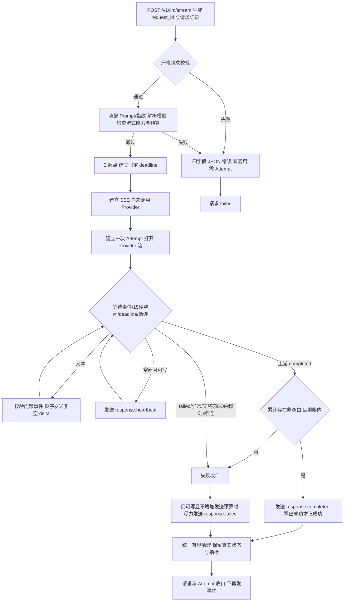

# F5：Streaming 文本增量与执行收口

> 状态：验收通过。2026-11-01，用户已分别确认本文完整设计与[逐例测试方案](test-plan.md)，授权按实施计划/TDD推进。此前分段需求确认、文档自检与本次完整设计确认分别记录。
>
> 本文契约已实现；最终离线1099、Python3.12关键235及最新真实两例通过，原生Claude Code第2轮APPROVED；一项P3已补HTTP两例。实际执行与历史阶段分别见测试方案。

## 1. 目标与边界

### 1.1 前置与交付

基于 [F4](../F4/design.md) 与 [F4-O1](../F4/optimizations/O1/design.md)，新增 `POST /v1/llm/stream`。内部 Agent 使用同一逻辑模型、受控 Prompt 与预算体系，在 Provider 尚未结束时就能收到文本增量；明确区分正常完成、失败与未完整收到终态。

必须做：

- 单独的严格流式请求模型；不支持的参数不出现在 OpenAPI 中。
- 显式模型流式能力、统一 Provider 事件、Mock/Chat Completions/Responses 三种实现。
- 真增量 SSE、15 秒空闲心跳、固定总期限、单一串行发送出口与受控读取。
- 正常/失败终态、断连与超时清理、最小请求/Attempt 元数据及时间指标。
- 四层测试、F1—F4 回归、两条真实流式接入和原生 Claude Code 三维独审；实际执行后才记录验收。

### 1.2 不做与后续基础

不做结构化流式输出、工具/图片/音频、调用方历史消息、自定义 System、任务编排和业务授权。F5 一次请求至多一次 Provider 尝试，无重试、fallback、自动增加预算或裁剪；恢复留 F7。主动取消接口与 `response.canceling`/`response.canceled` 留 F6，**当前断连的最低清理属于 F5**。SQLite、Trace 查询接口和保留期留 F8；多实例/多 worker/公开访问、Router、限流和模型管理留 1.7。

不增加事件序号、历史事件保存、断点续传或自动重连。断线后重新提交是新调用，可能重新计费、产生不同回答。不给后续功能预建空接口；提供可复用的统一事件、单次执行生命周期与真实指标即可。

### 1.3 保留基线

普通 `/v1/llm`、F4 精确十进制与 Schema 验收、主动探测和存活检查保持原有语义。静态 Prompt/Few-shot 正文、版本及原有黄金资源不变。默认配置仍为两条 Mock，ENV 与 Provider 分离，凭据仍由维护者在本机独立文件配置。实现时必须给现有模型 YAML 和测试配置显式补上能力字段；文档阶段不修改运行配置。历史验收工件不改写。

## 2. 最小方案

### 2.1 组件与职责

文件位置已按本项方案落地；仅新增流式执行和必要传输文件，其余扩展已有组件，不重构普通调用全链。

| 组件 / 文件 | 输入 → 输出 | 唯一职责 / 依赖 | 缺失后的问题 |
| --- | --- | --- | --- |
| `src/contracts.py` | HTTP 数据 → 严格流式请求；平台事件数据 | 请求不继承含 Schema 的公开模型；复用已有 Prompt/消息/Usage 类型 | 不支持字段仍进入请求文档，或两套边界漂移 |
| `src/services/models.py`、`src/providers/factory.py` | 配置与注入实例 → 能力校验后的绑定 | 前者校验严格能力声明；后者核验实际适配器/注入实例实现和客户端所有权 | 配置声称支持，调用后才发现没有实现 |
| `src/services/prompts.py`、`token_budget.py` | 模板、User、模型预算 → 最终消息/指纹/预算 | 沿用既有装配与计数，不为流式增加另一套 Prompt | 流式绕过字符或 Token 上限 |
| `src/providers/base.py`、三个适配器 | 统一参数 → `ProviderStreamEvent` 异步流 | 转译供应商协议、校验上游原始类型、汇总终态 Usage；原始协议止于此层 | Gateway 依赖 `finish_reason` 或供应商事件名 |
| `src/services/gateway.py` | 流式请求 → 已预检的单次执行参数 | 唯一业务入口；复用最小公共预检步骤，保持 F3/F4 旧错误顺序 | 路由绕过能力/预算，各入口规则不一致 |
| `src/services/streaming.py`（新增） | 已预检参数、Provider、可等待的发送出口 → 执行/终态/清理 | 总期限、心跳调度、顺序读取、非空判断、唯一终态和资源清理；不编码 HTTP | 发送等待不在期限内、任务遗留、重复终态 |
| `src/api/routes.py`、`src/api/sse.py`（新增） | HTTP/ASGI ↔ SSE 字节与断连通知 | 编码及实际发送；发送协程完成后才向执行层确认；不解析 Provider 协议 | 文本换行破坏事件，或仅 yield 就误认为已经发送 |
| `src/middleware/request_context.py`、`src/services/trace.py` | 请求 ID、执行观察 → 请求/Attempt 记录 | Middleware 承担 ID/入口失败；流式执行组件承担已交接后的终态；防重复收口 | HTTP 200 或最终空 body 被误记为成功 |
| `src/constants.py` | 平台固定限制 | 存放心跳与清理时限，使用既有 HTTP 状态常量方式 | 魔法数散落，难以对应测试 |

Provider 的共享客户端属于应用 lifespan；每次流的读取任务和上游响应属于本次执行。断开一个流只能关闭该流，不能 `aclose()` 共享客户端或影响并发请求。Mock 的客户端关闭计数与单次流关闭计数分开。

### 2.2 执行主链



预检通过后将终态所有权明确交给流式执行层；在其接管前发生的本地异常仍由入口统一收口。开始响应头发送后不能切回 JSON。SSE 的建立/响应头实际发送也受总期限约束；若此时失败且尚未打开 Provider，则仍为零调用/零 Attempt。

### 2.3 总期限、心跳和背压

- B 起点为本地预检完成、即将建立 SSE 的时刻。`deadline = B + 生效 timeout_seconds`；不包含 HTTP 入站/本地预检，也不是 Agent 整体任务 SLA。
- 期限覆盖响应头发送、Provider 建连/读取、所有实际下游发送等待。心跳、文本、上游内部事件都不延长 deadline。Provider 调用使用剩余预算，不重新获得完整超时时间；响应头发送返回后再次检查deadline，已过期则不创建Attempt/调用Provider。
- SSE 建立后、调用 Provider 前即可等待并发心跳调度。自上次成功写出事件后空闲 15 秒发送 `response.heartbeat`；首个间隔从响应头发送完成算起。文本写出后重新计算空闲间隔；空内部事件不重置。
- 心跳不证明 Provider 有进展，不属于回答、Usage 或 TTFT，也没有双向 ACK 保证。终态、超时或断连后不再启动新心跳。
- 一个发送出口串行处理文本/心跳/终态。不缓存完整回答、不设无界队列；当前增量发送完成后才请求下一条上游事件。等待上游时最多保留一次挂起读取，发心跳不取消/重建它；发送阻塞时不额外预取。
- 下游不可写时不能保证每 15 秒送达心跳；总期限仍生效。网络库/操作系统自带缓冲不等于应用没有背压，也不能保证远端模型立即停止计算。
- 总期限到达先停止执行，错误为 `request_timeout`；不为失败事件重置或额外分配发送预算，无法即时写出则关闭连接。清理独立有界，不继续等待生成或发送正文。

### 2.4 清理与终态竞争

所有出口进入同一个清理路径：停止心跳、取消/回收挂起读取、关闭本次上游响应。清理方法须可重复进入但实际资源只关闭一次；取消和关闭的异常被观察并处理，不留下悬空任务。关闭异常不能覆盖已有首因或已成功写出的终态。

| 时序 | 请求 / Attempt 结果 |
| --- | --- |
| 上游正常完成，非空白文本满足条件，完成事件成功写出 | completed / completed；后续断连不改写 |
| 上游已 completed，剩余文本或完成事件发送时断连/超时 | failed / failed；保留已确认的上游 completed 元信息与 Usage |
| 上游失败、协议错误或没有显式终态 EOF | failed / failed；连接仍可写时发送失败事件 |
| 总期限先到 | failed / failed（若已调用）；`request_timeout` |
| 客户端先断连 | failed / failed（若已调用）；内部 `client_disconnected`，不冒充主动 canceled |

发送终态仍在总期限内：即使先收到 Provider failed，若发送 `response.failed` 时阻塞到 deadline，最终请求/Attempt 的执行错误为 `request_timeout`；若期间明确断连则为 `client_disconnected`。保留已经确认的 Provider 失败分类作内部元信息（`provider_error_code`），不把上游失败误归为正常。完成事件发送阻塞同样以超时/断连收口。此优先级遵循“总期限包含实际发送”的已确认规则；清理异常则不改变这一最终执行原因。已经尝试发送终态时不再补发第二个终态。

完成条件与 deadline/断连由同一执行层串行裁决；写终态前再次检查期限和已知断连。完成事件未被确认写出时不能记录成功；一旦成功写出，不再启动第二个失败事件。只允许至多一个终态发送尝试；终态发送中断时记录失败，不再向同一连接追加另一个终态。

**工程约束（已随完整设计确认）**：清理采用单个固定 1 秒宽限（平台常量、非请求参数），各清理步骤共享，不逐项重置。它不增加生成/发送期限，仅限制取消与关闭；流式总耗时按实际执行结束记录，因此可能含这段清理。实现需证明本项目网络客户端能在取消后结束；不能宣称能强杀任意忽略取消的第三方协程。若实际依赖无法满足，应回到设计节点，不放任无界等待。

## 3. 契约

### 3.1 请求与预检顺序

| 字段 | 规则 |
| --- | --- |
| `model` | 必填非空字符串，逻辑模型精确匹配 |
| `prompt` | 必填 name/version；variables 沿用 F2，每项由受控模板决定 |
| `messages` | 恰好一条非空白 user；原文保留，最多 20,000 字符 |
| `max_output_tokens` | 可省略；提供时严格正整数，不允许 null/布尔/字符串/小数，受模型平台上限约束 |
| `timeout_seconds` | 可省略；提供时同上，受模型超时上限约束 |

`response_schema`、`stream`、`api_protocol`、原始供应商参数及其他额外字段均不声明，出现即 `422 / invalid_request`，包括 `response_schema:null`。OpenAPI 只列支持参数，不采用隐藏字段后运行期拒绝的方式。

```json
{
  "model": "general-primary",
  "prompt": {
    "name": "context_answer",
    "version": "1.1.0",
    "variables": {"context": "订单 A123 的商品为充电器。"}
  },
  "messages": [{"role": "user", "content": "订单 A123 的商品是什么？"}],
  "max_output_tokens": 128,
  "timeout_seconds": 30
}
```

预检顺序：严格 HTTP/字段校验 → 既有模板/变量装配与渲染长度、消息指纹 → 逻辑模型存在性 → 流式能力 → 输出预算 → 超时上限 → 完整消息计数/窗口验收。保持 F3 无 Schema 文本的既有顺序；不把当前流式顺序反向应用到 F4 Schema 路径。所有本地可确定的失败均发生在 B/SSE/Attempt 之前，零上游调用。

System、静态 Few-shot 与 User 模板沿用现有受控资产，不新增流式专用 Prompt、不临时追加 System。最终 User 20,000/context 10,000 字符及 Token 窗口约束同时有效；超预算直接拒绝。

### 3.2 模型能力与配置迁移

每个模型新增显式必填严格布尔 `supports_streaming`，无默认值。缺失/null/字符串/数字在启动拒绝。`true` 同时要求绑定的适配器具备流式实现；声明为 false 的模型仍可普通调用/探测，但流式请求以 `400 / unsupported_capability` 在 SSE 前拒绝。

默认两条 Mock 模型和静态测试注册表已显式补 `supports_streaming: true`；能力拒绝场景显式配置 false。真实接入仍为 DeepSeekProvider/Chat 和 OpenAICompatibleProvider/Responses，各自实现 stream。Provider 配置的 `api_protocol` 决定协议，请求不能选择。真实能力声明不替代真实验收。

启动校验兼顾受控 adapter 能力表及实际注入对象的流式方法；仅有方法名不是其行为正确的证据。模型声明 true 而显式注入对象缺少流式方法时启动失败，不能等请求到来报错。已验收测试替身需要最小迁移，不删除旧断言来绕过校验。新增字段不改变已有 model_id/token_counter 选择规则。

### 3.3 Provider 内部协议

新增异步 `stream(model, messages, *, max_output_tokens, timeout_seconds)`，使用与真实 Provider 相同的 Mock 契约；实现返回可aclose的异步生成器，执行层关闭它时退出Adapter的响应上下文，释放本次流。普通 `complete` 与 `ProviderResult` 不因 F5 重新命名或改语义。

统一 `ProviderStreamEvent`：

| 字段 | running | completed | failed |
| --- | --- | --- | --- |
| `delta`：严格字符串 | 可为空 | 可带最后一段文本 | 可带失败前最后一段文本 |
| `status` | running | completed | failed |
| `usage`：既有严格 Usage 或 null | 必须 null | 取得则给值，否则 null | 取得则给值，否则 null |
| `error_code` | 必须 null | 必须 null | 必须为已知平台 Provider 错误码 |

为落实已确认的 Generation 指标，内部来源标记为：`upstream_terminal_received`（严格布尔），running 必须 false、completed 必须 true；failed 仅在已收到并验收明确远端终态时为 true，网络/解析故障合成的 failed 为 false。它只帮助记录“是否观察到远端最终结果”，不透传供应商字段，也不改变按 status/error_code 收口的主链；这项内部布局已随本文完整设计确认，不改写此前分段讨论的确认范围。

可附带 `actual_model`、受控的上游状态/结束分类作内部诊断；不得携带原始异常、自由文本错误或 SDK 对象。Gateway 只依自身 status/error_code 决策，不根据上游原始 finish_reason/事件名分支。Usage 不做类型强转、不将未知变成 0，仍满足 input+output=total。

先校验完整内部事件，再发送其 delta，最后处理终态。`delta=""` 不发公开增量；空格/换行原样发出。`failed + 最后一段文本` 先发文本再发失败；completed 也支持同一事件带最后增量。累计是否有非空白只用标记，不拼装保存整份回答。只有明确 completed 且累计含非空白才允许公开成功；仅空白则 `provider_invalid_response`。

受控网络/HTTP/协议故障由 Adapter 转成 failed 事件；已有 `ProviderCallError` 可以作为适配器内部转换材料，不作为另一套预期流式返回协议。未预期 Python 异常由执行层记 `internal_error`，不伪装上游错误；客户端任务取消不得被宽泛捕获成 Provider 失败。未知状态、非法字段组合或迭代器无终态耗尽由执行层记 `provider_invalid_response`。消费首个终态后停止迭代并清理，绝不继续转发后续内容。

### 3.4 两条上游协议的完成证据

| 路径 | 文本来源 | 正常完成证据 | 失败归一化 |
| --- | --- | --- | --- |
| DeepSeekProvider / Chat Completions | 校验后的单一 assistant choice 的 content delta | 合法正常结束分类及协议 `[DONE]`；仅 `[DONE]` 或仅 EOF 不足 | length→output_truncated；过滤/拒答/不可用/HTTP/网络沿用平台分类；工具输出不作为文本成功 |
| OpenAICompatibleProvider / Responses | `response.output_text.delta` | 合法 `response.completed` 及其 response 正常状态；不要求 `[DONE]` | incomplete/max_output_tokens→output_truncated；failed、拒答、过滤按既有分类；output_text.done/output_item.done 不代表整次完成 |

Chat 请求 `stream:true`、`stream_options.include_usage:true`；DeepSeek 文档约定 Usage 在 `[DONE]` 前的最终 choice 块，不能硬套其他服务的独立 Usage 块布局。Responses 请求 `stream:true`、`store:false`，保持受控 input/非思考/预算；事件中的最终整份文本不能再次当 delta 发出。上游元数据/生命周期事件不计 TTFT、不重置下游心跳，不将未知输出事件当文本。

Adapter 使用真实 HTTP/SDK 的流式读取能力，禁止先读取完整响应再模拟增量；校验原始 JSON 类型与 Usage 后再构造平台对象，避免 SDK 自动转换掩盖非法类型。HTTP/SDK 隐式重试、环境代理和跟随重定向仍关闭。SSE 分帧解析可复用依赖的既有能力，不另造通用框架；分片、UTF-8、多行 data 和协议异常需有真实字节测试。

### 3.5 公开 SSE

成功建立后 HTTP 200、`Content-Type: text/event-stream`（UTF-8），响应头带 Gateway 生成的 `X-Request-ID`。每事件为 `event: <名称>`、`data: <单份 JSON>`、空行结束；JSON 编码转义正文换行/引号，解码后原文不变。公开 data 字段精确如下：

| event | data |
| --- | --- |
| response.delta | request_id:string、delta:string（非空，允许纯空白） |
| response.heartbeat | request_id:string |
| response.completed | request_id:string、usage:Usage或null |
| response.failed | request_id:string、code:string、message:string（安全固定消息） |

```text
event: response.delta
data: {"request_id":"example-request-id","delta":"订单 A123 的商品为充电器。"}

event: response.completed
data: {"request_id":"example-request-id","usage":null}

```

不返回四字段 JSON 信封、完整回答、parsed、actual_model、attempts、内部时间指标或供应商原始事件。不发 started/id/retry 字段。客户端仅看到 HTTP 200、心跳或无终态断流均不能判成功；重新提交不续接旧请求。

### 3.6 错误、调用次数与记录

| 阶段 / 原因 | 对外 | Provider / Attempt | 记录与恢复 |
| --- | --- | --- | --- |
| 非法 JSON/字段/额外字段 | SSE 前 422 invalid_request，四字段 JSON | 0 / 0 | 请求 failed，不重试 |
| 模板/变量/字符错误、未知模型、预算/窗口/超时参数错误 | SSE 前沿用 F2/F3 的 400/422 与稳定 code | 0 / 0 | 保留已完成预检信息，请求 failed |
| 模型 supports_streaming=false | SSE 前 400 unsupported_capability | 0 / 0 | 请求 failed |
| SSE 后认证/额度/限流/连接/读超时/不可用/拒绝参数 | response.failed，既有 provider_* code/安全消息 | 1 / 1 | 请求/Attempt failed，禁止重试与 fallback |
| 截断/过滤/拒答/无完成证据/空白或非法事件 | response.failed，output_truncated/provider_content_filtered/provider_refused/provider_invalid_response | 1 / 1 | 部分文本不可撤回；失败保留已知信息 |
| 总期限到达 | SSE已建立且尚未尝试终态时，可写则尽力 response.failed/request_timeout，否则断开 | 0或1 / 同调用数 | failed；不再等待发送或读取 |
| 客户端断连或明确传输关闭 | 无终态送达保证 | 0或1 / 同调用数 | 内部 client_disconnected，failed；无 canceled |
| 本地未预期程序异常 | SSE 前 500/internal_error；后尽力 response.failed/internal_error | 取决于是否已经调用 | failed；不泄露异常，不重试 |

Provider 自身连接/读取超时先于总期限时为 `provider_timeout`；总 deadline 到达为 `request_timeout`，不因同样表现为 TimeoutError 混淆。失败消息由平台错误表提供，不返回供应商响应正文/URL/Key/堆栈。

表中 Provider 错误指失败事件能在期限内写出的路径；若失败事件发送阶段再发生总超时/断连，按 2.4 的执行错误优先级收口，保留 Provider 原分类。响应头尚未成功写出时不直接发送 SSE body，结束传输并记录失败。

### 3.7 最小 Trace 与指标

沿用内存 RequestTrace/AttemptTrace，operation 新增 streaming。入口失败有请求、无 Attempt；在真正开始本次 Provider 流之前才建 Attempt。已开始流式执行的终态由执行组件唯一写入，Middleware 不能凭最终 body/函数退出把它改成成功。请求与 Attempt 均以 request_id 关联，不依赖并发列表顺序。

保留模型/协议、模板版本/指纹、输入计数及其版本、生效预算、已取得 Usage、稳定错误与状态；Attempt 的 `provider_error_code` 保存已观察到的 Adapter failed 分类（未观察到为 null），与最终执行 error_code 分开，供发送失败时定位。其余只增加所需时间观察。时间差用单调时钟，同一次执行采用同一时钟基准：

| 内部信息 / 指标 | 定义 |
| --- | --- |
| B 起点 | 本地预检后、建立 SSE 前 |
| `ttft_ms` | B → 首个非空 delta 成功写出；空格/换行也计入；从未写出文本则 null |
| 流式总执行耗时 | B → 本次执行结束，含实际等待和有界清理；不是 Provider 纯生成耗时 |
| 上游首段文本到达时间点 | Gateway 首次收到 Provider 非空 delta；不是下游写出时间 |
| 上游最终结果到达时间点 | 收到带明确远端终态证据的合法 completed/failed（upstream_terminal_received=true）；网络异常转换的failed不算，其他情况未知 |
| `generation_duration_ms` | 上游首段文本到达 → 上游最终结果到达；任一点未知为 null；不以总耗时减 TTFT 代替 |

例：B=0 秒，上游首段到达=2 秒，下游首段写出=3 秒，上游最终结果到达=7 秒，执行结束=8 秒，则 TTFT=3 秒、generation_duration=5 秒、总耗时=8 秒。心跳/响应头不计 TTFT。失败时保留已观察时间点、Usage 和元信息，不填 0 冒充未知。

Generation 指标是 Gateway 观察到的上游阶段，含网络/读取节奏影响；背压也可能推迟最终事件被观察到的时刻，不能作为模型纯计算时间或提供商内部延迟。保留时间点即可推算，不重复维护两套公式。流式Attempt.latency_ms从创建Attempt至清理/失败通知结束，不含预检和SSE响应头；它是本次流尝试的执行耗时。原普通 Attempt latency 含义不改；F5 的字段布局与公式在测试中固定，不把普通耗时冒充流式总耗时。

不逐段存文本，不保存完整 Prompt/消息/回答、原始上游数据、密钥或堆栈。无公开 Trace 查询/指标接口，无 SQLite。Trace 不能证明对端已经读取/展示，也不能保证断开上游后供应商不再计费。

### 3.8 官方依据与验证边界

2026-11-01 重新核对官方页面：

- [DeepSeek Chat Completions](https://api-docs.deepseek.com/api/create-chat-completion/)：stream/DONE、末块 Usage 与结束分类，作为主路径适配依据。
- [DeepSeek Responses](https://api-docs.deepseek.com/guides/responses_api/)：语义 SSE、三种终态、无 DONE，作为实际备用接入服务依据。
- [OpenAI Responses streaming events](https://developers.openai.com/api/reference/resources/responses/streaming-events)：文本增量与完整响应生命周期，辅助核对兼容协议。
- [WHATWG SSE](https://html.spec.whatwg.org/multipage/server-sent-events.html#event-stream-interpretation)：UTF-8、事件/data/空行分帧；本项目显式 heartbeat 是平台选择。

文档阶段仅核对资料；其后正式功能验证与真实接入已执行，证据见测试方案。官方声明不替代本项目真实接入证据；两种适配器当前都连 DeepSeek，不能称双供应商容灾。SDK 流式实现以锁文件当前依赖为基础（openai 3.42.0/httpx2 2.16.0），具体调用方法在实施步骤核验，不无依据改变锁文件。

## 4. 验收边界

[测试方案](test-plan.md)逐例定义请求、事件、次数、Trace、时间与资源断言。Mock 证明平台行为，协议回环证明真实适配器的字节和映射，本地真实 HTTP 证明提前到达/断连，显式真实两例证明当次云端接入；任何一层不能冒充另一层。

成功必须有上游完成证据、累计非空白及下游完成事件写出；无终态断流不成功。入口失败零调用；调用后失败一次 failed Attempt；清理不污染并发请求。所有相关回归、真实必验与原生 Claude Code 无 P0–P2 才可报告验收通过。

## 5. 状态与交接

- 已确认：目标范围、请求字段、B 起点总期限/15 秒心跳、公开事件、统一 Provider 事件、完成证据、显式能力、职责、指标、清理/竞争、背压、不续传及四层测试范围。
- 2026-11-01，用户在了解两轮文档合理性检查及处置后回复“确认”，完整设计确认；包含最小文件组织与预检交接、固定 1 秒清理宽限、远端终态来源标记及 Provider 原错误分类字段。此前分段确认与本次完整确认分开，不据此认定测试方案已确认。
- [测试方案](test-plan.md)：覆盖范围已获认可，具体用例与执行方案已于2026-11-01单独确认，并按[实施步骤](implementation-plan.md)执行；功能验证与独审均通过，最终结论见测试方案3.10。
- 本轮同步 README、项目 AGENTS、架构、契约、跨功能测试入口与进度，只改当前设计说明；不改源码/测试/运行配置与历史验收。
- 已验证：Mock/协议/真实HTTP、旧功能回归、最低3.12关键集与主备两条真实接入；[代码导读](implementation-summary.md)已建立。原生Claude Code第2轮已通过，P3测试缺口已补齐，当前验收通过。
- 模板回看：本项将发送完成、上游完成、实际到达三类观察分开；测试模板需明确异步控制信号/时钟、阻塞出口以及资源所有权的证明方法。仅补通用提问，不将 F5 事件/15 秒/1 秒推广为所有 Feature 的规则；实际效果待实施验证。
