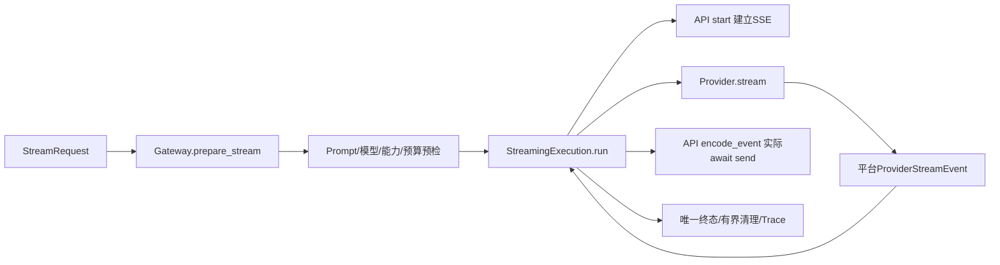

# F5：Streaming——代码实现导读

> 状态：验收通过；最终离线1099/3.12关键235/最新真实两例通过，原生Claude Code第2轮APPROVED，P3补测闭环。更新时间：2026-11-01。
>
> [设计](design.md)、[逐例测试/执行记录](test-plan.md)、[实施步骤](implementation-plan.md)。本文解释当前代码，实际通过结论以测试方案为准。

## 1. 问题与行为变化

F4 的 `/v1/llm` 等完整文本/结构化结果后返回。F5 新增 `/v1/llm/stream`，在上游仍工作时逐段发送文本，等待期间发送空闲心跳，并将成功、失败、超时与断连收口。调用方仍选择逻辑模型与受控模板，不选择 Chat/Responses。

普通调用/Schema 精度/主动探测不改语义；无重试、fallback、主动取消、事件重放、持久化或公开Trace接口。默认两条Mock保留，YAML每个模型显式增加supports_streaming。真实两条适配器都连接DeepSeek，不能称双供应商容灾。

## 2. 核心调用链与组件

预检不触发Provider，失败返回JSON；执行从B起点设总期限，再建立SSE。Adapter只解析上游；执行器只读平台事件；API只负责编码、实际发送和断连通知。终态写出/取消读任务/关闭本次响应由执行器统一管理，Middleware不再根据最终空body替流式请求推断成功。

## 3. 建议阅读顺序

| 顺序 | 文件及类/函数 | 读完应能回答的问题 |
| --- | --- | --- |
| 1 | [contracts.py](../../../src/contracts.py)：StreamRequest | 为什么请求里没有response_schema/stream？省略预算和显式null有什么区别？ |
| 2 | [models.py](../../../src/services/models.py)、[factory.py](../../../src/providers/factory.py) | 模型声明的支持与实际适配器能力在哪里分别检查？注入实例由谁关闭？ |
| 3 | [gateway.py](../../../src/services/gateway.py)：prepare_stream、_budgets | SSE之前依次确认了什么？普通调用共享哪一小段逻辑、错误顺序为何不变？ |
| 4 | [base.py](../../../src/providers/base.py)：ProviderStreamEvent/Provider | 为什么Gateway不需要理解finish_reason？远端终态证据为何单独标记？ |
| 5 | [providers/streaming.py](../../../src/providers/streaming.py)：frames、chat_events、responses_events | 两种协议各凭什么完成？Usage、拒答、分片和EOF怎样处理？ |
| 6 | [deepseek.py](../../../src/providers/deepseek.py)、[openai_compatible.py](../../../src/providers/openai_compatible.py)、[mock.py](../../../src/providers/mock.py)：stream | HTTP/SDK怎样实际逐段读取？本次响应如何关闭？普通complete怎样保留？ |
| 7 | [services/streaming.py](../../../src/services/streaming.py)：run、_work、_emit | 总期限如何覆盖真实send？心跳为何不会重建上游读取？ |
| 8 | 同文件：_validate_event、_observe、_cleanup、_notify_failure | 如何防嵌套Usage绕过校验，如何在取消/清理异常后仍留真实终态？ |
| 9 | [api/sse.py](../../../src/api/sse.py)、[routes.py](../../../src/api/routes.py) | 为什么yield不算发送确认？正文换行怎样不破坏SSE？ |
| 10 | [request_context.py](../../../src/middleware/request_context.py)、[trace.py](../../../src/services/trace.py) | 预检失败与已开始流式执行的终态分别由谁记录？三个耗时从哪里推算？ |

## 4. 关键设计与取舍

- **同一实际发送出口**：执行器await API回调；API回调await ASGI send。当前增量成功发送后才请求下一条事件；等待一次anext时可以多次发送心跳，不创建无界生产队列或完整回答缓存。
- **一个总deadline**：从预检后开始，包含响应头、Provider连接/读取和下游阻塞。provider_timeout表示上游自身先超时，request_timeout表示总期限；文本和心跳不续期。终态也受发送期限约束，失败通知只做剩余预算内发送或到期后一调度轮的尽力发送，不重新获得超时预算。
- **明确完成证据**：Chat需合法stop与DONE；Responses需完整completed，文本done不等于响应完成。Gateway还要求累计存在非空白文本。空格/换行是增量、可以计TTFT，但仅空白不能成功。
- **单次终态与清理所有权**：终态发送最多尝试一次；成功写出completed后不被晚到断连改写。停止worker/pending read并关闭本次流，应用共享client留给lifespan。清理task有固定1秒共享宽限，shield使执行任务在清理期间被取消仍能回收资源；Trace同步finally收口，之后传播取消。
- **错误分层**：已知Provider错误成为平台failed；未知程序异常为internal_error。只有实际start/send的OSError才作为下游断连，不能把Provider意外OSError归错责任方。发送失败覆盖执行结果时，Attempt.provider_error_code保留已确认的上游失败分类；清理问题另存cleanup_error_code，不覆盖执行首因。
- **数值与来源**：执行器重新校验事件和嵌套Usage原始字段，不能因为已有Pydantic实例就跳过严格检查。Generation结束点只有明确远端终态才记录，网络故障合成failed不填；TTFT是首段成功写出，二者不混算。时间点只留在内部内存Trace。

这些选择解决当前单实例/单worker内的并发与生命周期问题，不提供强杀任意忽略取消的协程、多实例共享取消、端到端接收确认或供应商停止计费保证。

## 5. 成功、拒绝与失败定位

用context_answer@1.1.0、资料“订单A123的商品为充电器”、单条user问题调用stream，消息装配含静态Few-shot，一次流式Attempt。收到delta后由Agent消费；只在收到completed时判完整成功。X-Request-ID对应每个事件中的request_id。

| 现象 | 优先检查 |
| --- | --- |
| JSON 422 | StreamRequest；是否误带Schema/stream/协议参数，或预算类型非法 |
| JSON 400 | Prompt/变量/渲染长度、逻辑模型、supports_streaming、输出/窗口预算；应零Attempt |
| SSE失败但没有文本 | Adapter建连/HTTP/协议；SSE在连接Provider前已建立，认证错误也走failed |
| 部分文本后output_truncated | 上游明确截断，F5不续写、不换模型 |
| provider_invalid_response | 原始协议/字段类型、内部事件组合、无完成证据、只有空白，沿Adapter→执行校验排查 |
| request_timeout | 整条执行期限，含下游send；结合provider_error_code区分上游先失败后发送又超时 |
| client_disconnected | 断连通知或实际发送OSError；检查单流关闭和其他并发请求是否正常 |
| HTTP200后直接断流 | 不能判成功；查看Trace终态，终态可能无法送达 |
| cleanup_error_code非空 | 取消读任务或关闭响应异常/超时；原请求结果仍保留，不凭清理路径退出记成功 |

无产品Trace查询接口，测试从注入应用状态/仅测试IPC观察，不为定位增加产品HTTP入口。TTFT是服务端写出观察，不是Agent读取或浏览器展示时间。

## 6. 验证与边界

用例与原始命令统一见[测试方案执行记录](test-plan.md)。单元/Mock验证主链，真实HTTP子进程握手证明提前到达，真实适配器回环证明SDK/HTTP不完整缓冲，显式两条真实流证明当次接入。各层结果不可互相替代。

开发中已闭环已知Usage/模型元信息在失败中丢失、头发送完成后的期限重查、嵌套Usage、清理期间取消、取消读取中的关闭错误、异常责任方和OpenAPI自定义Response签名等Red。最终全量1099、最低3.12关键235及最新真实两例通过，原生Claude Code第2轮APPROVED；审后仅补E02的HTTP两例，产品代码与受审版本相同。实际证据与首轮复核见测试方案3.8—3.10，F5已验收。F6从已有清理与执行终态扩展主动取消，F7再讨论恢复，F8再做持久化。
