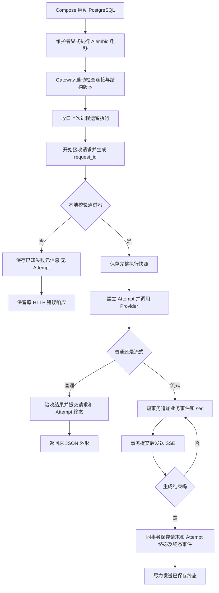

# F5-O1：统一持久化基础

> 状态：已实现并验收通过，原生Claude Code第2轮APPROVED。用户已于2026-11-02分别确认本设计及[测试方案](test-plan.md)，授权按[实施步骤](implementation-plan.md)执行；实际结果见测试方案。
>
> 初稿落档时仅有文档；设计和测试随后分别获用户确认，现已实施。实际进度和验收证据统一见测试方案，不将初稿描述当成当前运行结论。

## 1. 目标与边界

### 1.1 关联基线与交付目标

基于 [F5 已验收设计](../../design.md)、[原测试与验收](../../test-plan.md)以及 [F4 Structured Output](../../../F4/design.md)。原 Feature 的设计、测试、原始审查和运行证据保持历史原貌，新证据在本项目录维护。遵守 [项目工作流](../../../../../AGENTS.md)与[文档约定](../../../../AGENTS.md)。

本项完成后，普通文本、Structured Output 和现有流式调用具有可追溯的 PostgreSQL 请求/Attempt 记录；流式业务事件先保存再发送。重启后保留已提交数据，未完成的执行按规则失败收口。调用方暂时仍使用原接口，无新增查询或续传入口。

### 1.2 必须做

- Docker Compose 只管理 PostgreSQL，Gateway 继续以 uv/Uvicorn 在本机启动；仍为单实例、单 worker、可并发处理多个内部 Agent 请求。
- SQLAlchemy 异步接口 + psycopg 3 + Alembic；数据库是必需依赖，不可用时不退回内存或 SQLite。
- `POST /v1/llm` 的文本及结构化调用、`POST /v1/llm/stream` 共用请求和 Attempt 持久化。流式另保存业务事件；主动探测暂不落库。
- 使用 `tb_` 前缀、单数表名，内部 BIGINT 主键与对外 UUID request_id 分离。
- 创建有效执行快照；入口拒绝保留最小失败记录，Provider/Attempt 为 0；不保存未经校验的原始请求正文。
- 短事务、先保存后发送、终态互斥、重复收口幂等；数据库故障停止本次生成，恢复后核对遗留记录。
- 调整生成完成与发送完成的关系：完成事件和状态提交成功后，发送失败不能覆盖 completed。
- 不清理请求、Attempt、输入快照或业务事件，不设置保留期限。

### 1.3 不做与递增关系

| 事项 | 本项边界 | 后续归属 |
| --- | --- | --- |
| 两阶段流式协议 | POST 仍直接返回 SSE；无 GET 订阅入口 | F5-O2 改为 POST 返回 202/ID，首次 GET 启动并补读 |
| 事件序号 | 数据库内保存请求级 seq，SSE 外形仍沿用 F5 | F5-O2 对外暴露事件游标及续传 |
| 断连 | 生成中断连仍停止上游；已提交终态保持不变 | F5-O2 执行独立于订阅，断连继续生成 |
| 主动取消 | 不增加取消接口、取消执行器或取消事件生产路径 | F6；已有六状态词汇见第 5 节交接 |
| Provider 恢复 | 一次请求至多一次尝试，不重试/fallback | F7 |
| 全量 Trace | 普通与流式落库；探测保留原内存记录；不增加 Trace 查询 API | F8 补齐 Trace 覆盖及诊断查询 |
| 计费 | 保存已知 Usage；不计算费用、不预留或扣款 | F9 |
| 多实例 | PostgreSQL 共享数据不等于跨实例执行协调 | 1.7 |

不增加结果缓存、普通回答回放、Redis/消息队列、通用 Repository 基类或每表一个 Service。原 EventStreamResponse 仍属于 API 层，供应商流解析仍属于 providers；本项不移动这两个文件。

## 2. 最小方案

### 2.1 目录与组件

```text
projects/llm-gateway/
├── compose.yaml
├── config/
│   ├── gateway.yaml                 # 新增 database 非敏感段
│   └── postgres.password            # 本地密码，不纳入版本管理
├── migrations/
│   ├── env.py
│   └── versions/
└── src/
    └── persistence/
        ├── database.py
        ├── tables.py
        └── store.py
```

必要的包初始化、Alembic 配置及无密码示例文件随本项建立，不预建 O2/F6 模块。现有运行配置中的真实 Provider 绑定、.env 和本地 Provider 凭据不被本次文档整理覆盖。

| 组件 | 输入 → 输出 | 职责与依赖 | 缺少时的问题 |
| --- | --- | --- | --- |
| 应用配置装配 | gateway.yaml → 模型配置、数据库配置 | 统一读取/分发配置；ModelRegistry 仍只管理 models/providers，不接收数据库职责 | 全局配置被 Provider 注册表错误拒绝或重复解释 |
| persistence/database.py | 显式数据库配置 → 引擎、Session 工厂 | SQLAlchemy 管理一套连接池；连接检查与释放；不调用 Provider | 连接泄漏、并发共享事务 |
| persistence/tables.py | 字段定义 → 三表及约束元数据 | 字段、键、约束与索引；不决定业务状态 | ID 关联、事件顺序及唯一性无法保证 |
| persistence/store.py | 类型化记录/操作 → 已提交结果 | 具体短事务：请求建立、快照保存、Attempt、事件、终态、恢复；异常转换 | 调用链各自提交，出现状态与事件不一致 |
| services/gateway.py | 统一请求 → 数据或平台错误 | 预检、装配、调用、结果验收和持久化编排 | 数据库成功被误当作模型成功 |
| services/streaming.py | 已预检请求/Provider 事件 → 已保存事件、发送 | 现有生成/清理流程接入存储；完成提交后禁止被传输故障改写 | 终态被覆盖、发出的事件无回放依据 |
| Middleware/异常处理 | 入口上下文/错误 → 请求 ID、拒绝记录 | 未完成校验时只保存已知元信息；不得根据 HTTP 200 改写执行终态 | 非法输入没有定位记录、错误记录触发 Provider |
| api/ | 平台数据 ↔ HTTP/SSE | 编码和发送；不直接写 SQL | HTTP 与数据库事务耦合 |
| main.py/lifespan | 配置与组件 → 已准备的应用 | 构造/检查数据库、运行启动恢复、管理恢复任务及关闭；保持工厂可注入 | 版本错误仍接流量、后台任务泄漏 |
| Alembic | 同一数据库配置/迁移版本 → 明确升级 | 显式执行迁移，应用只校验版本，不自动建表或升级 | 表结构与代码漂移 |

生产路径不再以原内存 TraceStore 作为普通/流式请求状态真相；可保留类型化执行上下文传递尚未提交的观测值，但不提供内存降级服务。探测因本次未纳入而保留原记录方式；原内存 Trace 不是历史持久化证据。

### 2.2 启动与调用流程



数据库写入失败是上述步骤的独立失败出口，不继续进入 Provider 或后续正常发送。流式必须真实增量推进；不为凑事务或日志而缓存完整回答。普通调用的结果验收、Schema 精确十进制和上游错误分类保持原有规则。

Attempt 在即将调用 Provider 的边界建立。数据库提交与远端请求不可能组成同一个事务：进程可能在提交 Attempt 后、真正发起网络调用前退出，因此遗留 Attempt 只能表明准备进入一次尝试，不能证明供应商已接受请求或产生费用。恢复不自动重发；正常可控测试仍以 MockProvider 计数核对实际副作用。

### 2.3 事务和并发边界

| 操作 | 同一事务内保证 |
| --- | --- |
| 入口拒绝 | request_id 对应的一条 failed 请求记录；完整快照为空，Attempt 为 0 |
| 保存有效请求 | 输入快照及生效参数保存成功后才允许进入 Provider |
| 开始尝试 | 请求的执行开始信息与所属 Attempt 关联一致；本项一次请求最多一次尝试 |
| 追加流式事件 | 锁定所属请求，推进 last_event_seq，插入同 seq 事件；回滚时两者均不生效 |
| 完成或失败 | 条件更新未到终态的请求，更新 Attempt、保存已知 Usage；流式同时追加唯一终态事件 |
| 启动恢复 | 仅将 running/canceling 收口为 failed；流式已通过预检的请求追加失败事件；已到终态不再追加 |

并发操作使用独立 AsyncSession；不能把 Session 放入单例后由多个请求/订阅共用。数据库中同一请求的状态变更和事件分配按同一请求行串行化；不同请求可并发。

不跨模型读取、SSE 发送或等待持有事务。seq 由请求行上的计数与事件插入事务共同管理，不直接使用全局 Identity 充当事件序号。已提交事件保持原 seq，不因重试数据库操作而复制事件。

提交超时或连接断开可能导致提交结果未知，不能直接认定回滚，也不能盲目重插或把已提交 completed 改为 failed。停止继续生成/正常发送，连接恢复后以 request_id、事件联合键和现有终态核对；没有已提交终态时才做条件失败收口。

## 3. 契约

### 3.1 外部接口与兼容边界

- `POST /v1/llm` 请求和普通/结构化成功正文、四字段错误外形保持原约定；不增加公开 actual_model/attempts，不增加结果回放。
- `POST /v1/llm/stream` 仍直接返回 F5 SSE，原请求模型、15 秒空闲心跳、事件名称及 data 字段保持；数据库内 seq 暂不成为公开字段。
- request_id 仍由 Gateway 控制，以 UUID 字符串在响应头和现有 SSE data 中出现；不向调用方暴露内部 BIGINT 主键。
- 不增加 GET 事件接口、202 创建响应、取消入口、Trace 查询入口或额外请求参数。
- `/healthz` 仍仅表示进程存活；数据库启动检查失败则应用不启动，运行中失联不把此接口改成数据库探测。
- 原主动 Provider 探测不纳入三表持久化；不因新增数据库而向探测额外发送模型请求。

### 3.2 三表及标识

以下字段方案供本次完整设计整体审阅。Identity 使用 `GENERATED ALWAYS AS IDENTITY` 并显式 PRIMARY KEY；request_id 使用 PostgreSQL 原生 UUID，不存成 UUID 文本主键。

#### tb_llm_request

| 字段 | 类型/空值 | 含义或约束 |
| --- | --- | --- |
| id | BIGINT Identity，主键 | 数据库内部标识 |
| request_id | UUID，非空、唯一 | 对外定位一次模型请求，首次建立后不改变 |
| operation | TEXT，非空 | completion / streaming；由入口决定 |
| status | TEXT，非空 | 本项产生 running/completed/failed；后续阶段再接入 pending/canceling/canceled 的生产路径 |
| requested_model | TEXT，可空 | 记录已取得的逻辑模型选择，不虚构尚未解析的数据 |
| prompt_name / prompt_version | TEXT，可空 | 已取得的受控模板标识 |
| prompt_fingerprint / schema_fingerprint | TEXT，可空 | 完成相应步骤后填写 |
| input_snapshot | TEXT，可空 | 完整渲染消息、验收后的 Schema、生效输出/超时参数及执行所需非敏感模型/Provider 配置；仅全部预检通过后写入 |
| input_token_count / max_output_tokens | BIGINT，可空 | 实际完成预检的本地输入计数及生效输出预算；非负/正值 |
| counter_version / structured_output_mode | TEXT，可空 | 对应计数资源和本次结构化模式 |
| timeout_seconds | INTEGER，可空 | 生效超时参数，正值 |
| created_at / started_at / deadline_at / ended_at | TIMESTAMPTZ | created_at 非空，其余按进度填写；持久化 UTC 时间，不把进程单调时钟当跨重启时间 |
| last_event_seq | BIGINT，可空 | 流式初始为 0，随事件事务推进；普通调用为空 |
| error_code / error_message | TEXT，可空 | 稳定错误码及安全说明，不存异常堆栈、带密码连接串或凭据 |
| timing_snapshot | TEXT，可空 | 已取得的相对耗时及观察点来源；未知保持 null，不在重启后用单调时间重新计算 |

输入快照和 timing_snapshot 使用现有 json_codec 的规范化 JSON 文本存储，不经过默认 float 解码；读取复用相同 codec。当前不依赖 JSON 内部条件查询，不额外引入 JSONB 索引。此选择用于保留 F4 精确十进制，普通回答 text/parsed 本项不作为结果缓存保存。

入口拒绝行只有已经确认的元信息：request_id、operation、failed、时间和错误始终存在；其余字段按处理进度填写。未经校验的原始 body、用户自带的任意 System、Provider 凭据不作为诊断原文落库。

#### tb_llm_attempt

| 字段 | 类型/空值 | 含义或约束 |
| --- | --- | --- |
| request_pk | BIGINT，非空、外键 | 关联 tb_llm_request.id |
| attempt_no | INTEGER，非空、正值 | 与 request_pk 组成联合主键；本项最多一条 |
| model / provider / adapter / api_protocol / configured_model | TEXT，非空 | 实际进入尝试所用配置 |
| actual_model / finish_reason / upstream_status / upstream_finish_reason | TEXT，可空 | 只保存已观察并通过适配器校验的远端信息 |
| status | TEXT，非空 | running / completed / failed；沿用本次尝试及结果验收语义 |
| input_tokens / output_tokens / total_tokens | BIGINT，可空 | 已验证实际 Usage；全部未知为 null，已知时非负且总数一致 |
| started_at / ended_at | TIMESTAMPTZ | started_at 非空，ended_at 按结果填写 |
| latency_ms | DOUBLE PRECISION，可空 | 本次进程测得的非负耗时，不在重启后伪造 |
| error_code / provider_error_code / cleanup_error_code | TEXT，可空 | 执行错误、已知上游原分类和清理错误分开保留 |

#### tb_llm_stream_event

| 字段 | 类型/空值 | 含义或约束 |
| --- | --- | --- |
| request_pk | BIGINT，非空、外键 | 关联 tb_llm_request.id |
| seq | BIGINT，非空、正值 | 与 request_pk 组成联合主键；请求内从 1 递增 |
| event_type | TEXT，非空 | 本项仅 delta/completed/failed 对应的 response.* 业务事件 |
| payload | TEXT，非空 | 经平台验收并编码的 JSON 载荷，保持现有 request_id/delta/usage/code/message 语义 |
| created_at | TIMESTAMPTZ，非空 | 事件保存时间 |

心跳不写此表，不推进 last_event_seq。入口拒绝只保存失败请求元数据，不伪造一次已启动流的业务事件；input_snapshot 为空的拒绝行不是可执行或可订阅的已接受请求。后续 O2 需按这一标识校验订阅资源。

初始索引仅包含请求表主键、request_id 唯一索引、用于非终态恢复的状态索引，以及两张子表的联合主键。联合主键已以 request_pk 为前缀，不再重复创建同前缀单列索引；不增加正文搜索、时间分区或清理索引。不添加级联删除功能。

### 3.3 配置、部署和迁移

用户已确认：database 非敏感配置进入 gateway.yaml，密码独立本地文件，Compose 只运行 PostgreSQL。以下为完整设计建议的运行默认值，随本文件整体审阅；不是已创建的配置：

```yaml
database:
  host: 127.0.0.1
  port: 15432
  name: llm_gateway
  username: llm_gateway
  password_file: postgres.password
```

password_file 相对项目 config 目录解析，不随工作目录改变。应用和 Alembic 使用同一配置构造连接，不在 YAML、.env、命令行或日志中写明文密码。Provider credentials.yaml 的 api_key 结构保留，数据库密码不混入其中。新增 database 后，应用配置装配需更新顶层允许项，不能让旧 load_registry 的二键约束直接拒绝整个新文件。

Compose 建议固定 PostgreSQL 官方 `18.6-bookworm` 标签，镜像拉取和本机架构兼容留实施验证，不使用 latest 或候选版本。端口仅绑定 `127.0.0.1:15432`；实施前检查占用，不停止其他服务。命名数据卷挂载 `/var/lib/postgresql`，对应官方 PostgreSQL 18 镜像布局；正常停止/重建保留卷。密码文件作为 Compose secret 只读挂载，POSTGRES_PASSWORD_FILE 指向该文件；不自动生成或覆盖维护者已有密码。

Docker 健康检查只证明数据库准备程度，Gateway 启动还要实际验证应用账号连接及迁移版本。Alembic 通过显式命令升级，应用启动不自动执行 DDL。已有卷上的角色/密码变更不靠重新设置初始化环境变量完成；不通过删除数据卷修复连接问题。

建议连接池初始使用固定 5 条连接、无额外溢出；一次存储操作的获取连接/执行/提交共享 5 秒预算。这是本项运行默认建议，不新增调用方请求参数；执行中的操作还必须受原请求剩余期限约束，取更小值。最终依赖版本由实施时解析并锁定，实际镜像、迁移和连接证据归入本项测试方案。

### 3.4 成功、断连与期限

- 普通调用：只有模型结果及结构化验收通过，且请求/Attempt 终态提交成功后才返回成功 JSON。新增存储操作有独立有界等待；不把原 Provider timeout 误称覆盖全部 HTTP 处理的总期限。
- O1 流式仍沿用 F5 的 B 起点、固定总期限及发送背压；期限内存储等待同样计入预算，心跳不延长期限。生成和订阅分开计时留 O2。
- 增量保存失败不发送该增量，停止继续读取，清理本次上游流，不关闭共享客户端。
- 明确上游正常结束且累计含非空白文本后，同事务保存 completed 事件、已知 Usage 与 completed 状态；提交后的发送失败/超时不能反向覆盖终态。
- 若同一 Provider 终态携带末段 delta，O1 保留先处理 delta 再处理终态的顺序；末段发送中断且 completed 尚未提交时仍可失败。观察到上游 completed 不等于平台 completed 已提交，本项不额外要求把这两条公开事件合并为一次提交。
- 提交完成前的 O1 断连仍停止生成；请求按 client_disconnected 失败收口。失败事件可保存，但对断开的连接不保证送达。
- 发生总期限/连接关闭时不为等待落库追加新的正常生成或 SSE 发送预算。未能在剩余期限内确认的最终保存转入受应用生命周期管理的有界核对/恢复，不让 HTTP 连接无限等待。
- 清理错误单独记录，不以 finally 执行或上游连接关闭作为生成成功证据。现有 TTFT/Generation 的观察点及未知值语义保留，存储耗时不冒充纯模型生成时间。
- 完成提交后才取得的发送/清理/总耗时诊断，可独立更新已知元信息，但不得改写终态或追加相反终态事件；尚未取得的指标保持未知。

### 3.5 失败与恢复

| 场景 | HTTP / SSE / 数据 | Provider 与恢复 |
| --- | --- | --- |
| 启动缺配置/密码、连接失败或迁移不匹配 | 启动失败，安全诊断；无运行时内存降级 | 无调用 |
| 非法 JSON、字段、模板、模型或预算 | 保留原 4xx/code；尽力保存 failed 元信息；不保存原始 body | 0 次、0 Attempt；不因记录失败改变为执行 |
| 有效调用在进入 Provider 前保存失败 | 503/storage_unavailable，四字段 JSON | 0 次；不重试 Provider |
| 普通调用后终态保存无法确认 | 不返回生成成功；尚可响应时 503/storage_unavailable；不暴露候选半成品 | 已有尝试的实际次数不变，核对提交结果 |
| SSE 建立前存储失败 | 503/storage_unavailable，普通 JSON | 已知未进入 Provider 则 0 次 |
| SSE 建立后存储明确失败且没有已提交终态 | 停止正常增量；可写且有剩余期限时仅尽力发安全失败通知，否则关闭；不能声称通知已持久化 | 停止/清理本次流，不自动重新调用 |
| 已提交终态后响应发送失败 | 请求/事件终态保持，发送错误单独记录 | 不重调、不追加相反终态 |
| 上游/验收错误 | 原平台错误码不被统一改成存储错误；保存已知上游元信息和 Usage | 最多一次，沿用原受控分类 |
| 提交结果不确定 | 不猜测回滚，不盲目追加另一条事件或覆盖 completed；未核对前关闭传输，不直接发 response.failed，以免与实际已提交的 completed 矛盾 | 按联合键、已有终态核对后条件收口 |

storage_unavailable 为本项新增受控错误；未预期 Python 编程错误仍为 internal_error，不以数据库类别掩盖。503 不等于零上游调用，需按实际阶段说明和验收。

启动恢复在接收请求前执行，前提是原执行进程已停止，不能在另一个仍存活实例旁启动后扫掉它的请求。running/canceling → failed，原因 execution_interrupted；保留已有事件和 Usage，未知仍未知；已验收流式请求追加下一 seq 的 response.failed，与状态/Attempt 更新同事务完成。pending 若在后续阶段产生则保持 pending；终态保持，不自动重新调用模型。

运行中数据库恢复只核对本进程已经停止执行、但最终保存未确认的请求；不能把其他仍在运行的请求批量失败。应用维护待核对的请求标识和任务所有权，存储恢复任务核对数据库后条件收口；该集合只是定位未完成保存，不作为可读写的内存状态替代品。进程退出后由下次启动恢复接管。后台任务须在 lifespan 关闭时停止并释放连接，不无限占用原 HTTP 请求。

### 3.6 外部依据和证据边界

核对日期：2026-11-02。以下为官方资料，不等于本项目已经运行验证。

- [PostgreSQL 主键/唯一/外键约束](https://www.postgresql.org/docs/18/ddl-constraints.html)：UUID 可作主键；本项选择内部 BIGINT + 外部 UUID 是项目取舍，不声称官方强制推荐或已压测更快。
- [Identity](https://www.postgresql.org/docs/18/ddl-identity-columns.html)、[UUID](https://www.postgresql.org/docs/18/datatype-uuid.html)：Identity 与主键约束分别表达；UUID 使用原生类型。
- [PostgreSQL 事务](https://www.postgresql.org/docs/18/tutorial-transactions.html)：跨表原子提交；不把数据库事务扩展成远端调用恰好一次保证。
- [SQLAlchemy asyncio](https://docs.sqlalchemy.org/en/20/orm/extensions/asyncio.html)、[psycopg 方言](https://docs.sqlalchemy.org/en/20/dialects/postgresql.html#module-sqlalchemy.dialects.postgresql.psycopg)：异步连接与并发 Session 隔离。
- [Alembic](https://alembic.sqlalchemy.org/en/latest/tutorial.html)：显式迁移版本管理。
- [PostgreSQL 官方镜像](https://hub.docker.com/_/postgres)：18 的卷挂载布局、官方版本标签和密码文件初始化方式。

## 4. 验收边界

具体测试方案在设计整体确认后单独制定并讨论，不预先创建空测试文档或把下表当作已确认的逐例测试方案。

| 要证明的目标 | 必须观察的证据 |
| --- | --- |
| 普通/结构化/流式真实落库 | 使用隔离真实 PostgreSQL，核对三表、关联、快照、精确小数、已知及未知 Usage；不以 SQLite/内存替身证明事务 |
| 入口拒绝零调用 | HTTP 原错误、失败请求元信息、0 Attempt、MockProvider 计数为 0 |
| 先保存再发送 | 在提交处设置屏障，HTTP 客户端不能提前看到未提交增量；失败时不继续消费上游 |
| 终态原子与互斥 | 故障注入覆盖事件插入、请求/Attempt 更新与提交；验证回滚、未知提交核对和重复收口 |
| 发送失败不覆盖完成 | 明确区分上游结束、提交成功、ASGI 写出、客户端收到；分别在提交前后断开或阻塞 |
| 并发请求隔离 | 不同 request_id/内部主键、独立 Session、seq 及实际 Provider 计数正确，不假定返回顺序 |
| 重启恢复 | 真实进程退出/重启，保留数据卷；running/canceling 失败、已有终态不变、事件不重复、无自动模型调用 |
| 数据库不可用 | 启动/调用前/调用中/提交不确定分开验证，恢复不误伤活跃请求，无内存回退 |
| 旧功能兼容 | 普通四字段 JSON、Structured Output 精确十进制、F5 增量/心跳/期限/清理、探测原行为 |
| 资源与配置隔离 | 连接、事务、后台恢复任务有界释放；测试使用自有凭据、独立测试库/卷，不读取或清空开发者数据 |

MockProvider 只替代模型调用，不替代 PostgreSQL 的并发、事务与恢复。单元测试可用存储故障替身定位分支，但不是运行时降级。真实 Provider 推理另行显式启用并按确认测试方案执行，不把本轮本地配置检查当作 O1 真实接入证据。

## 5. 状态与交接

### 5.1 已确认决定与审阅范围

用户已逐项确认：PostgreSQL/Compose；三类记录和短事务；事件保存失败停止生成；不清理；SQLAlchemy/psycopg/Alembic；普通与流式统一落库而探测不纳入；tb_ 单数表名；内部 BIGINT 与公开 UUID 分离；入口拒绝最小记录；必需数据库与恢复；配置组织；目录职责；O1 内部完成判定调整。

本稿中的具体字段类型、JSON 文本存储、镜像/本机端口、连接池与操作等待默认值及异常收口组织由设计者提出；用户已于 2026-11-02 整体确认本设计，不将这些建议追述为用户逐项指定。用户随后单独确认测试方案，当前按 TDD 实施，实际证据归测试方案。

### 5.2 向 O2/F6 交接的已确认需求

这些是后续功能的需求记录，不是 O1 已实现的接口或验收：

- O2：`POST /v1/llm/stream` 创建并返回 202 四字段 JSON，data 含 request_id，同时响应头保留 ID；这是创建接口对“ID 仅在响应头”旧约定的明确变更。
- O2：`GET /v1/llm/stream/{request_id}/events` 首次有效访问原子触发 pending → running；不等待 GET 的 POST 不调用模型。之后所有 GET 只订阅，不再调用 Provider。
- after_seq 可选，默认 0；读取 seq 大于游标的事件；非整数/负值 422、不存在请求 404、超出当前最大序号 400。已读到终态后 204 仅表示无未读事件，不代替成功/失败判断。
- 支持同请求多个独立订阅、各自游标/心跳；历史和实时事件统一按数据库游标读取，分页后等待再查，不切换到另一份内存事件来源。
- O2 断连后继续生成；生成期限从首次有效 GET 成功触发开始，包含上游及持久化，重连不重置；订阅无整体总超时，15 秒空闲心跳，单次发送最多 30 秒。订阅错误不生产表示生成失败的 response.failed。
- 六状态：pending、running、canceling、completed、failed、canceled；后三者互斥终态。pending 取消直接 canceled；running 取消经 canceling。完成与取消竞争以数据库先成功提交为准，取消接受后不能再转 completed。
- 重启：pending 保持；running、canceling 均 failed；已有终态不变，不自动重新生成。
- F6 才增加取消接口及实际取消执行；取消阶段自身故障与精确返回体在 F6 设计时继续收敛，不混入 O1 实现。

### 5.3 文档同步、评估和下一步

- README、进度、架构、契约和项目 AGENTS 同步“F5/O1 已验收、O2 仅需求确认”的区别，移除现行规划中仍指向 SQLite 的安排；原历史验收工件不重写。
- [本项测试方案](test-plan.md)已单独确认，已执行；[代码导读](implementation-summary.md)已产出，实际结论见本项测试记录。
- 模板回看：现有设计模板已覆盖关联基线、职责、生命周期观察点、错误、副作用和证据边界，本次无需为数据库专有细节扩展通用模板。
- 2026-11-02 已完成一轮全文独立设计检查及一次定向补充复核，均 Approved、无阻断问题；[原始报告与处置](design-review.md)区分两次实际读取范围。补充明确末 delta/完成提交时序、终态后的诊断更新，以及提交未知时关闭传输而非发出相反终态。该评估不是 Claude Code 代码审查、TDD、数据库运行或整项验收。
- 文档阶段历史检查：本地链接存在、围栏闭合，148 个既有文件摘要未变，当时未实现。实施阶段另建源码基线和历史/凭据保护摘要，当前不沿用该历史摘要声称源码未改；实际运行见测试方案。
- 当前执行最小实施步骤和 TDD，之后完成真实 PostgreSQL/接入验证、代码导读及原生 Claude Code 独立审查。无需重复确认已确认的设计/测试或例行开始许可；发现新的需求歧义时才返回相应讨论。
