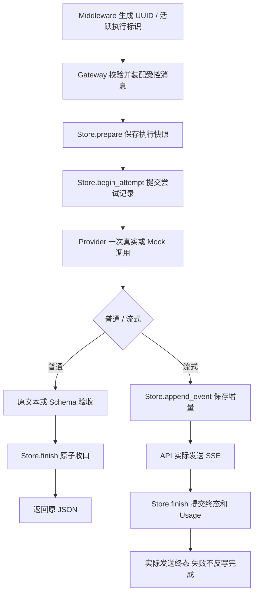

# F5-O1：统一持久化基础——代码实现导读

> 状态：验收通过；原生Claude Code第2轮APPROVED，无P0–P2；更新于 2026-11-02。[设计](design.md)和[测试方案](test-plan.md)已分别确认，真实结果以测试方案及原始证据为准，当前不提前称整项验收。

## 1. 问题与行为变化

原 F5 的请求与 Attempt 只在内存中，重启丢失，SSE 发完没有业务事件存储依据。本项将普通文本、Structured Output 和现有流式请求接入 PostgreSQL；完整有效执行输入与流式业务事件保存，入口拒绝仅保留已知元信息。Provider Key、数据库密码及未校验 raw body 不落库。

POST /v1/llm/stream 仍直接 SSE，不增加公开 seq、202 创建、GET 补读、主动取消或重试。O1 生成中断连仍停止；完成事务提交后发送故障不再覆盖 completed，传输错误独立诊断。心跳不保存，无产品数据清理。

## 2. 核心调用链与组件

生命周期：main 构造一套数据库连接池，startup 校验迁移后 recover；运行中只核对已经停止执行、最终保存尚未确认的标识。关闭时停止后台任务、有界尝试收口后 dispose。当前单实例、单 worker 前提不能靠 PostgreSQL 自动扩展成多实例协调。

## 3. 建议阅读顺序

| 顺序 | 文件 / 函数 | 读完应能回答的问题 |
| --- | --- | --- |
| 1 | [compose.yaml](../../../../../compose.yaml)、[gateway.yaml](../../../../../config/gateway.yaml) | 数据库在哪里运行、密码如何共用、本机端口如何绑定？ |
| 2 | [database.py](../../../../../src/persistence/database.py)：DatabaseConfig / Database.transaction | 五连接池、共享五秒操作预算及外部取消与内部超时怎样区分？ |
| 3 | [tables.py](../../../../../src/persistence/tables.py)、[初始迁移](../../../../../migrations/versions/f5o1_001.py) | UUID 如何关联内部 BIGINT、Attempt 和 seq 的唯一性如何保证？ |
| 4 | [store.py](../../../../../src/persistence/store.py)：prepare / begin_attempt / append_event / finish | 哪些数据必须在同一事务提交？为什么已到终态不能重写？ |
| 5 | [main.py](../../../../../src/main.py)：create_app / lifespan / flush_pending | 为什么启动必须先检查 PG，运行恢复为何不能扫掉活跃请求？ |
| 6 | [request_context.py](../../../../../src/middleware/request_context.py) | 入口拒绝和宿主取消怎样留下最小记录、何时移除活跃标识？ |
| 7 | [gateway.py](../../../../../src/services/gateway.py)：_complete / complete | 快照、上游调用、结构化验收与落库失败分别发生在哪一步？ |
| 8 | [streaming.py](../../../../../src/services/streaming.py)：prepare / _emit / run | B 起点为何覆盖保存，提交与发送为什么有两个完成观察点？ |
| 9 | [routes.py](../../../../../src/api/routes.py)、[sse.py](../../../../../src/api/sse.py) | 为什么 SSE Response 保留在 API 层，路由本身不写 SQL？ |
| 10 | [HTTP 测试](../../../../../tests/integration/test_f5o1_http.py)、[PG 测试](../../../../../tests/postgres/test_f5o1_persistence.py)、[进程测试](../../../../../tests/smoke/test_f5o1_process.py) | 如何证明实际落库、原子性、进程恢复、零/单调用及真实断连？ |

## 4. 关键设计与取舍

- 请求表 tb_llm_request：内部 id 为 BIGINT Identity，对外 request_id 为非空唯一 UUID。Attempt/事件以 request_pk 外键关联，联合主键分别含 attempt_no/seq。内部自增 ID 不充当 SSE 序号。
- 执行快照与事件载荷使用共享 json_codec 编码为 TEXT，避免 Schema 小数经默认 float 舍入；不依赖 JSON 内部查询，不增加全文索引。
- 请求行锁保护序号分配和终态变更；保存失败回滚计数和事件，提交未知先重新核对，不盲目追加或覆盖终态。
- 数据库事务和远端调用不是原子操作；进程可能在建立 Attempt 后、真正调用模型前退出，不能从 Attempt 存在推导供应商已经接受或收费。
- app.state.traces 仍提供本进程的诊断兼容视图，探测继续使用原内存记录；普通/流式的状态、事件和恢复以 PG 为准，没有运行时内存降级。
- 原 F5 的有界清理/单发送出口保留；完成提交后取得的耗时、清理和发送问题只补记诊断，不改终态或已保存 Usage。数据库数字/版本策略集中到 constants，迁移版本属于迁移资产。
- 针对提交确认丢失或宿主取消，停止本次执行后交给受应用生命周期管理的核对，不让原 HTTP 请求无限等待。反例已覆盖“快照实际保存但确认等待时被取消”，防止留下永久 running。
- 密码文件只移除末尾 LF、保留其余有效字符，和容器读取约定一致；特殊字符及前后空格由真实认证对照验证。最后空传输帧发送错误也只更新投递诊断，终态保持不变。
- 配置与数据库测试使用自有密码、随机端口、独立库/卷；默认应用测试显式注入模型/环境/PG配置。维护者临时切真实 Provider 不再改变测试绑定。

## 5. 成功、拒绝与失败定位

用订单 A123 的一次普通调用：从响应头取得 request_id → 查询 tb_llm_request → 用 id 查 tb_llm_attempt。成功时可见有效输入快照、completed、已知或 null Usage；普通调用没有 stream_event 行，不额外保存可重放的完整回答。

| 现象 | 优先定位 | 观察依据 |
| --- | --- | --- |
| 应用未启动 | database.py / Alembic / 密码文件 | 连接、结构版本、健康检查；应用不自动迁移 |
| 400/422 | Middleware、Prompt/Schema/模型/预算组件 | failed 元信息、input_snapshot=null、0 Attempt、0 Provider |
| 503/storage_unavailable | 对照发生阶段及 Store 事务 | 503 不代表零调用；先检查是否已建立 Attempt 或已提交终态 |
| HTTP200 后直接断流 | streaming.py、事件表和传输诊断 | 客户端未见 completed 不能判成功；内部可能已提交 completed |
| completed 后发送失败 | timing_snapshot.delivery_error_code | 请求/Attempt 仍 completed，事件不增加相反终态 |
| PG 中遗留 running | 当前进程活跃标识或待核对队列 | 活跃执行不能被恢复误伤；已停止执行应收口；重启按 execution_interrupted |
| 重启后多一条 failed | Store.recover | 仅未完成执行被收口，旧事件保留，重复启动不重复终态 |

当前无公开 Trace/事件查询 API，定位通过本机 SQL 与原始测试证据；续传和取消在后续事项实现。

## 6. 验证与边界

已执行：稳定基线 1099/8 skipped；完整收尾回归 1186/14 skipped；补齐直接 PG 故障断言及审查修订后，串行全量 1228 passed/14 skipped、Python 3.12 关键回归 312 passed（弃用警告按错误）。冻结版本全量及 49 组实际覆盖索引见[本项测试记录](test-plan.md)。真实主备文本/结构化/流式六例通过，后续修订的失败与取消路径由本地测试证明；第2轮原生 Claude Code 已完整结束（APPROVED，无P0–P2），额外密码反例及两项P3修订已通过回归，新增文档索引P3已补齐。

进程/TCP/Compose 用例使用 MockProvider + 真实 PostgreSQL，不冒充真实模型；六次 live 使用真实 Provider + 隔离 PG，不冒充生产可靠性。原实现者/设计子代理评估不是 Claude Code 代码独审。没有执行多实例、多 worker、跨重启继续生成、计费或清理验收。
