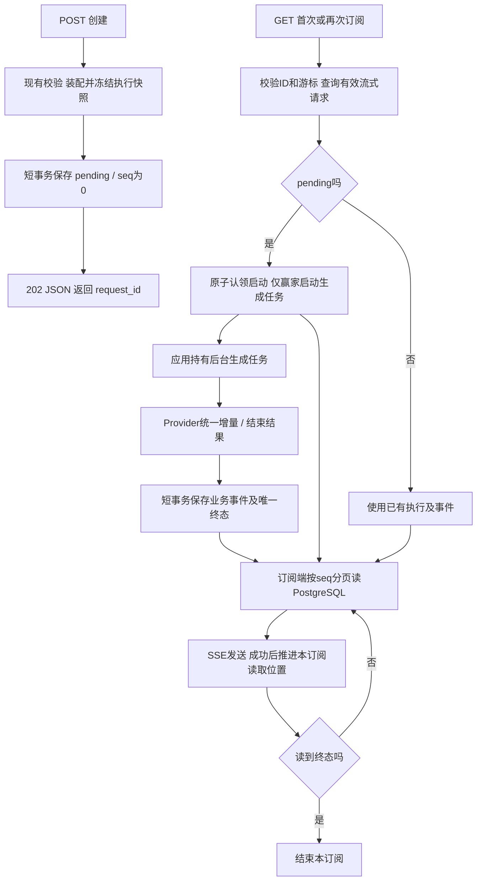

# F5-O2：两阶段调用与断点续传

> 状态：验收通过，最终证据见[测试方案](test-plan.md#39-最终验收)。2026-11-02用户在确认首次GET可省略after_seq、应用轮询机制及断连继续生成后，确认采用推荐方案A。已完成TDD、真实PG/TCP/进程验证和独立审查，结果在测试方案单独记录。

## 1. 目标与边界

关联基线：[F5-O1设计](../O1/design.md)及[验收](../O1/test-plan.md)。复用PostgreSQL三表、精确JSON编码、Provider统一事件、短事务与重启恢复；原验收工件不改写。

调用方先创建模型请求，再订阅事件；断开订阅后生成继续，重连按最后成功处理的序号读取。单实例、单worker，可服务多个内部Agent及多个订阅者。

必须做：POST创建pending；首次有效GET原子启动；生成与订阅生命周期分离；业务事件先提交后读取；请求级seq、分页回放和持续读取；独立心跳/发送时限；后台任务归属、异常收口与有界停机。

不做：F6主动取消及新取消事件、F7模型重试/fallback、F8公开Trace查询、F9计费、数据清理、Redis/消息队列、LISTEN/NOTIFY、多实例协调或对外Chat/Responses兼容接口。普通`POST /v1/llm`与探测语义保持。

为F6交付稳定的请求状态、生成任务所有权及条件状态变更；本项不预建取消路由或空取消实现。

## 2. 最小方案

### 2.1 流程与组件



| 组件/位置 | 输入→输出、责任与依赖 | 缺少时的问题 |
| --- | --- | --- |
| `api/routes.py`及`contracts.py` | POST沿用StreamRequest，返回创建结果；GET解析UUID/游标；明确JSON/204/SSE出口 | 创建与订阅混淆，HTTP202被误判为生成成功 |
| `services/gateway.py` | 复用现有本地预检与消息装配，生成有效快照；GET不重渲染Prompt、不重新选择模型 | 等待订阅期间配置变化，导致执行内容漂移 |
| `persistence/store.py` | 创建pending、条件认领启动、保存事件/终态、按请求和seq分页查询；每次独立Session/短事务 | 并发GET重复启动、序号竞争或连接被长订阅占住 |
| `services/streaming_manager.py`（新增） | 应用生命周期持有生成任务；协调数据库认领与任务注册、期限、异常及停机 | 订阅断开连带取消生成，或后台异常留下永久running |
| `services/streaming.py` | 复用Provider消费/校验/Usage/清理，输出改为持久业务事件；不等待任何订阅者 | 慢消费者拖住生成，订阅错误覆盖模型结果 |
| `services/subscriptions.py`（新增）及`api/sse.py` | 从PG分页读取；API编码并执行真实发送；管理本订阅游标、心跳和发送时限 | 回放与实时来自两套数据、遗漏中间事件或无限缓存 |
| `main.py`及Middleware | 组装组件，区分HTTP完成与生成完成，监督所有自有任务，按既有规则恢复 | 202/GET200/连接结束被误写为completed |

组件名是本次实现组织，公共入口/状态/记录以第3节契约为准。任务表只保存运行中的任务句柄及执行上下文，不保存另一份可订阅事件列表；事件与状态以PG为真相。预计复用现有三表，不新增基础设施或订阅表；若实施发现必须改变存储契约，先说明影响。

### 2.2 已选择的读取方式

采用A：按`request_pk`及`seq > 当前游标`排序查询，单页最多100条。查到即逐条发送，页未满也立即发送；消费一页后可立即查下一页，空结果才等待100ms再查。查询结束释放连接，不持有SQL数据库CURSOR或长事务。100ms及100条为内部常量，不新增调用参数；发现延迟还包含调度、查询及网络耗时，不承诺100ms端到端SLA。

PostgreSQL提供WHERE/ORDER BY/LIMIT；等待、重复查询、发送及游标推进由Gateway实现。历史与新事件始终通过同一查询路径读取。B（PG通知唤醒后仍按游标查库）留作后续有测量依据的优化，本项不实现。

### 2.3 任务和并行边界

生成任务由应用持有，订阅仅持有读取状态。并发首次GET通过数据库条件变更决定赢家，同进程任务注册也须串行协调；看到running不允许另起任务。认领后未能启动的已停止执行必须收口，不自动补发模型请求。

实施主链顺序：存储创建/认领/读取→后台生成→订阅/路由接线→进程及故障验收。契约稳定后，独立读库/订阅测试可与生成执行器测试并行；共同的Store、main、routes、Middleware及迁移由统一集成者处理，不同时修改。未确认F6/F7等功能不提前编码；PG停启故障套件串行。

## 3. 契约

### 3.1 创建

`POST /v1/llm/stream`沿用当前StreamRequest：model、prompt、单条user消息、可省略的max_output_tokens/timeout_seconds。字符、Token、能力、Prompt、预算及额外字段规则保持；仍不接受stream或response_schema。本地校验和快照保存成功后返回：

```json
{
  "success": true,
  "code": "ok",
  "data": {"request_id": "8f16e898-a6f3-42bb-8ac2-2226d879b657", "status": "pending"},
  "message": "请求已创建"
}
```

HTTP为202，X-Request-ID与data.request_id一致。成功时一条pending记录、有效快照、last_event_seq=0；started_at/deadline_at为空，无Attempt/业务事件/Provider调用。只创建未订阅可长期pending，不增加TTL或自动启动。此路由由原POST直接SSE改为202，是本项明确的接口变更。

入口拒绝沿用原4xx及仅元信息failed记录，无执行快照、Attempt或模型调用。202仅表示创建已提交，不是completed。创建响应传输失败也不能把已提交pending改成执行失败。

### 3.2 订阅与游标

- 首次：`GET /v1/llm/stream/{request_id}/events`，省略after_seq默认0。
- 续传：`GET /v1/llm/stream/{request_id}/events?after_seq=12`，读取seq严格大于12的全部后续事件，按序分页。
- request_id须为UUID；游标须为非负十进制整数。空值、负数、小数、布尔文本、重复游标或未支持查询字段返回422/invalid_request。显式0也合法；游标以after_seq为准，不隐式使用Last-Event-ID替代。
- 查询不存在、普通请求或没有有效快照的入口拒绝记录，返回404/not_found，不创建新的模型请求。
- after_seq超出当前last_event_seq：400/invalid_event_cursor，不启动生成、不改变原请求。
- 终态且after_seq等于最后序号：204，空响应体，表示无未读事件；不等同于生成成功。
- 其他有效订阅返回200，Content-Type为text/event-stream；成功订阅的X-Request-ID和业务帧request_id均指向原生成请求。订阅HTTP诊断不另增模型Attempt或请求记录。

所有确定的路径/游标检查先于启动。首次有效GET原子认领pending→running，只有确认提交的赢家启动一次生成；再次或并发GET均只订阅。GET校验失败不触发模型。已终态请求只回放，不能重新生成；O1已保存有效流式快照及事件可按同样路径读取。

### 3.3 快照、期限与指标

POST冻结实际消息、模型/Provider非敏感配置及生效预算；GET按快照执行，不加载新版Prompt改写输入。当前配置/资源无法执行原快照时，生成按execution_configuration_changed失败收口、0次Provider调用，不偷偷换模型。真实凭据值不保存，仍由应用受控加载。

B为首次有效GET认领启动的生成起点：认领前采集时间，成功认领时保存started_at/deadline_at；认领提交及之后Provider/持久化等待计入同一剩余预算。认领失败不启动模型，pending保留与否以事务结果为准；其他GET不重置B。默认/最大生成期限仍由现有模型配置决定。普通调用的原Provider超时语义不变。

每个订阅独立管理：15秒无成功发送时发心跳；每次ASGI发送（含最终空传输帧）最多30秒；无整个订阅的总超时。慢/断开的订阅只结束自身，不拖住生成或其他订阅。每次只持有有限页，不缓存完整回答。

Generation仍按上游首文本与明确远端结束观测。原生成TTFT保留B到首段文本成功发送的观察点：只有附着本次活跃生成上下文的订阅能以首次实际发送补记一次；未观察到则null。完成后的新历史回放及重启回放不重算或覆盖原生成指标。订阅发送问题单独诊断，不覆盖生成error_code/终态；不为本项新增完整订阅持久化，后续诊断覆盖归F8。

### 3.4 事件、交付与终态

业务帧使用数据库seq作为SSE id，data沿用既有request_id及事件数据，不再复制一份data.seq：

```text
id: 12
event: response.delta
data: {"request_id":"8f16e898-a6f3-42bb-8ac2-2226d879b657","delta":"后续内容"}

```

response.completed仍携带usage（未知为null），response.failed携带安全code/message。心跳仅携带request_id，无id、不落库、不占seq。F6再增加取消事件。

Store的(seq,event_type,payload)为唯一回放依据；先提交再可读。Request/Attempt/终态事件仍同事务，终态互斥。每个订阅发送成功后推进自己的内存读取位置；这只能证明服务端完成发送等待，不能证明调用方已处理。

调用方保存最后成功处理的seq；断连/重连允许重投，调用方按seq去重。无客户端ACK存储，不承诺端到端恰好一次。读到已保存终态后结束当前连接；后续GET可再按游标回放。

### 3.5 故障、未知提交和资源

| 阶段/情形 | 处理与副作用 |
| --- | --- |
| POST保存或GET查询/启动前存储失败 | 尚未开始SSE时503/storage_unavailable四字段JSON；无自动模型调用 |
| 创建提交确认丢失 | 核对实际记录：已提交pending保持pending，未提交不声称创建成功；不因HTTP失败统一写生成failed，不自动调用模型 |
| 启动提交确认丢失/任务注册失败 | 不猜测回滚、不得启动第二个Provider调用；核对后，已running且确无执行所有者的请求失败收口；未认领的pending仍可由以后有效GET触发 |
| 已启动生成中的Provider/验收/存储失败 | 停止本次生成并有界关闭自有上游流；明确失败由生成所有者写一次failed及安全事件，禁止模型重试/fallback |
| 增量/终态提交结果未知 | 查询已有seq及终态，不盲重写/另发相反终态；已completed保持，未完成且执行已停止则条件失败收口；PG恢复前允许暂未落终态 |
| 订阅查询、发送、客户端断开 | 结束该订阅，保留其已处理游标；不发布表示模型失败的response.failed，不改生成状态，也不关闭共享Provider |
| 后台未预期异常 | 收集异常并收口internal_error，不把任务退出/finally当成功；运行恢复只处理已停止的生成 |
| 正常停机/强退 | 有界结束订阅并停止自有生成，能确认时保存失败；Uvicorn设置有限graceful shutdown等待（建议5秒），然后应用使用既有清理/收口预算。强退由下次启动恢复接管 |

六状态词汇保持：pending/running/canceling与completed/failed/canceled；本项正常生产pending/running/completed/failed。重启pending保留、running/canceling按execution_interrupted失败、终态不变，不重新调用模型。原普通请求恢复与Usage已知/null语义保持。

### 3.6 依据与验证边界

- [LIMIT/排序](https://www.postgresql.org/docs/18/queries-limit.html)、[DECLARE数据库游标](https://www.postgresql.org/docs/18/sql-declare.html)：本轮对话已核对PostgreSQL18官方文档。这里使用普通增量查询，轮询是应用逻辑。
- 上游Chat/Responses仍只由现有Provider配置选择；本项不改变供应商协议。序号及终态、真正提前到达、断连继续和恢复必须通过实际PG/进程验证，文档不是运行证据。

## 4. 验收边界

证明创建零调用、首次有效订阅仅启动一次、并发GET不重复生成、PG先存后发与连续seq、断连持续保存及重连完整、多订阅相互隔离、期限独立、各阶段未知提交与重启收口、原普通/结构化/探测不回归。逐组输入、故障与副作用断言见[测试方案](test-plan.md)。真实PG与真实进程不可用内存替身替代；两条真实Provider流式样本单独显式执行。

## 5. 状态与交接

- 已确认：两阶段、after_seq可省略、后台生成与订阅分离、PG按序号分页轮询（100ms/100条推荐值）、多订阅、断连续传、独立期限、重启规则及本项边界。来源为本次对话和O1第5.2节已确认交接；具体代码组件、错误码及观察点细化由执行者整理，不追述为用户逐字段指定。
- 已按[实施步骤](implementation-plan.md)完成并验收，累计第2轮独审无P0–P3；不改写原F5/O1历史。
- 并行仅限已确认且接口稳定的独立任务；O2主链先落稳，F6随后接入。
- 模板沿用现有版本；一次自检覆盖已确认需求、生成/订阅所有权、错误出口及测试映射，不开展重复评估。
- 实现稳定后才产出implementation-summary.md；验收后交付F6。当前不建立空代码导读或未来方案。
