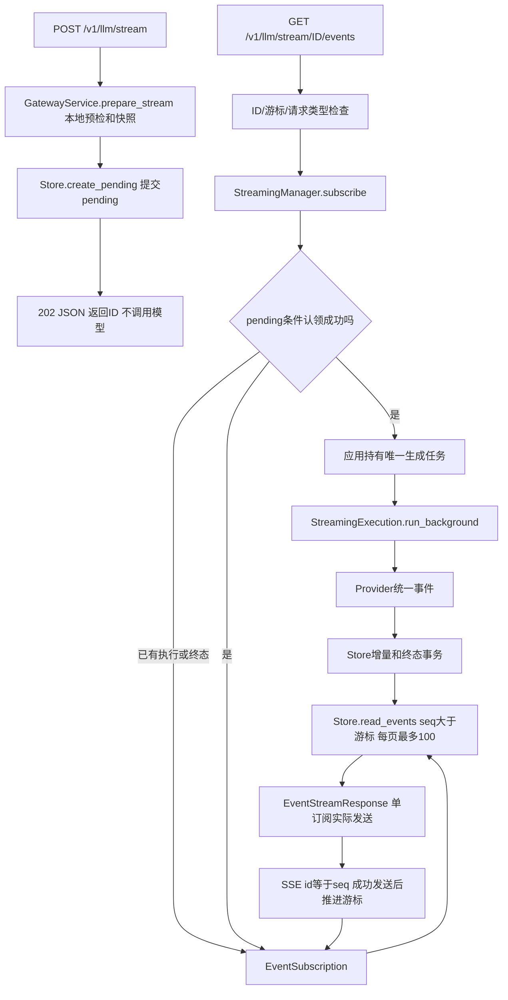

# F5-O2：两阶段调用与断点续传——代码实现导读

> 状态：验收通过，累计第2轮独立审查APPROVED，P0–P3均0。2026-11-02。[设计](design.md)、[测试与验收](test-plan.md)、[实施步骤](implementation-plan.md)。原F5/O1历史报告保持原样。

## 1. 行为变化

原POST一直持有模型流，客户端断开会停止生成。现在POST只做现有预检并保存pending，返回202及ID；首次有效GET认领并启动后台生成，GET只读取数据库事件。断开订阅后生成继续，重连按最后成功处理的SSE id补读。普通调用、结构化输出、探测、上游协议选择保持。

本项没有主动取消、重试、fallback、计费、清理或多实例协调。只有本机/隔离网络单实例单worker；同实例多Agent和多订阅可并发。

## 2. 调用链与职责

生成任务表只放任务句柄及活跃执行上下文，不放事件缓存。PG既是历史回放源，也是新事件读取源；读到业务终态后结束订阅。

## 3. 阅读顺序

| 顺序 | 位置 | 应能回答的问题 |
| --- | --- | --- |
| 1 | [contracts.py](../../../../../src/contracts.py) 的 StreamRequest/StreamCreatedResponse；[routes.py](../../../../../src/api/routes.py) 的 stream/stream_events | POST为何只返回ID，GET怎样严格解析游标，204和错误何时返回，OpenAPI为何显式区分SSE成功与JSON错误？ |
| 2 | [gateway.py](../../../../../src/services/gateway.py) 的 prepare_stream/_snapshot | 哪些预检在创建阶段完成，实际消息与模型/Provider配置怎样冻结？ |
| 3 | [store.py](../../../../../src/persistence/store.py) 的 create_pending/get_stream/claim_stream/read_events | pending与running怎样区分，为什么并发认领只有一个赢家，分页为何不持有长事务？ |
| 4 | [streaming_manager.py](../../../../../src/services/streaming_manager.py) | 谁持有生成任务，确认丢失为何不能自动调用，配置变化和无所有者running怎样收口？ |
| 5 | [streaming.py](../../../../../src/services/streaming.py) 的 run_background/run/_emit/_work | 如何复用Provider验收和有界清理，同时避免将虚拟发送当作TTFT？ |
| 6 | [subscriptions.py](../../../../../src/services/subscriptions.py) | 如何按页查询、空结果等100ms、独立15秒心跳和30秒单次发送，断开只取消自己的任务？ |
| 7 | [sse.py](../../../../../src/api/sse.py) | id如何编码，最终空传输帧为何也有独立期限，读库失败为何不发送模型失败事件？ |
| 8 | [main.py](../../../../../src/main.py) 与 [request_context.py](../../../../../src/middleware/request_context.py) | 为什么区分HTTP活跃集与生成活跃集，创建响应失败为何不能覆盖pending，停机与延后持久化如何闭环？ |
| 9 | [test-plan.md](test-plan.md) 的覆盖映射和证据 | 哪些是受控测试、真实PG/TCP/进程、真实供应商，哪些结论尚未验证？ |

## 4. 关键取舍

- **先冻结后执行**：GET不用当前Prompt重新组装消息。模型、Provider非敏感配置、计数资源不匹配时以execution_configuration_changed失败，零Provider调用；真实Key不进快照，仍由受控凭据组件加载。
- **认领与注册**：同请求的短暂进程锁协调事务与任务注册；PG的pending条件更新决定赢家。只有提交得到确认才启动任务。未知提交或注册失败加入针对性收口，不重新调用模型；孤儿恢复共享同一请求锁，避免误收口刚提交但尚未注册的认领；未调度协程及时close，后台异常被取回。
- **独立生命期**：HTTP202/200和连接结束均不充当生成完成。创建Trace与实际生成Trace分开对象，避免旧POST发送故障污染已启动生成。后台唯一所有者保存业务终态；任务停止但终态仍在应用恢复队列时，通过awaiting_persistence保持原执行者收口所有权，订阅不抢写通用中断终态而丢失原错误/Usage。订阅仅读取并发送。
- **单一事件源**：按seq大于游标排序读取，最多100条；只有空页等待100ms，查完就释放连接再发送。没有第二份广播列表、整回答聚合、SQL CURSOR或长事务。常量集中在[constants.py](../../../../../src/constants.py)。
- **期限分开**：B在首次GET认领前记录，同一总期限包含认领、Provider及保存。重连不刷新。订阅无总体30秒限制，每次headers/业务帧/心跳/最终空帧各最多30秒；空闲心跳15秒。
- **实际发送观察**：后台不标记first_text_sent_at；附着活跃上下文的订阅在首段实际send成功后，只补记一次TTFT。Generation仍是上游首段至明确远端结束；历史或重启回放不改原指标。订阅错误仅安全诊断，不修改生成error_code/Usage。
- **数据库结果为准**：创建未知提交先核对pending；认领未知提交不调用Provider；delta/terminal未知提交不盲增seq/发相反终态。延后写入以任务已停止为前提，活跃任务不被恢复扫描误伤。更新诊断时保留期间新排队的补记。
- **有界停机**：管理器关闭自有订阅及生成任务，上游流按既有1秒预算清理。数据库离线时仍释放连接池；无法提交的running由下一次启动失败收口。pending保持，三终态不变，强退不恢复模型生成。README启动命令使用有限Uvicorn排空等待。

## 5. 订单A123怎样定位

POST返回request_id后先查tb_llm_request：应pending、seq=0、started_at/deadline_at为空、无Attempt。GET启动后running、有首次B对应deadline和一个Attempt。每段文本先提交tb_llm_stream_event，再由订阅读出；seq从1开始。正常结束Request/Attempt/response.completed同事务，Usage未知保持null。

| 现象 | 先看哪里 | 判断边界 |
| --- | --- | --- |
| POST400/422 | routes/GatewayService预检、请求元信息 | 模型零调用；尚无有效执行快照 |
| POST/GET503 storage_unavailable | Store/Database及是否已提交 | 不从503推断是否提交；创建失败不等于生成失败 |
| GET400 invalid_event_cursor | after_seq与当前last_event_seq | 未来游标不启动生成；204仅无未读 |
| response.failed execution_configuration_changed | 保存快照与当前资源 | 零Provider调用，不能偷偷换配置执行 |
| response.failed request_timeout/Provider错误 | StreamingExecution、Attempt、最终事件 | 只由生成写出；无重试/fallback |
| GET断开/超时/读库失败 | 订阅安全日志request_id/code | 原生成可能仍running/completed；携最后处理id重新GET |
| 重启后execution_interrupted | Store.recover、已有seq及唯一失败事件 | 不重新调用Provider，历史仍可续读 |

调用方按最后**成功处理**的id续传并去重。服务端send成功不证明客户端保存了游标；旧游标重连允许收到同一seq，不承诺端到端恰好一次。

## 6. 验证与边界

针对性测试已覆盖创建零调用、并发单生成、真实PG提交/回滚与确认丢失、真实TCP提前首段、断连继续、进程恢复和发送位置故障。最新完整1330项及修正相关严格41项通过，两条真实接入保留采集版本边界；数量、命令、受审源码摘要及独审结果统一以[test-plan.md](test-plan.md)和其原始证据为准；原始输出与版本边界不由本导读替代。

数据库表结构和迁移版本保持f5o1_001，不需要新增迁移。F6后续接入本管理器的任务归属和状态条件变更；本项不创建空取消接口。
