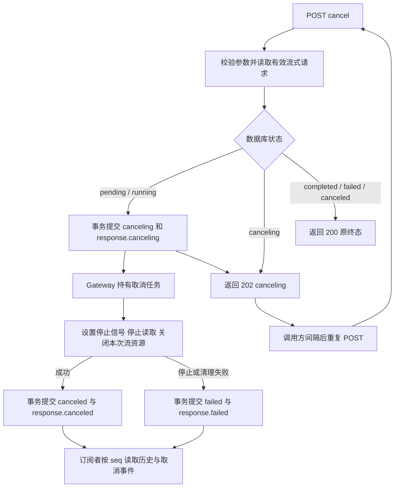

# F6：流式请求主动取消

> 状态：验收通过。完整设计与测试方案已分别确认，最终受影响F5/F6严格542通过，累计第2轮独审APPROVED、无P0–P3；实际证据与版本边界见测试方案3.6–3.8。
>
> 基线：[F5-O2 两阶段调用与续传](../F5/optimizations/O2/design.md)已验收。本项不改写其历史验收记录。[测试方案](test-plan.md)随后单独确认，已按TDD进入实施。

## 1. 目标与边界

调用方使用一个取消接口发起取消，并重复调用同一接口获取进度，直到得到 `canceled`、`failed`、`completed` 之一；不依赖 SSE 确认取消结果。Gateway 即使没有订阅者或取消调用方已经断连，也独立完成停止、清理和终态持久化。

必须做：

- 对有效 `pending`、`running` 流式请求先提交 `canceling`，再停止执行、清理并提交终态。
- 幂等重复取消、首次 GET 与取消竞争、正常终态与取消竞争。
- PostgreSQL 持久化取消状态与业务事件，保持连续 seq、重放与多订阅。
- 取消成功后禁止新内容提交、重新启动模型、重试或 fallback。
- 覆盖停止/清理失败、存储故障、提交结果不确定、服务退出及重启恢复；保留已观察到的 Usage 和诊断。

不做：普通调用主动取消、整个 Agent 任务取消、业务动作回滚、多实例协调、新查询接口、计费、数据清理、重试/fallback。F7/F8/F9 的既有顺序不变。默认两条 Mock 配置不变，不因本项读取真实 Key 或自动增加付费调用。

部署边界保持本机或隔离开发网络、单实例单 worker。`canceled` 表示 Gateway 已完成本次执行的本地停止与资源清理，不证明上游已停止计算或不再计费。

## 2. 最小方案



| 组件与位置 | 本次职责与输入输出 |
| --- | --- |
| `src/api/routes.py`、`src/contracts.py` | 接收 request_id，校验无请求体/查询参数；调用管理器；将状态包装为统一 JSON，声明准确的 OpenAPI 响应 |
| `src/services/streaming_manager.py` | 复用按 request_id 的启动/恢复协调锁；协调取消接受与后台任务注册，保证同请求只有一个取消所有者；轮询只读进度、不重复停止；生命周期由应用持有 |
| `src/services/streaming.py` | 区分主动取消与超时/退出；先记录停止信号，再中断生成；有界清理本次 iterator、读取与工作任务，保留已知元信息；不关闭共享 Provider 客户端 |
| `src/persistence/store.py` | 事务化取消接受/终态提交、状态条件检查、事件连续序号；禁止 canceling 后新 delta 和普通终态覆盖 |
| `src/main.py` | 将取消结果接入既有延迟持久化与应用退出流程；避免通用恢复抢占仍活跃或已有待保存结果的取消任务 |
| `src/services/subscriptions.py` | 保持只读；按既有机制发送取消事件，终态后结束，不承担停止模型职责 |
| `src/persistence/tables.py`、`migrations/` | 显式迁移扩展 Attempt 的 canceled 与事件的 canceling/canceled；Request 已有六种状态，不新增业务表 |

复用现有管理器、执行器和存储边界，不另建取消服务、消息总线或取消表。公共契约、入口、迁移与主程序接线由统一集成者处理；本项不依赖并行编码。

### 2.1 停止、清理与持久化的顺序

1. Gateway 持有取消操作，使 HTTP 调用方断连不能撤销已接受的取消。协调锁覆盖接受与取消所有者注册；后台任务不归某次 HTTP 响应所有。
2. 数据库锁定目标请求。仅 `pending/running` 可提交 `canceling`，同一事务追加一次 `response.canceling`；提交成功是取消接受点。终态只返回原值。
3. 确认取消已接受后设置本地取消信号，再停止生成。若创建了生成任务但还没有创建执行器，也必须阻止其开始 Provider 调用。
4. 未开始的 pending 请求没有 Provider/Attempt，无须构造模型流，但仍经过 canceling，再提交 canceled。running 请求停止读取并清理本次执行拥有的资源，沿用现有 1 秒清理预算；轮询不延长预算、不重复 task.cancel。原生成总期限不重置。
5. 清理完成后由取消所有者提交 canceled；停止或清理失败则提交 failed。请求/已有 Attempt 的终态、已知元信息、终态事件同一事务提交；无 Attempt 不补造 Attempt。终态提交未确认，不对外声称取消完成。

取消期间通用生成失败通知、延迟保存及遗留任务恢复不能抢写终态；它们必须识别取消所有者及待保存结果。停止失败时保留任务诊断与跟踪，不能仅因已经返回 failed 就宣称资源已释放；数据库写入屏障仍禁止后续内容。

实现补充（第1轮审查复现后的契约内修正）：首次Provider启动也复用接受取消的请求协调锁。Attempt提交不代表可以无条件启动；锁内按实际DB状态确认running，再让首次读取任务进入，不等待首段内容。取消已提交但ACK未返回时，模型启动必须等待接受结果，不能只看尚未更新的内存标志；实际回滚后仍允许原调用继续。未增加用户配置或Provider协议分支。

## 3. 契约

### 3.1 HTTP

`POST /v1/llm/stream/{request_id}/cancel`

- request_id 为有效 UUID，规范化后查询。
- 不接受请求体（包括 `{}`）或查询参数；不新增轮询次数、取消原因等字段。
- 取消对象必须是持有有效输入快照的流式请求；普通请求、入口拒绝记录及不存在的 ID 都按流式资源不存在处理。
- 成功响应 `X-Request-ID` 为原生成 request_id，不为取消另建模型请求或 Attempt。

处理中：HTTP 202。

```json
{
  "success": true,
  "code": "ok",
  "data": {"request_id": "00000000-0000-4000-8000-000000000001", "status": "canceling"},
  "message": "请求正在取消"
}
```

终态：HTTP 200，相同四字段；data.status 只可能是 canceled、failed、completed，message 为“请求已结束”。`success=true` 表示本次接口成功返回状态，不代表原生成成功；failed 仍是原请求终态，不伪装成取消成功。data 不增加 Provider、模型实际名称、Attempt 或内部错误详情；诊断能力由 F8 继续完善。

未完成时允许返回 canceling；若本次读取时已经终态，可直接返回该终态，不要求调用方固定轮询次数。建议调用方间隔 500ms 轮询；这是调用建议，不新增服务端参数或限流功能。网络/存储错误不是业务终态，调用方不能据此认定已完成。

| 条件 | HTTP / code | 执行与恢复 |
| --- | --- | --- |
| UUID 非法、请求体非空、有查询参数 | 422 / invalid_request | 拒绝，不触发取消或 Provider |
| 无有效流式资源 | 404 / not_found | 拒绝，不修改普通请求/拒绝记录 |
| 已接受且尚未终态 | 202 / ok | 返回 canceling；重复请求不重复事件或清理 |
| 已到任一终态 | 200 / ok | 返回原终态，不重新进入 canceling |
| 读取、接受或保存遇到存储不可用/提交结果未知 | 503 / storage_unavailable | 统一错误外形，不声称取消完成；后台持有已知结果，恢复后核实并收口 |
| 服务正在停止，不能接收新的取消任务 | 503 / execution_interrupted | 不虚报新接受，已有结果不改写 |
| 未预期程序错误 | 500 / internal_error | 统一拦截、脱敏，不当作取消完成 |

### 3.2 状态与竞争

| 当前状态 | 取消行为 |
| --- | --- |
| pending | canceling → canceled；不启动 Provider，不建立 Attempt |
| running | canceling → canceled，或停止/清理失败后 failed |
| canceling | 只返回状态，不另启取消任务；仍由既有所有者推进 |
| completed / failed / canceled | 返回原终态，无新事件或执行副作用 |

首次 GET 与取消按同一请求协调：取消先接受则 GET 不启动生成；GET 先启动则取消已有生成，不能多次调用 Provider。正常 completed/failed 与取消接受按数据库先成功提交的状态变更决定；一旦 canceling 已提交，普通完成/失败路径不能再覆盖。上游完成但数据库尚未提交 completed，不等于 Gateway 已完成。

接受取消事务的确认丢失时，不把内存推测当事实：保留协调与核实责任，读取数据库区分实际已接受、已终态或未提交；确认前不返回取消成功、不重新启动模型。HTTP 断连、重复 POST 或数据库恢复不能制造第二个取消所有者。事务等待沿用现有数据库操作上限，轮询接口不等待整段生成/清理。

### 3.3 SSE 与历史内容

- canceling 与对应 `response.canceling` 原子提交；canceled 与 `response.canceled` 原子提交。取消失败保存 `response.failed`，code 为 `cancel_cleanup_failed`，底层清理原因保留诊断。事件 data 沿用 request_id 等现有约定。
- 三类终态互斥，每个请求仅一个终态事件；canceling 事件最多一次。业务事件共用连续数据库 seq，SSE id、after_seq 及多订阅语义不变。
- **禁止 canceling 接受后提交新的 delta；取消前已经提交的 delta 保留，仍可发送与重放。** 已经进入网络的数据不能撤回，不承诺取消响应之后调用方绝对看不到历史内容。
- 不跳过历史 seq，不清空事件表。心跳仍无 id、不落库；终态已提交不代表某个订阅者已收到。

### 3.4 记录、故障与恢复

- 成功取消的 Request 与已存在 Attempt 终态为 canceled；取消本身不是 Provider 故障。清理失败为 failed，error_code=cancel_cleanup_failed，cleanup_error_code 保留具体原因。
- 已知 Usage/上游结束信息照实保留，未知仍为 null，不能因取消写零或冒充未收费。取消与生成日志/诊断按原 request_id 关联，不为每次轮询追加模型 Trace。
- 仅终态事务明确成功，才允许对外返回 canceled。终态保存失败时保留已知取消结果，恢复后提交；其他 GET、轮询及通用恢复不能抢写 execution_interrupted 并丢失已知 Usage。
- 数据库长期不可用时不保证立即有可查询终态；接口返回 503，恢复后继续收口，不回退内存成功或重新调用模型。
- 应用退出协调生成与取消任务；重启时仍按既有规则将 running/canceling 收口为 failed / execution_interrupted，不自动重启模型或把未证明完成的取消写成 canceled。pending 保留，原终态保持。
- 不记录凭据或原始堆栈，不新增业务数据清理。显式迁移、版本检查及未迁移拒绝启动沿用现有规范。

## 4. 验收边界

必须观察 HTTP 状态、持久化状态与事件、Provider 调用/读取/关闭计数、活跃任务及资源归属，不能只验证接口返回值。

最小覆盖：pending 取消零调用；首段前/后取消；重复及并发轮询；首次 GET/完成/失败与取消的可控竞争；取消调用方断连；多订阅、断连续传与历史事件连续性；清理异常/超时；数据库不可用和事务确认丢失；已知 Usage 保存；退出/重启；普通及结构化调用、原 F5-O2 回归。逐组用例与执行方式见[测试方案](test-plan.md)。

验证层次为受控 Mock/本地协议服务、真实 PostgreSQL、进程内 HTTP、必要的 TCP/进程故障。真实 Provider 不能精确证明竞争时序或停止计费；本项不默认额外付费。测试方案已单独确认，实际回执及最终结论在测试方案中归档。

## 5. 状态与交接

- 已确认：单一 POST 接口发起及轮询；内部先 canceling，再停止/清理与提交终态；调用方直到得到 canceled/failed/completed 才停止轮询，SSE 不是取消确认的前提。
- 对旧目标约定的明确调整：pending 也经 canceling，替代“pending 直接 canceled”。README、架构和契约中的旧目标描述已按本次确认同步，历史验收工件保持原样。
- 完整设计确认：2026-11-02 用户在完整设计交付后回复“确认”，包括历史事件可重放、清理失败及存储不确定性的收口规则。无待决定设计项；实现中新契约问题按工作流返回讨论。
- 合理性自检：取消所有者与生成/订阅分离；以数据库提交为接受屏障；轮询不重复副作用；复用现有组件/表；未扩展到多实例或远端计费保证。已完成一次静态核对；实际运行证据与独审结论见测试方案3.6–3.8。
- [测试方案](test-plan.md)已单独确认；已按[实施步骤](implementation-plan.md)完成实现、验证及两轮独审，验收通过。AGENTS.md 不在本次文档修改范围内，后续修改须先获得用户明确确认。
- 模板回看：沿用现有生命周期、故障及证据字段，不新增模板内容；现有测试模板中的 Claude Code 旧表述按已批准的根工作流解释为独立审查 Agent，本项不额外修改模板。
