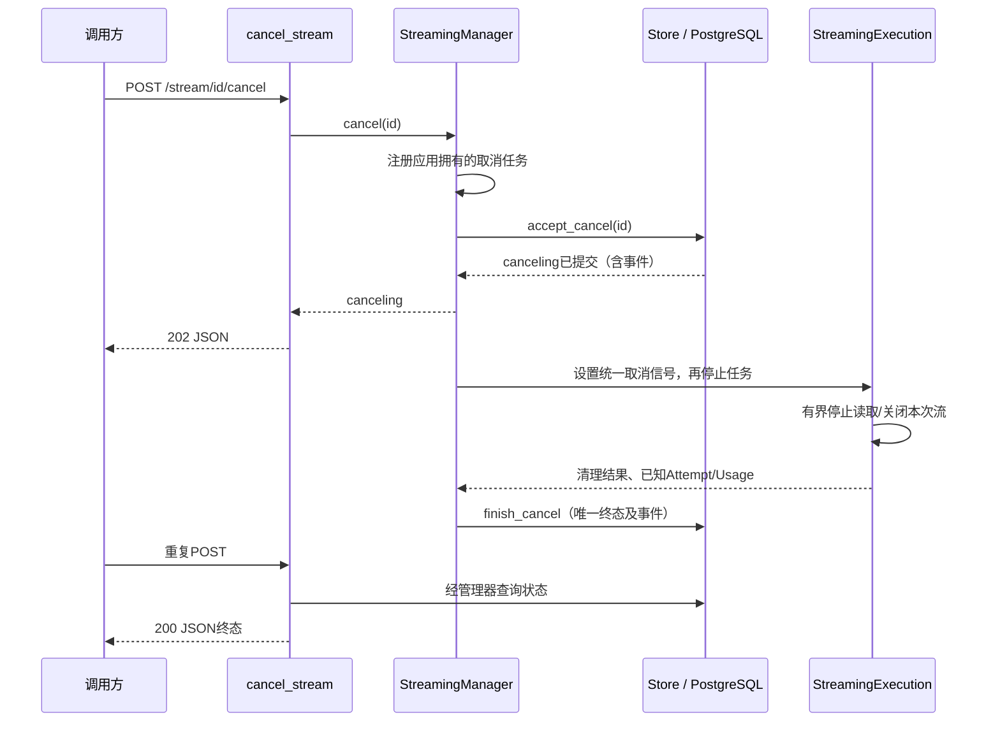

# F6：主动取消——代码实现导读

> 状态：验收通过。最终F5/F6受影响链路严格542通过/10跳过，累计第2轮独审APPROVED；全量及修正版本边界见测试方案3.6–3.8。更新时间：2026-11-02。
>
> 对应[设计](design.md)、[测试方案](test-plan.md)、[实施步骤](implementation-plan.md)。取消与订阅解耦，关闭SSE仍不取消生成。

## 1. 问题与行为变化

F5-O2将生成交给应用后台管理，断开订阅仍会继续生成。F6提供显式停止这次模型请求的能力：调用方POST取消并轮询同一接口，处理中202/canceling，终态200返回canceled/failed/completed。

pending和running都先经过canceling。取消一经数据库接受，就禁止提交新的delta或由普通路径覆盖终态；Gateway独立停止读取、清理本次流，再保存取消终态。轮询和HTTP断连不会重复启动或中断清理。已提交历史内容仍能按seq发送/重放。

## 2. 核心调用链与组件

管理器、取消HTTP协议不区分Chat Completions/Responses；执行器操作统一Provider迭代器。适配器内部关闭具体上游响应，共享Provider客户端仍由应用生命周期负责。

## 3. 建议阅读顺序

| 顺序 | 文件/类/函数 | 读完应能回答的问题 |
| --- | --- | --- |
| 1 | [contracts.py](../../../src/contracts.py)：StreamCancelData/StreamCancelResponse；[routes.py](../../../src/api/routes.py)：cancel_stream | 输入、四字段响应、202与200分别表达什么；为什么取消不建立新模型请求 |
| 2 | [streaming_manager.py](../../../src/services/streaming_manager.py)：Cancellation、cancel、_start_cancel、_cancel_operation、_admit_provider | 谁拥有取消操作，HTTP为什么不能取消后台清理；重复POST为什么不重复副作用；首次模型启动为何也需协调 |
| 3 | [store.py](../../../src/persistence/store.py)：accept_cancel、append_event、finish、finish_cancel | 取消与完成谁赢，以什么提交点为准；如何保证canceling后无新内容及唯一终态 |
| 4 | [streaming.py](../../../src/services/streaming.py)：run_background、run、_emit、_work、_start_provider、_cleanup | 停止信号如何传递，为什么主动取消不是internal_error；首次读取如何进入启动边界；子任务不响应取消时怎样有界结束等待并保留跟踪 |
| 5 | [main.py](../../../src/main.py)：flush_pending；manager的subscribe/reconcile/close | 延迟保存和遗留恢复为何不能抢走取消结果；退出与重启边界在哪里 |
| 6 | [f6_001.py](../../../migrations/versions/f6_001.py)、[tables.py](../../../src/persistence/tables.py)、[database.py](../../../src/persistence/database.py) | 为什么需要显式迁移，哪些CHECK被扩展；旧数据为何不重写，旧库为何拒绝启动 |
| 7 | [F6存储测试](../../../tests/postgres/test_f6_storage.py)、[HTTP测试](../../../tests/integration/test_f6_http.py)、[竞争测试](../../../tests/integration/test_f6_races.py)、[故障测试](../../../tests/integration/test_f6_faults.py) | 测试如何控制提交顺序，怎样独立确认真正落库与执行副作用 |
| 8 | [清理单元测试](../../../tests/unit/test_f6_execution.py)、[协议测试](../../../tests/integration/test_f6_protocol.py)、[进程测试](../../../tests/smoke/test_f6_process.py) | 逻辑、SDK/协议、实际网络/进程各自证明了什么 |

## 4. 关键设计与取舍

- **接受取消先于停止模型**：状态及response.canceling同事务提交。普通delta只允许running，普通finish不能覆盖canceling，防止仅靠task.cancel留下并发写入窗口。
- **首次调用也经过协调**：执行器提交Attempt后，由管理器在与取消接受共用的请求锁内重新确认running，再启动Provider及首个读取任务；保留锁一轮调度让首次调用进入，不等待首段文本。取消已提交但ACK延迟时，原执行不能先越过启动边界；ACK不确定后根据实际数据库状态判定，事务回滚则原请求可继续。这个边界不涉及上游协议或远端计算原子性。
- **应用持有操作**：取消任务和接受结果Future独立于HTTP；HTTP仅shield等待接受结果。重复调用查询同一状态，不重发task.cancel。取消操作分接受不确定、已接受、停止完成等内部阶段，使数据库恢复只补未完成步骤。
- **真正的清理上限**：用独立关闭任务加有界wait，而非只在等待可能吞取消的子任务外包timeout。超时标记清理失败，保留尚未结束的任务及诊断，不宣称资源已释放。
- **迟到清理不倒退终态**：协调者已确认终态后，执行器即使晚退出，也保留Trace/Attempt的已确认状态和错误；不能再改回canceling或清空取消失败原因。
- **数据库是真相**：接受/终态确认丢失后核实实际提交；终态保存失败保留已知结果，不启动新Provider，不让通用reconcile抢写execution_interrupted。后台恢复复用已有周期，没有新消息系统或表。
- **保留历史事件**：取消不是撤回已发送内容。旧事件不删不跳，取消事件继续原seq；订阅仍只读。SSE可通知其他订阅者，调用方只轮询取消接口即可确认本次结果。
- **已有Attempt按事实收口**：pending无Attempt，不补造；运行中保留已知Usage/上游信息，未知null，清理失败有独立诊断。并不等价于供应商停止计费。
- **最小迁移**：Request已有六状态，只扩Attempt和事件CHECK。旧迁移及历史数据不改；迁移是维护者显式操作，启动只检查版本。

## 5. 成功、拒绝与失败定位

订单A123：先POST创建取得ID；首次GET可启动生成；POST取消得到canceling；Gateway清理并保存canceled；重复POST返回终态。没有首次GET时也可以取消，Provider调用与Attempt均为0。

| 现象/结果 | 首先查看 |
| --- | --- |
| 422 invalid_request | routes.cancel_stream的UUID、body及query校验 |
| 404 not_found | Store有效流式快照选择，确认不是普通或入口拒绝ID |
| 一直202 canceling | 同ID的取消任务阶段、存储可用性、清理/终态保存等待；不可因等待久就猜测已取消 |
| failed/cancel_cleanup_failed | tb_llm_attempt.cleanup_error_code与执行器清理计数/任务跟踪 |
| 503 storage_unavailable | 区分接受前、提交确认丢失、清理后保存失败；用DB实际状态/事件判断，HTTP错误本身不是终态 |
| POST返回completed或原failed | 正常终态先提交，取消不能倒退原状态 |
| 重启后failed/execution_interrupted | 原执行进程已停止，startup recover收口running/canceling；没有远端续跑或自动重发 |

按request_id关联tb_llm_request，再通过内部request_pk关联Attempt/事件；公开诊断查询仍留F8。取消接口不暴露actual_model/attempts，不为导读新增产品端点。

## 6. 验证与边界

原始Red、目标Green、严格检查、实际PG故障及全量结果在[测试方案](test-plan.md)归档。当前证据包括真实PostgreSQL、TCP/子进程、本地HTTP服务经真实适配器/SDK；不是实际供应商调用。

未证明多实例协调、生产容量、供应商计算停止或费用归零；本项不读取真实Key、不新增付费调用。两轮独立审查已完成，原始报告及最终验收见测试方案3.8。AGENTS.md、默认Mock配置和历史验收工件保持原样。
