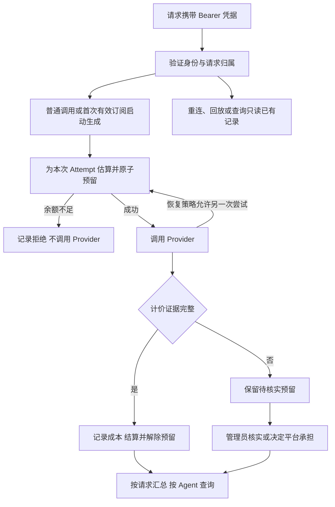

# F9 用量与计费

2026-11-03 用户确认整体设计，同日用户单独确认[测试方案](test-plan.md)。

## 1. 目标

一个内部 Agent 能知道自己的可用余额、累计消耗、费用来自哪些请求，以及某次重试为何占用预算。管理员可以拨款，处理未知费用，并将供应商账单与 Gateway 成本核对。沿用单实例、单 worker、PostgreSQL 和 F8 的 Request/Attempt 记录。首版使用人民币，按总余额管理。手动拨款是内部预算分配，本期不接支付渠道。

## 2. 一次调用的路径

| 组件 | 职责与边界 |
|---|---|
| 管理 CLI 与身份验证 | CLI 创建 Agent、签发/轮换/撤销随机凭据、拨款和处理待核实项。凭据只展示一次，库中保存公开标识和验证摘要。业务入口从 Authorization 解析 agent_id，凭据不进 URL、Trace、日志。 |
| 模型适配器与价格配置 | 适配器提取供应商实报 Token 和缓存拆分。版本化价格按实际供应商、模型、币种、生效范围查找，两条协议访问同一供应商时共用对应价格。记录尝试采用的价格版本、单位价、费率时段与计价依据。 |
| 预算与账本服务 | 在 Provider 副作用之前按 Agent 串行化余额检查和预留；按请求及尝试号唯一记录。以精确十进制计算。拨款和人工处置使用唯一操作号防止重放，操作来源与依据可追溯。 |
| 账务查询 | 读取一致的 PostgreSQL 视图。按 Agent 汇总，按请求分页，再按尝试展开。原有生成响应、流事件和 Trace 各自保留职责。 |

## 3. 账务规则

- 初始余额为零。可用余额 = 累计拨入 − 已结算给 Agent 的费用 − 当前有效预留。待核实预留是当前预留的子集。结算金额可超出估算，负余额拒绝新的付费尝试，已发起的调用照实结算。
- 每个付费 Attempt 都先预留，包括 F7 重试、备用模型和由 Agent 发起的真实模型健康探测。输入取该次实际组装后的本地估算，按缓存未命中价格，输出取该次发送的输出上限，按最高适用费率保守预留。默认 Mock 上报模拟 Token，供应商成本和 Agent 扣款均为零。创建 pending、/healthz、取消、查询、多个订阅及续传均不触发额外付费调用。
- 价格按元/百万 Token 配置。费用 = (命中输入 × 命中价 + 未命中输入 × 未命中价 + 输出 × 输出价) / 1,000,000。以适用供应商价表计费，禁止将缓存或时段折扣凭空补齐。版本化保存历史价格，结算后查询不按最新价重算。单价与账本均用 Decimal/NUMERIC，API 输出十进制字符串，保留小额费用。示例见 [DeepSeek 价格](https://api-docs.deepseek.com/zh-cn/quick_start/pricing/)与[两种协议的 Usage](https://api-docs.deepseek.com/guides/responses_api/)。
- 普通成功、流式成功、失败和取消使用相同的证据标准。无法证明是否进入上游，或缺少影响金额的 Usage/分类/实际费率，保留预留并列为待核实。能证明调用前已终止则释放。重启和提交确认丢失时按同一 Attempt 恢复或重读，不能重复结算、重复调用或仅因超时自动释放。
- 管理员处理待核实记录时注明依据，可核实费用并结算、确认零费用并释放，或由平台承担并解除 Agent 预留。最后一种保留供应商侧未知/后续核实的独立记录。供应商账单以其可提供的账户、币种、时段和金额作对照；只有证据能关联到 Attempt 才逐笔调整，否则保留总额差异与待核实项。

## 4. 调用方查询契约

三个 GET 使用已有 JSON 信封。验证 Bearer 后按所属 Agent 限定查询。凭据缺失、无效或已撤销返回 401；其他 Agent 的请求与不存在的请求统一 404。创建、订阅、取消、Trace 和付费探测同样校验身份或归属，存活探针保持公开。旧记录无可信归属时仅供本地管理核查，不归到新 Agent，也不补记费用。

| 接口 | data 的主要内容 |
|---|---|
| GET /v1/billing/summary | 全生命周期累计拨款、已结算、当前预留、其中待核实的金额及笔数、可用余额、币种。真实与 Mock 用量分别给出已知输入/输出/合计及未知尝试数。无记录表示零笔；有尝试但无实报时已知用量小计为 null。 |
| GET /v1/billing/requests | 每个请求一行，含 request_id、创建时间、逻辑模型、请求状态、账务状态、已结算、当前预留和待核实金额。包含已归属的零成本请求。可按创建时间过滤，使用 UTC 的 [from,to)，默认每页 50 条、最大 100 条。以创建时间及唯一 ID 倒序生成下一页游标；非法参数返回 422。 |
| GET /v1/billing/requests/{request_id} | 同一请求的金额合计，以及按尝试号排序的 Provider、模型、用量来源、实报用量与缓存分类、价格版本、预留和结算金额、处置状态及可公开原因。金额未知时返回 null。 |

例如 A123 主模型未报 Usage，预留 0.010 元；备用模型结算 0.006 元。只有这笔请求且拨入 1.000 元时，整个账户已结算 0.006 元，当前预留和其中的待核实各为 0.010 元，可用余额 0.984 元。明细有一行请求、两次尝试，请求已完成而账务部分待核实。人工补结算只改变金额及账务状态，不改变原生成结果。余额不受列表筛选和分页影响。

## 5. 验收与阶段

先核对 HTTP 返回、持久化金额、供应商调用次数和可用余额，再检查恢复、重放及跨 Agent 隔离。旧 F8 历史验收保持原样。整体设计已确认，测试方案已确认，进入 TDD。
