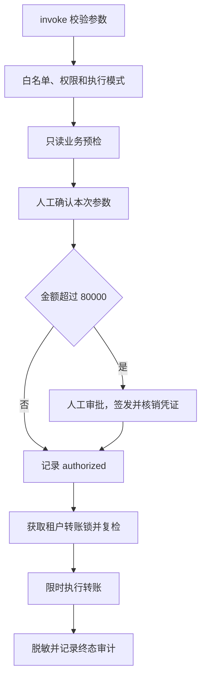

# 转账工具治理设计方案

在第二章作业版增加 `transfer` 写工具。一次调用从 `ToolRuntime.invoke()` 进入，使用真实的模拟余额，经过参数校验、权限检查、只读业务预检、人工确认、按金额触发的人工审批、限时执行、结果脱敏和审计。

## 1. 范围与设计取舍

- 实现和测试分别落在本目录上一级的 [tool_governance_demo.py](../tool_governance_demo.py) 和 [test_tool_governance_demo.py](../test_tool_governance_demo.py)。作业版的注册入口是 `build_governance()`，把转账追加到它的 `tools` 列表。继续由同一个 Runtime 执行各工具。
- 复用 `create_refund` 的同次调用确认和一次性审批凭证。转账的审批阈值由工具策略声明，Runtime 按策略执行。用静态审批开关会让普通转账也进入审批。把阈值放进 handler 会把审批移到执行阶段。
- 保持 `PermissionEngine.decide` 的源码逐字一致。实际门禁顺序沿用作业版，参数校验后先执行白名单、RBAC 和模式检查，再读取账户做预检。未授权请求只得到权限或模式错误。
- 保留退款的教学默认审批。大额转账要求一次独立的人工审批答复，CLI 由同一位练习者依次扮演确认人和审批人。

## 2. 数据与参数

在 `ORDERS` 后定义 `ACCOUNTS: dict[tuple[str, str], float]`，键为 `(tenant_id, account_id)`。

| 租户 | 账号 | 初始余额 |
| --- | --- | ---: |
| `tenant_a` | `ACC-A-123456` | 100000.0 |
| `tenant_a` | `ACC-A-654321` | 5000.0 |
| `tenant_a` | `ACC-A-888888` | 20000.0 |
| `tenant_b` | `ACC-B-111111` | 50000.0 |

在 `REFUNDS` 后定义空的 `TRANSFERS: dict[tuple[str, str, str], float]`。键为 `(tenant_id, from_account, to_account)`，值是该方向最近一次成功转账的金额。对同一方向再次发起成功调用会再次更新余额，字典中对应键的金额会被覆盖。每次调用仍有独立审计。

`TransferArgs` 继承 `StrictArgs`，沿用其 `extra="forbid"` 和字符串首尾去空白。导出的 Schema 应有 `additionalProperties: false`。

| 字段 | 类型与约束 |
| --- | --- |
| `from_account` | 必填 `str`，匹配 `^ACC-[A-Z]-[0-9]{6}$` |
| `to_account` | 必填 `str`，匹配同一正则 |
| `amount` | 必填 `float`，`Field(strict=True, gt=0, le=100000, allow_inf_nan=False)`，接受 JSON 整数和小数，拒绝字符串与布尔值 |

参数由模型提供。租户、调用者、权限和审批入口由可信应用层提供。伪造的 `tenant_id`、`approval_id` 或 `approved` 字段由模型校验拦截，返回 `INVALID_ARGUMENT`。

## 3. 调用链路



### 3.1 业务预检与注册

`async def transfer_precheck(args, context)` 按下列顺序检查。首次执行在人工确认之前，第二次由 Runtime 在取得写锁后执行。两次都只读。

1. `50000 < amount <= 80000` 时抛出 `PolicyDenied("EXCEED_LIMIT", "命中教学金额区间")`。超过 80000 的金额继续走后续检查。
2. 用 `(context.tenant_id, args.from_account)` 取转出余额，缺失按 `0.0` 处理。余额小于金额时抛出 `PolicyDenied("INSUFFICIENT_BALANCE", "转出账户余额不足")`。
3. `(context.tenant_id, args.to_account)` 缺失时抛出 `PolicyDenied("ACCOUNT_NOT_FOUND", "转入账户不存在")`。租户来自上下文，账号中的字母只参与格式校验。

注册项绑定 `TransferArgs`、`transfer_precheck`、`transfer_handler` 和租户级写锁键 `f"transfer:{context.tenant_id}"`。同租户的不同转账可能共享任意一端账户，按租户串行可复用现有单键锁。CLI 和测试分别使用同一个 Runtime 来承接一组调用。

| 策略项 | 值 |
| --- | --- |
| 工具名 | `transfer` |
| 副作用和风险 | `Effect.WRITE`、`Risk.HIGH` |
| RBAC 权限 | `transfer:create`，上下文白名单还须包含 `transfer` |
| 人工确认 | `requires_confirmation=True` |
| 审批条件 | `requires_approval=lambda args: args.amount > 80000` |
| 审批方式 | `requires_manual_approval=True`，仅在审批条件成立时生效 |
| 处理器超时和重试 | `timeout_seconds=2.0`、`max_retries=0`、`idempotent=False` |

### 3.2 人工确认与条件审批

- 把 `ToolPolicy.requires_approval` 扩展为 `bool | Callable[[StrictArgs], bool]`。Runtime 在参数校验和权限检查后对已解析参数求值一次，把结果用于 `DONT_ASK` 和审批分支。布尔值保持原有语义。任何金额的转账都因确认要求在 `DONT_ASK` 下返回 `DONT_ASK_DENIED`。现有 `PLAN` 拒绝写入，`BYPASS_PERMISSIONS` 仍受白名单、RBAC 及两道人工作业门禁约束。
- 直接复用 `_confirm()`，展示本次调用、身份和规范化的转出账号、转入账号、金额。只有明确答复 `True` 才签发和核销本次确认凭证。拒绝返回 `CONFIRMATION_REJECTED`，缺失答复或等待超时沿用 `CONFIRMATION_UNAVAILABLE`。确认失败时审批入口调用数为零。
- 给 `invoke()` 和 `before_tool_call()` 增加可选的关键字参数 `ask_approval`，沿用 `Callable[[str], Awaitable[bool | None]]` 形状，由可信审批交互层提供。仅当策略要求本次人工审批且确认已经成功时调用，展示本次调用、身份和已确认的规范化参数。等待上限沿用 120 秒。只有明确答复 `True` 后才走 `ApprovalStore.request()` 签发凭证，再走 `consume()` 核销，凭证继续绑定本次确认 ID、用户、租户、工具和参数摘要。
- 在确认返回后立即保存规范化参数摘要，并用该参数快照生成审批提示。审批答复返回后、签发凭证前，重新校验原始调用参数，再分别比较重新校验的参数和当前执行参数的摘要。两者都须与审批前快照一致，校验失败或摘要不符时返回 `APPROVAL_REQUIRED`。这使人工审批等待期间的参数变更无法进入执行阶段。
- 人工审批分支中的缺少回调、拒绝、无效答复、超时和普通交互异常统一返回现有的 `APPROVAL_REQUIRED`。协程取消继续向上传播。人工审批分支使用本次答复签发凭证，预置的 `context.approval_id` 无法跳过回调。其他工具沿用原有的显式审批 ID 核销或教学默认审批。普通转账直接执行，不调用审批回调、签发或核销接口。

### 3.3 写入、超时与脱敏

Runtime 的 `Handler` 契约统一为 `(tool_call_id, args, context)`，由 `_execute_once()` 传入 `prepared.call.id`。对作业版原有处理器、原 Shell 演示中的直接调用及测试替身机械适配形参。保留原业务逻辑和输出。转账 ID 直接来自真实调用标识。

`async def transfer_handler(tool_call_id, args, context)` 按以下步骤执行。

1. `amount > 80000` 时先 `await asyncio.sleep(3.0)`。Runtime 的 2 秒执行时限会在首次写入前取消这段等待，返回写操作超时码 `TIMEOUT_UNKNOWN`。此时确认、审批已核销，余额与 `TRANSFERS` 仍是调用前的值。
2. 通过 `context.tenant_id` 构造两个键。handler 在任何写入前再次检查转入键，缺失时抛出 `PolicyDenied("ACCOUNT_NOT_FOUND", "转入账户不存在")`。Runtime 已在同一把锁内重做转出余额检查。
3. 在同一把锁内连续扣减转出余额、增加转入余额，写入 `TRANSFERS[(tenant_id, from_account, to_account)] = amount`。三次写入之间无 `await`。沿用需求给定的三条预检规则，若两键相同且余额充足，视为净额为零，保持余额并记录本次成功金额。
4. 返回 `txn_id=tool_call_id[-6:]`、`from`、`to`、`amount`、`status="success"`。完整账户键只在内部处理和授权人员的提示中使用。

在 `redact()` 的字符串分支中先做原有邮箱替换，再用 `re.sub(r"\b(ACC-[A-Z]-)[0-9]{2}([0-9]{4})\b", r"\g<1>****\g<2>", text)` 处理账号。例 `ACC-A-123456` 得到 `ACC-A-****3456`。原有递归逻辑负责处理结果中的 `from`、`to` 及嵌套字符串。验收同时检查 `ToolResult.content` 与 `ToolResult.to_model_payload()`。

## 4. 审计与转账记录核对

筛选 `record["tool_name"] == "transfer"`，按 `tool_call_id` 归并全部转账调用，包括在参数、权限、预检、确认或审批处结束的调用。审计行数取决于调用是否通过门禁。

| 调用结果 | `authorized` 行 | 终态行 |
| --- | ---: | ---: |
| 前置门禁拒绝 | 0 | 1 |
| 通过门禁后成功、执行超时或锁内复检失败 | 1 | 1 |
| 调用方取消正在等待或执行的任务 | 取消前已通过门禁则有 1 行 | 1 |

在 `invoke()` 的最外层捕获已经进入协程的调用所传播的 `asyncio.CancelledError`，写入 `ok=False`、`error_code="CANCELLED"` 的终态后原样抛出。复用前置失败的审计元数据字段，取消属于调用终止，审计行可省略权限 `decision`。现有内存审计的单次写入无内部等待。工具自身的执行超时仍由现有分支转换为 `TIMEOUT_UNKNOWN`。

终态用 `"ok" in record` 识别。断言终态 ID 和本次测试发起的调用 ID 一一对应，`ok`、`error_code` 与实际返回或取消一致。全量行数等于调用数加 `authorized` 行数。普通成功的授权行有确认 ID，审批 ID 为空。大额超时的授权行有确认与审批 ID，并能在审批存储中查到关联且已核销的凭证。审计继续只保留参数键名，测试验证常规转账记录不含完整账号值。

用不同账户对跑多笔成功转账，断言 `TRANSFERS` 的键、金额和条数与成功调用逐笔匹配。用单独场景验证同一对账户再次成功时覆盖金额、余额再次变更、两次调用各有终态审计。失败、拒绝和超时逐笔比较调用前后的余额及记录快照。

## 5. 实施与验收

在 `homework` 目录运行。当前 Python 3.11 环境通过相邻课程项目的 `../../codes/.venv/bin/python` 使用，现有基线为 **93 项测试通过**。

```bash
PYTHONDONTWRITEBYTECODE=1 ../../codes/.venv/bin/python -m pytest -q -p no:cacheprovider
```

### 任务一 · 注册、参数、预检与普通转账

- [ ] 在现有测试文件增加 `test_transfer_` 用例。用 `monkeypatch.setattr(demo, "ACCOUNTS", accounts, raising=False)` 注入初始数据的副本，用 `monkeypatch.setattr(demo, "TRANSFERS", transfers, raising=False)` 注入空字典，每组测试新建 Runtime 和审计。首批测试只通过 `invoke()` 与工具发现验证参数契约，避免在测试收集阶段导入尚未定义的 `TransferArgs`。所有转账都通过 `runtime.invoke(ToolCall(...), ctx, ...)` 发起。
- [ ] 先执行 `../../codes/.venv/bin/python -m pytest -q test_tool_governance_demo.py -k transfer`。转账尚未注册时，成功与参数、预检等断言应出现 `TOOL_NOT_ALLOWED` 差异。
- [ ] 实现数据、模型、预检、注册、显式调用 ID、余额写入和脱敏。验证普通转账、余额变化、成功记录和模型输出。与任务二一起交付注册策略，保证大额路径的人工审批和超时用例同时通过。

### 任务二 · 条件审批、超时与审计

- [ ] 增加下表的条件审批、执行超时和审计断言。用确认和审批回调的调用轨迹验证顺序及次数。用审批凭证的绑定与核销状态验证门禁完成。
- [ ] 实现条件审批策略、可信审批回调和取消终态审计。至少一个超时用例使用真实执行路径和 2 秒限时。对锁内复检的失败，在确认回调中模拟业务状态变化后再答复，让首次预检通过，第二次预检拒绝。
- [ ] 运行转账测试及全量测试，预期全部通过。复核 `PermissionEngine.decide` 的源码与实施前完全一致，复核新增调用都走 `runtime.invoke()`，检查每个测试的审计和状态断言。

| 场景 | 关键断言 |
| --- | --- |
| 格式、缺字段、额外字段、金额为 0 或负数、大于 100000、非有限数、字符串、布尔值 | `INVALID_ARGUMENT`，无人工回调，无写入 |
| 50000、50000.01、80000、80000.01、100000 | 各自从初始余额开始。50000 普通成功，中间两个返回 `EXCEED_LIMIT`，后两个到达人工审批门禁 |
| 转出余额不足、转出账号缺失、转入账号不存在、跨租户转入 | 按预检顺序返回 `INSUFFICIENT_BALANCE` 或 `ACCOUNT_NOT_FOUND`。增加同时触发多条条件的用例，验证区间先于余额、余额先于转入账号 |
| 大额但余额不足 | 例如用余额 5000 的账户转出 80000.01，返回 `INSUFFICIENT_BALANCE`，两个人工回调均未调用 |
| 白名单缺失、缺权限、`PLAN`、`DONT_ASK` | 分别为 `TOOL_NOT_ALLOWED`、`PERMISSION_DENIED`、`PLAN_MODE_DENIED`、`DONT_ASK_DENIED`。权限用例同时构造余额不足，确认先返回权限错误 |
| 拒绝确认、缺少答复、`BYPASS_PERMISSIONS` 仍需确认 | 分别覆盖 `CONFIRMATION_REJECTED`、`CONFIRMATION_UNAVAILABLE`，审批回调均为零次 |
| 普通转账确认同意 | 成功、确认回调一次、审批回调零次、余额和记录正确、结果账号已脱敏 |
| 大额确认后未获审批，含预置审批 ID | 缺少回调或返回拒绝、无答复时均为 `APPROVAL_REQUIRED`，无写入。覆盖预置 ID 无法跳过人工审批 |
| 审批等待超时、交互异常或参数被篡改 | 用短审批等待时限测试审批超时。用审批回调将原始金额从 90000 改为 91000 再答应，确认签发次数为零、余额和记录未变，终态为 `APPROVAL_REQUIRED` |
| 调用方取消 | 审批回调已进入等待后取消，或 handler 已进入超时模拟等待后取消。调用方收到 `CancelledError`，各有一条 `CANCELLED` 终态，余额和记录保持调用前的值 |
| 大额确认后人工审批同意 | 顺序为确认、审批、执行。至少一例实际等待并得到 `TIMEOUT_UNKNOWN`，审批已核销，余额和转账记录无变化 |
| 确认期间余额变化或转入账号移除 | 锁内复检返回对应业务错误，转账未引起额外余额变化，审计含授权和终态两行 |
| 转入账号在锁内复检通过后缺失 | 构建 Runtime 前用包装器替换 `demo.transfer_precheck`。包装器执行真实预检，在同一调用的第二次预检成功后移除转入键。通过 `runtime.invoke()` 验证实际 handler 返回 `ACCOUNT_NOT_FOUND`，未扣减转出余额，未写入记录 |
| 确认后并发使用同一转出账户 | 同租户、同 Runtime 两笔转给不同收款方，每笔 50000，测试起始余额设为 75000，并让两个调用先同时到达确认。只允许一笔成功，另一笔锁内复检返回余额不足 |
| 同一账户转入转出、同一对账户重复成功、多笔不同方向成功 | 分别验证净余额、覆盖语义、逐笔审计和按唯一键核对成功记录数 |

### 任务三 · 手工跑通

- [ ] 在脚本提供 `--transfer` 演示入口，原来的无参入口继续跑已有示例。演示使用带 `transfer:create` 和 `transfer` 白名单的上下文，调用 `runtime.invoke()`。复用现有可取消的终端输入逻辑，给确认与审批分别显示提示。
- [ ] 在终端运行 `../../codes/.venv/bin/python tool_governance_demo.py --transfer`。依次演示非法参数、命中金额区间、普通转账和大额超时。成功示例从 `ACC-A-123456` 向 `ACC-A-654321` 转 1000，答一次 `y`。超时示例从同一转出账户向 `ACC-A-888888` 转 90000，依次对确认和审批各答一次 `y`。普通转账之后转出余额仍为 99000，足够让大额用例通过两次预检。
- [ ] 输出脱敏结果、转账调用终态数、授权数及成功记录数。按上述输入应得到 **4 个终态、2 个授权行、1 条转账记录**。普通转账结果有脱敏账号，大额结果为 `TIMEOUT_UNKNOWN`，余额变化仅来自 1000 的成功转账。
